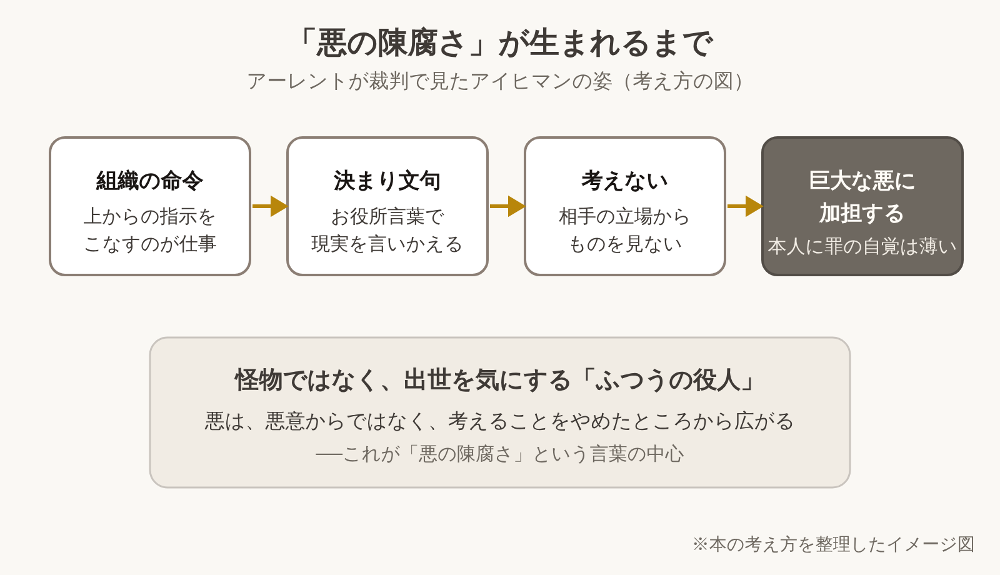

※本記事はアフィリエイト広告を利用しています。

📚 **この記事は、本を読む前の「下読みノート」です。**要点・時代背景・読みどころを先につかんでおくと、オーディオブックでも、Kindleでも、紙の本でも、迷わず効率よく読み進められます。

## はじめに

大きな悪事をはたらく人は、怪物のような人物だと思いがちです。でも、法廷に現れたのは、出世を気にするふつうの役人でした。

『エルサレムのアイヒマン』は、哲学者ハンナ・アーレントが、ナチスの元幹部アイヒマンの裁判を見届けて書いた報告です。

<!-- 表紙画像：Amazonアソシエイトの画像付きリンクをここに貼る -->

副題の「陳腐（ちんぷ）」は、ありふれていて、どこにでもあるという意味です。悪は特別な人だけのものではない、という問いがこめられています。

この本を読むと、わかることは3つです。

- 命令に従うだけの人が、大きな悪に加わるしくみ
- 決まり文句ばかりの話し方が、考えることを止めてしまうわけ
- 60年以上たっても、この本が論争を呼び続ける理由

**悪人の顔をしていない悪のほうが、ずっと身近にある。そう思うと、会社の会議室も少しちがって見えてきます。**

ページ数のある、手ごわい本です。まずは映画『ハンナ・アーレント』で裁判の空気をつかみ、そのあと本を開くと入りやすくなります。

本は**Kindle（電子書籍）**で、気になった言葉にハイライトを引きながら読むのがおすすめです。

本書の朗読版は見つかりませんでしたが、**Audible（オーディブル）**で哲学や歴史の入門書を聴いておくと、**下地ができて本文がぐっと読みやすくなります。**どちらも無料体験があります。

**こんな人に読んでほしい**

- 名前は知っている名著を、要点からつかんでおきたい方
- 「上の指示だから」で動く職場に、もやもやしている方
- 歴史や哲学の教養を、大人になってから学び直したい方
- 映画『ハンナ・アーレント』を観て、原作が気になった方

---

### この記事を書いた人

:::author
name: 矢野英人
tagline: つみたて読書
catch: 〜耳とスマホで自己投資〜
avatarUrl: /avatars/profile-avatar.png

本は読みたい。でも、時間も集中力も続かない。40代半ば、2児の父の私も同じです。

文学部からリハビリ医療の専門職へ。介護の現場で18年、約1,000人の老いを見てきました。

老いは誰にでも来る。それでも、知識は年をとっても伸びるといわれます。お金も教養も、元手は時間。本を開くなら、人生でいちばん若い今日から。

このサイトでは、読む前の「地図」をつくっています。要点と時代背景を先に知っておけば、耳でも、スマホでも、紙でも、短い時間で深く読めます。

資格：理学療法士／介護支援専門員（ケアマネジャー）／2級FP技能士
:::

---

### 本の概要

| 項目 | 内容 |
|---|---|
| タイトル | 『エルサレムのアイヒマン 新版――悪の陳腐さについての報告』（原題：Eichmann in Jerusalem: A Report on the Banality of Evil） |
| 著者 | ハンナ・アーレント（1906-1975）（訳：大久保和郎） |
| 出版年月日 | 原著1963年（Viking Press）【要確認：刊行月】。日本語の新版は2017年8月（みすず書房） |
| 出版国 | アメリカ（原著） |
| 出版時の著者の年齢 | 56〜57歳（1906年生まれ）【要確認：生年月日と刊行月】 |
| ジャンル | 裁判の報告・政治哲学 |
| 本の分量 | 長め（新版は400ページ前後）【要確認：ページ数】 |
| 映像化 | 映画『ハンナ・アーレント』（2012年）で、本書を書く過程が描かれる |

---

### この本の内容

1960年、ナチスの元親衛隊員アドルフ・アイヒマンが、逃亡先のアルゼンチンでイスラエルの諜報機関に捕まります。彼はユダヤ人を強制収容所へ送る輸送を取りしきった人物でした。

1961年4月11日、エルサレムで裁判が始まります。アーレントは雑誌『ニューヨーカー』の特派員として傍聴し、1963年2月から連載で報告しました。

彼女が法廷で見たのは、決まり文句をくり返し、手柄や昇進の話ばかりする男でした。この男は、なぜ何百万人もの死に加われたのか？

**怪物なら、遠ざければすむ。ふつうの人だから、話はやっかいになる。読み終えたあと、鏡を見るのが少しこわくなる本です。**

**アイヒマン本人は、自分のしたことをどう語ったのか。**その答えは、法廷でのやりとりを記した章にあります。

:::speech
speaker: 読者
side: left
tone: stone

ナチスの裁判の話って、歴史に詳しくないと読めない気がします……
:::

:::speech
speaker: 矢野英人
side: right
tone: sky

先に映画を観ておけば大丈夫です。人物の顔がわかると、Kindleで読んでも話が頭に入りますよ。
:::

👇 **まずは気軽に『エルサレムのアイヒマン』を手に取ってみよう**

- **法廷の言葉に、ハイライトで印をつけながら読みたい方**
  👉 [Kindle Unlimited 30日間無料体験はこちら](【アフィリエイトURLを入れる】) 【要確認：本書のKindle版の有無と読み放題の対象か】
- **通勤中に、歴史や哲学の入門書を耳で学びたい方**
  👉 [Audible 30日間無料体験で教養書を聴く](【アフィリエイトURLを入れる】)
- **映画『ハンナ・アーレント』を先に観たい方**（2026年10月時点の配信状況）
  👉 [Prime Videoで『ハンナ・アーレント』を観る](【アフィリエイトURLを入れる】)

---

### この本に登場するキーワード

命令を受け、決まり文句で考えるのをやめ、気づけば大きな悪の歯車になっている。本書の考え方を、4つの段階にまとめたイメージ図です。

:::speech
speaker: 読者
side: left
tone: stone

「陳腐」って、悪いことが大したことない、という意味ですか？
:::

:::speech
speaker: 矢野英人
side: right
tone: sky

いいえ、罪が軽いという話ではありません。悪をする人の中身が、驚くほどありふれていた、という意味です。
:::

- **悪の陳腐さ**：悪は、悪魔のような動機がなくても起きる。考えることをやめた、ふつうの人によっても起きる、という見方です。
- **アイヒマン裁判**：1961年にエルサレムで開かれた裁判。アイヒマンは死刑判決を受け、1962年に処刑されました。
- **最終解決**：ナチスがヨーロッパのユダヤ人を殺そうとした計画の呼び名。本書は、その実務の流れも細かく追っています。
- **決まり文句**：アイヒマンは、お役所言葉や紋切り型の言い回しをくり返しました。アーレントは、そこに「相手の立場で考えられない」姿を見ます。
- **ユダヤ人評議会をめぐる論争**：本書は、ナチスに協力させられたユダヤ人組織の指導者にもふれました。この部分は当時から強い反発を呼び、いまも評価が分かれています。

**「考えない」は、ぼんやりすることではない。忙しく、まじめに、目の前の書類だけを片づけていく。そんな姿のほうが近いのかもしれません。**

---

### 作品と執筆時の時代背景

- **社会**：1961年8月、東西ベルリンの境に壁が築かれ、冷戦が目に見える形になりました。
- **科学技術**：裁判が始まった翌日の1961年4月12日、ガガーリンが人類で初めて宇宙を飛びました。
- **流行**：テレビが茶の間の主役に。テレビ局のないイスラエルに代わり、米国の会社が法廷をビデオに収めました。
- **数字**：裁判の様子は、約38か国のテレビやニュースで伝えられたといわれます。

戦争が終わって16年。世界は宇宙とテレビに夢中で、ナチスの時代は過去になりかけていました。そこへ、画面ごしに「ふつうの男」の顔が届きます。

本書は、その裁判を「怪物の物語」にしなかった報告です。本になる前の1963年3月には、ユダヤ系の団体が会員に向けて、この本を批判する文書を配りました。

同じ年の6月には、友人だった思想家ショーレムも厳しい手紙を送っています。多くの人を怒らせたこの本が、いまは組織を語るときの古典として読まれています。

---

## 映画『ハンナ・アーレント』を観てから本を開くと、法廷が目に浮かぶ

映像で人物の顔や時代の空気を先に知っておくと、本の場面が頭に浮かびやすくなります。文字と映像の両方でふれた話は、記憶にも残りやすいものです。

映画『ハンナ・アーレント』は、マルガレーテ・フォン・トロッタ監督の作品です。日本では2013年に岩波ホールで公開され、話題になりました。

見どころは、本書を発表したあとの激しい批判と、アーレントが自分の考えを語る講義の場面です。法廷の場面には、実際の裁判の記録映像も使われています。【要確認：記録映像の使い方】

おすすめは、映画を観る、本を読む、好きな場面をもう一度観る、の順番です。裁判をテレビ中継した人たちを描く『アイヒマン・ショー』も、あわせて観ると背景がわかります。

| 作品 | 制作年 | 配信サービス（2026年10月時点） |
|---|---|---|
| ハンナ・アーレント | 2012年 | Prime Video（レンタル）／DMM TV（レンタル） |
| アイヒマン・ショー／歴史を写した男たち | 2015年 | U-NEXT／Prime Video（レンタル） |

- 🎬 [Prime Videoで『ハンナ・アーレント』を観る](【アフィリエイトURLを入れる】)
- 🎬 [U-NEXTで『アイヒマン・ショー』を観る](【アフィリエイトURLを入れる】)

**本を書いたあとの騒ぎまで映画になる。一冊の報告が、それだけ多くの人の心をゆさぶったということでしょう。**

---

## 『エルサレムのアイヒマン』いま読むと刺さる3つの場面

※本書は著作権のある作品のため、本文の言葉は原文を確認できたものだけを引用します。下の3か所は、お手持ちの本で原文を確かめて差し替えてください。【要確認：原文を本で確かめて差し替え】

### 1. 自分は命令に従っただけだ、と語る被告

> **「【要確認：原文を本で確かめて差し替え】」**
> （アーレント『エルサレムのアイヒマン』法廷でのアイヒマンの証言を扱う章より）

アイヒマンは法廷で、自分は命令と法に従っただけだと、くり返し語ります。ユダヤ人を憎んでいたわけではない、とも言いました。

アーレントは、その言い分をうのみにはしません。それでも、彼が「悪魔」ではなく、ありふれた役人だったことを見つめます。

**怖いのは、悪意より「言われた仕事をきちんとこなす」まじめさです。**その姿は、どの組織にもいそうな人に重なります。

**「上が決めたことなので」。この言葉に一度も頼ったことのない大人は、たぶんほとんどいない。耳が痛いのは、そのせいです。**

### 2. 決まり文句しか話せない男

> **「【要確認：原文を本で確かめて差し替え】」**
> （アーレント『エルサレムのアイヒマン』アイヒマンの話し方を描く場面より）

アイヒマンは、お役所言葉や型どおりの言い回しを好んで使いました。自分の言葉で語ろうとすると、話がかみ合わなくなります。

アーレントは、そこに「相手の立場から物事を見る力」の欠けを見ました。決まり文句は、考えなくても話せる便利な道具だったのです。

会議の資料や報告書の言葉を思い出すと、他人ごとではありません。

**便利な言葉は、頭を省エネにしてくれる。省エネが行きすぎると、心まで止まってしまう。言葉の手入れは、思ったより大事な家事です。**

### 3. 「悪の陳腐さ」という言葉

> **「【要確認：原文を本で確かめて差し替え】」**
> （アーレント『エルサレムのアイヒマン』本書の終わり近く、裁判をふり返る場面より）

副題にもなった「悪の陳腐さ」は、本の終わり近くで出てきます。悪は深い動機からではなく、考えないことから広がる、という見方です。

この言葉は、アイヒマンの罪を軽くするものだと受けとられ、強い批判を浴びました。アーレント自身は、彼の死刑判決を支持しています。

裁判が始まった1961年の夏、アメリカのイェール大学では、心理学者ミルグラムが「人はどこまで命令に従うか」を調べる実験を始めていました。結果の読み方には議論がありますが、同じ問いが同時に追われていたことは興味深いです。

**「ふつうの人でも」と言われると、少しほっとして、少しぞっとする。その両方を感じさせるのが、この言葉の力なのでしょう。**

---

## 『エルサレムのアイヒマン』を医療従事者の目で読んで——「決まりなので」の手前で

いちばん引っかかったのは、決まり文句しか話せない男の姿です。アイヒマンは、お役所言葉の中でなら、迷わず話せました。

リハビリの現場にも、決まった言い回しがあります。「著変なし」「様子観察」。忙しい日ほど、記録はこうした言葉で埋まりがちです。

型どおりの言葉は、悪いものではありません。短く正確に伝えるための、大事な道具です。人の手が足りない現場では、なおさら助けられています。

ただ、その言葉の向こうに、昨日と少しちがう表情の人がいるかもしれない。「決まりなので」とご家族に答えるとき、相手の立場から見えている景色を、いちど想像できているか。自分にも、ときどき自信がなくなります。

**決まりを守ることと、考えることは、本当は両立するはず。どちらかだけになったとき、仕事は急にさびしくなります。**

最近、自分の口ぐせになっている決まり文句は何でしょう。この本は、それを静かに数えさせます。

答えが出たら、その言葉をいちど自分の言葉で言いかえてみる。それだけでも、見える景色は少し変わるはずです。

---

## よくある質問

**Q. 『エルサレムのアイヒマン』は、オーディブル（Audible）で聴ける？ Kindleならどう？**

A. 日本語版のAudible配信は、2026年10月時点で見つかりませんでした。電子書籍版は出ていますが、Kindle版の有無や読み放題の対象かどうかは、Amazonの商品ページで確かめてください。【要確認：Kindle版の有無】

**Q. 難しいですか？ どれくらいで読めますか？**

A. 人名や組織名が多く、歴史に慣れていないと最初は重く感じます。まず映画を観て、本は「法廷のアイヒマン」を描いた章から読むと、2〜3週間で芯に届きます。

**Q. 新版と旧版は何がちがいますか？**

A. 新版は2017年に出た、訳を見直した版です。これから読むなら、手に入りやすい新版をおすすめします。【要確認：新版で変わった点】

**Q. アーレントの主張は、いまも正しいとされていますか？**

A. 評価は分かれています。のちの研究で、アイヒマンはもっと強い反ユダヤ思想をもっていたとする見方も出ています。

本書は「答え」ではなく、考えるための材料として読むのがよいと思います。【要確認：後の研究の出典】

---

## まとめ

1. **大きな悪は、怪物ではなく、考えるのをやめたふつうの人からも生まれる**
2. **決まり文句は、相手の立場で考える力をそっと奪っていく**
3. **アイヒマン本人がどう語り、アーレントがどう判断したのか。その答えは法廷の章にあります**

まずは映画で法廷の空気にふれ、本はKindleの試し読みで冒頭だけのぞいてみてください。耳が空いている時間は、Audibleで歴史や哲学の入門書を聴いておくと、難しい本への助走になります。

**本を閉じたあと、いつもの「決まりなので」が少しだけ言いにくくなる。それがこの本のいちばんの効き目だと思います。**

---

💡 **KindleやAudibleを使うなら、Amazonプライムもチェック**

Kindleで本を読んだりAudibleで聴いたりしている方は、すでにAmazonのアカウントをお持ちのはずです。そのまま登録できるAmazonプライムは、読書好きにとってコスパのよいサービスです。

- 📚 **Prime Reading**：対象のKindle本・雑誌・マンガが追加料金なしで読める（Kindle Unlimitedより対象は少なめ）
- 🎬 **Prime Video**：映画・ドラマが見放題。映画『ハンナ・アーレント』はレンタルの対象（2026年10月時点）
- 🎵 **Amazon Music Prime**：通勤中の音楽やポッドキャストにも
- 📦 **配送料無料**：紙の本を買うときもお得

料金は月額600円、年額なら5,900円（月あたり約492円）です（2026年10月時点）。映画を1〜2本レンタルするのと同じくらいの金額で、読む・観る・聴くがまとめて楽しめます。

※AudibleとKindle Unlimitedはプライムとは別の料金がかかります。

👉 [Amazonプライム 30日間無料体験はこちら](【アフィリエイトURLを入れる】)

---

🎁 **【30日間無料体験】あなたに合った方法で読書を始めよう**

- 🎧 **耳から聴く読書（Audible）**
  プロの朗読で、歴史や哲学の教養書を耳から学ぶ。無料体験期間中は聴き放題対象作品を楽しめます。
  👉 [Audible（オーディブル）無料体験に登録する](【アフィリエイトURLを入れる】)

- 📖 **スマホ・タブレットで読む（Kindle Unlimited）**
  対象の電子書籍が読み放題。気になった言葉はハイライトで保存できます。
  👉 [Kindle Unlimited 30日間無料体験に登録する](【アフィリエイトURLを入れる】)

- 🎬 **映画で観る**
  👉 [Prime Videoで『ハンナ・アーレント』を観る](【アフィリエイトURLを入れる】)

- 📕 **紙の本・電子書籍を購入する**
  👉 [『エルサレムのアイヒマン 新版』をAmazonで見る](【アフィリエイトURLを入れる】)

---

### 参考情報

- [エルサレムのアイヒマン 新版（紀伊國屋書店ウェブストア。2017年8月、みすず書房、電子書籍版あり）](https://www.kinokuniya.co.jp/f/dsg-01-9784622086284)
- [Eichmann in Jerusalem（Wikipedia英語版。1963年の連載と刊行、評価と論争）](https://en.wikipedia.org/wiki/Eichmann_in_Jerusalem)
- [Adolf Eichmann（Wikipedia英語版。1960年の拘束、1961年の裁判、1962年の処刑）](https://en.wikipedia.org/wiki/Adolf_Eichmann)
- [Hannah Arendt's "Eichmann in Jerusalem" first appears in The New Yorker（Jewish Women's Archive。1963年2月16日）](https://jwa.org/thisweek/feb/16/1963/hannah-arendt)
- [Milgram experiment（Wikipedia英語版。1961年夏に始まった服従の実験）](https://en.wikipedia.org/wiki/Milgram_experiment)
- [Berlin Wall（Wikipedia英語版。1961年8月13日の建設開始）](https://en.wikipedia.org/wiki/Berlin_Wall)
- [Vostok 1（Wikipedia英語版。1961年4月12日、ガガーリンの宇宙飛行）](https://en.wikipedia.org/wiki/Vostok_1)
- [The Eichmann trial on television（VIEW Journal of European Television History and Culture。米国の会社による収録と、約38か国での放送）](https://viewjournal.eu/articles/10.18146/2213-0969.2014.jethc052)
- [Hannah Arendt on Trial（The American Scholar。1963年3月の反名誉毀損同盟の文書、ショーレムの手紙）](https://theamericanscholar.org/hannah-arendt-on-trial/)
- [映画『ハンナ・アーレント』の解説（東洋経済オンライン）](https://toyokeizai.net/articles/-/568061)
- [ハンナ・アーレントの配信状況（Filmarks、2026年10月確認）](https://filmarks.com/movies/54765/vod)
- [ハンナ・アーレントの配信状況（JustWatch、2026年10月確認）](https://www.justwatch.com/jp/映画/hannah-arendt)
- [アイヒマン・ショーの配信状況（JustWatch、2026年10月確認）](https://www.justwatch.com/jp/映画/the-eichmann-show)
