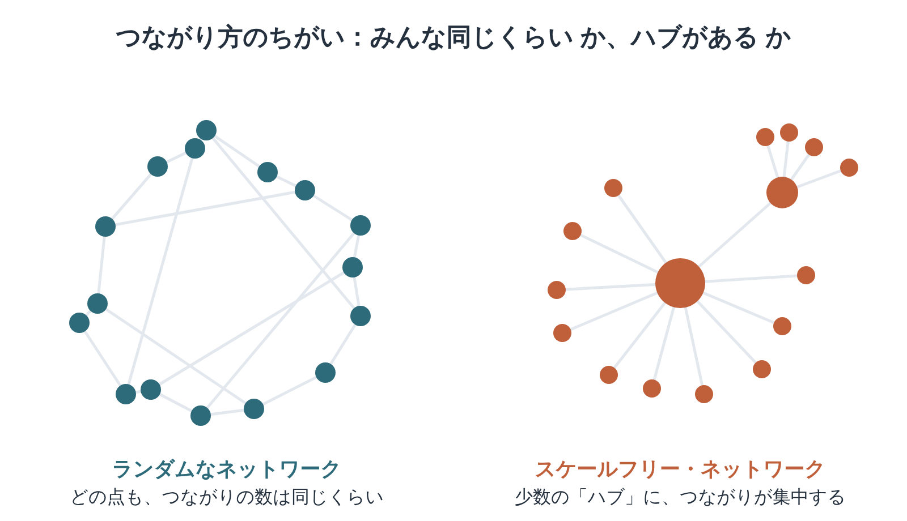

※本記事はアフィリエイト広告を利用しています。

## はじめに

仕事の情報を運んでくれるのは、親しい友人より、たまに会う程度の知り合いのほうが多い。アメリカの社会学者が1970年代に、そんな調査結果を発表しています。

『複雑な世界、単純な法則』は、物理学者マーク・ブキャナンが書いたネットワーク科学の入門書です。人間関係からインターネット、病気の広がりまで、「つながり方」に共通する法則を紹介しています。

<!-- 表紙画像：Amazonアソシエイトの画像付きリンクをここに貼る -->

原題の「ネクサス（Nexus）」は、ラテン語で「結びつき」のこと。「ネットワーク」は、点（人や場所）と線（つながり）でできた網の目を指します。

この本から持ち帰れるのは、次の3つです。

- 世界中の人が、意外なほど少ない段数でつながる理由
- 少数の「ハブ」に、つながりが集まるしくみ
- 浅い知り合いが、新しい情報を運んでくる理由

（四十を過ぎると、人間関係は職場と家族でほぼ固まる。安定しているようで、網の目としてはずいぶん細い。……年賀状の枚数で測るのは、やめておきます。）

数式はほとんど出てこない一冊です。

つながりの話は耳でも入りやすいので、**Audible（オーディブル）**で社会や人間関係の教養書を聴くのも手です。**Kindle**なら、関連するネットワーク科学の本も探せます。

**全部を読み通さなくても、つながりの見方は今日から変えられます。**どちらも無料体験があります。

**こんな人に読んでほしい**

- 「六次の隔たり」の意味を、きちんと知りたい方
- 職場と家庭だけの人間関係に、少し不安を感じている方
- SNSでうわさが一気に広がるしくみが気になる方
- 複雑系の本を、読みやすい一冊から始めたい方

---

### 本の概要

| 項目 | 内容 |
|---|---|
| タイトル | 『複雑な世界、単純な法則──ネットワーク科学の最前線』（原題：Nexus: Small Worlds and the Groundbreaking Science of Networks） |
| 著者 | マーク・ブキャナン（1961-）（訳：阪本芳久）【要確認：訳者名の表記】 |
| 出版年月日 | 原著2002年。日本語版は2005年2月25日（草思社） |
| 出版国 | アメリカ（原著） |
| 出版時の著者の年齢 | 40〜41歳ごろ（1961年生まれ） |
| ジャンル | 科学ノンフィクション（ネットワーク科学） |
| 本の分量 | 中くらい（単行本1冊） |

---

### この本の内容

人と人、ウェブページどうし、空港と空港、脳の神経細胞。世の中は、いろいろな「つながり」であふれています。

一見ばらばらな話ですが、つながりの「形」に目を向けると、驚くほど似た法則が見えてきます。1990年代の終わりから、この分野は一気に花開きました。

（人づきあいも空港の路線図も、同じ図で描ける。そう聞くと、自分の交友関係にも、どこかに乗り継ぎ便がありそうな気がしてきます。）

なぜ世界は意外に狭いのか。なぜ一部の人や場所に、つながりが集中するのか。

**つながりの多いところに、さらにつながりが集まる。その意外なほど単純なしくみは、本の中で。**

:::speech
speaker: 読者
side: left
tone: stone

人間関係の本ならまだしも、科学の本を読む時間はないです……
:::

:::speech
speaker: 矢野英人
side: right
tone: sky

通勤中に耳で社会の教養書を聴くだけでも、つながりの見え方は変わりますよ。
:::

👇 **まずは気軽に『複雑な世界、単純な法則──ネットワーク科学の最前線』を手に取ってみよう**

- **目次を確認しながら、刺さった言葉をハイライトで残したい方**
  👉 [Kindle Unlimited 30日間無料体験はこちら](【アフィリエイトURLを入れる】)
- **忙しくて本を開く時間がない方・耳で学びたい方**
  👉 [Audible 30日間無料体験で教養書を聴く](【アフィリエイトURLを入れる】) 【要確認：本書のAudible配信状況】

---

### この本に登場するキーワード

左は、どの点もだいたい同じ数のつながりをもつ網の目です。右は、少数の「ハブ」に線が集まっています。

現実の世界の多くは、右に近い形をしていることがわかってきました。

（人気者のまわりに人が集まるのは、学校のクラスでも会社でも同じ。網の目で描いてみると、少しだけ冷静に眺められそうです。）

- **六次の隔たり**：知り合いを6人ほどたどれば、世界中の誰とでもつながるという考え。心理学者スタンレー・ミルグラムが1967年に発表した、手紙の実験が有名です。
- **スモールワールド**：近所どうしの輪に、遠くとの「近道」が少し混じるだけで、世界は一気に狭くなる性質。1998年、ワッツとストロガッツが科学誌『ネイチャー』で示しました。
- **ハブ**：ほかと比べものにならないほど多くの線をもつ点。大きなサイトや、空港の拠点がその例です。
- **スケールフリー・ネットワーク**：ハブをもつ網の目。1999年、バラバシとアルバートが科学誌『サイエンス』で、多くの現実のネットワークがこの形だと報告しました。
- **弱いつながりの強さ**：浅い知り合いのほうが、別の集団の情報を運んでくれるという考え。社会学者グラノヴェッターが1973年に論文で示しました。

---

## 図でわかる「世界はなぜ狭いのか」

:::speech
speaker: 読者
side: left
tone: stone

ネットワークの「形」と言われても、ぴんとこないです。
:::

:::speech
speaker: 矢野英人
side: right
tone: sky

「みんな同じくらいの友だち数」か「一部の人気者に集中」か。違いはそれだけです。
:::

右側の「ハブのある網の目」は、ふだんはとても丈夫です。小さな点がいくつか消えても、全体はほとんど崩れません。

その一方で、中心のハブが止まると、全体が一気にばらばらになる弱さも抱えています。

大きな空港が雪で閉鎖されると、遠くの空港の便まで次々に遅れる。あの現象も、網の目の形で説明できます。

スモールワールドの「近道」も大事です。地元の輪だけでは届かない情報も、遠くとの線が数本あるだけで、あっという間に広がります。

（線が一本あるだけで、世界の距離が縮む。会っていない昔の同僚に連絡してみるくらいなら、今日からでもできそうですね。）

---

## 『複雑な世界、単純な法則』つながりの見方が変わる3つの場面

※本書は著作権のある作品のため、本文の言葉は原文を確認できたものだけを引用します。下の3か所は、お手持ちの本で原文を確かめて差し替えてください。【要確認：原文を本で確かめて差し替え】

### 1. 手紙は何人の手を渡るのか

> **「【要確認：原文を本で確かめて差し替え】」**
> （ブキャナン『複雑な世界、単純な法則』、ミルグラムの手紙の実験を紹介する場面より）

見知らぬ相手に手紙を届けるため、知り合いから知り合いへとバトンをつなぐ。手紙は、思ったよりずっと少ない人数で目的の人に届きました。

「世間は狭い」という実感に、科学の光が当たった瞬間です。ここから、本書の旅が始まります。

取引先や転職先も、たどれば数人先にいるのかもしれません。人脈は「数」より「どこにつながっているか」なのだと、この場面は教えてくれます。

（名刺の束より、たった一人の橋渡し役。人脈の値打ちは、枚数より橋の本数で決まるのかもしれません。）

### 2. ほんの少しの「近道」が世界を縮める

> **「【要確認：原文を本で確かめて差し替え】」**
> （ブキャナン『複雑な世界、単純な法則』、スモールワールド・ネットワークを説明する場面より）

ご近所だけの輪の中に、遠くの人との線を数本足す。それだけで、世界全体の「距離」がぐっと縮まります。

この発見のシンプルさには、思わずうなりました。複雑に見える問題も、構造を少し変えるだけで、状況が大きく動くことがあります。

いつもの人間関係の外に、一本だけ線を伸ばしてみる。それくらいの小さな行動でも、網の目全体には効いてくるはずです。

（新しい趣味の集まりに一度だけ顔を出す。それが、人生後半のいちばん安上がりな保険なのかもしれません。）

### 3. 金持ちはますます金持ちに

> **「【要確認：原文を本で確かめて差し替え】」**
> （ブキャナン『複雑な世界、単純な法則』、ハブが生まれる仕組みを説明する場面より）

つながりの多いものが、さらにつながりを集めていく。人気のサイトがますます人気になるのも、同じ流れです。

早く始めて、先に線を集めた人ほど有利になる。お金の世界の「複利」にも、どこか似ています。

人気が人気を呼ぶしくみを知っておくと、ランキングや口コミを見るときも、少し落ち着いて判断できます。

（早く始めた人ほど得をする。積み立ても読書も、たぶん同じ理屈で動いている。始めるなら、今日がいちばん早いということで。）

---

## 『複雑な世界、単純な法則』はどんな人に向いている？

| こんな人に | ポイント |
|---|---|
| ネットワーク科学の入門として | 数式をほとんど使わず、身近な例で全体像がつかめる |
| 『複雑系』『カオス』を読んだ人の次の一冊に | 複雑系の考え方を、「つながり」の側面から広げてくれる |
| 『偶然の科学』とあわせて | 本書にも登場するダンカン・ワッツ自身の本で、社会への応用をさらに深められる |

著者のブキャナンは、理論物理学で博士号をとったあと、科学誌『ネイチャー』や『ニュー・サイエンティスト』の編集に関わってきた人です。研究の最前線を、一般の読者向けに言いかえるのが得意な書き手です。

数式が少ないぶん、細かい理屈はつかみにくいところもあります。気になった概念は、紙に点と線をかいてみると頭に入ります。

（自分の交友関係を点と線で描いてみる。どこが太く、どこが細いのか。家計簿ならぬ「縁の帳簿」をつけるのも、案外悪くなさそうです。）

---

## 『複雑な世界、単純な法則』を医療従事者の目で読んで——支えが一人に集まる家は、強くて、もろい

読みながら思い浮かべたのは、一人暮らしの高齢の方を囲む「支えの網の目」でした。

家族、ケアマネ（介護プランを立てる相談役）、ヘルパー、民生委員、近所のお店。点と線で描いてみると、線が一人か二人に集まっていることがよくあります。離れて暮らす娘さんだったり、ケアマネ本人だったりします。

ハブがいる家は、ふだんは安定しています。困りごとは、まずその人に届くからです。

本書の言うとおり、ハブが止まると全体が一気に崩れます。頼りの家族が体調を崩したとたん、生活が回らなくなる。そんな話は、現場では珍しくありません。

正直に言うと、ケアマネがハブになりすぎている場面も見かけます。電話は全部そこに集まる。

休みの日も携帯を手放せない、という声も聞きます。担当が代わると、線がまとめて切れてしまう。

（線を集めるほど頼られて、頼られるほど抜けられなくなる。網の目の真ん中は、案外くたびれる場所です。）

リハビリの職員として出るサービス担当者会議（関係者が顔をそろえる話し合い）でも、横の線をつくることには意味があると考えています。ヘルパーさんと訪問看護師さんが直接話せるだけで、一人を経由しない道ができます。

「弱いつながり」の話も、現場の感覚に近いものでした。毎朝あいさつを交わす近所の方や、なじみのお店の人が、異変に最初に気づくことがあります。

私も認知症カフェのボランティアに関わってきましたが、気負わず顔を出せる場所は、まさに浅いつながりの集まりです。

ただ、浅いつながりに頼りすぎるのも危うい。ご近所は責任を負えませんし、個人情報の壁もあります。網の目は、強い線と弱い線の組み合わせで考えるしかなさそうです。

人の目が届かない時間は、機械の見守りを足す方法もあります。

これは、私たち自身の老後の話でもあります。会社という大きなハブを離れたとき、自分には何本の線が残るのか。

仕事と家族以外の線を、いまのうちに一本だけ増やしておく。今年の目標は、それくらいにしておきます。

---

## よくある質問

**Q. 数学が苦手でも読めますか？**

A. 数式はほとんど出てこないので、数学が苦手でも読めます。そのぶん抽象的な説明もあるので、点と線の図を自分でかいてみると理解が進みます。

**Q. 『複雑な世界、単純な法則』はオーディブル（Audible）やKindleで読めますか？**

A. 草思社版のKindle版・Audible版は、執筆時点で見つけられていません。【要確認：草思社版の電子書籍・Audible版の有無】

本書が手元にない日は、Audibleで人間関係や社会の教養書を聴いておくと、つながりの話がすっと入ります。紙の本と、耳で聴く関連書の組み合わせがおすすめです。

**Q. 「六次の隔たり」は本当ですか？**

A. ミルグラムの実験やその後の研究で、人と人が思ったより少ない段数でつながっていることが示されてきました。「必ず6人」という意味ではなく、「意外なほど近い」という目安として受けとるのがよさそうです。

**Q. 古い本ですが、いまの時代にも役立ちますか？**

A. 原著は2002年の刊行で、いまのSNSが広まる前の本です。つながりの形が情報や病気の広がりを左右するという考え方は、SNS時代のいまこそ実感しやすくなっています。

---

## まとめ

『複雑な世界、単純な法則』のエッセンスを、3つにまとめます。

1. **人間関係からインターネットまで、まったく違う網の目に共通する法則を紹介した入門書**
2. **「六次の隔たり」「スモールワールド」「ハブ」から、世界が意外に狭い理由がわかる**
3. **つながりが一部に集まっていく単純なしくみは、本の中で解き明かされる**

まずは紙に、自分のまわりの点と線をかいてみる。そのうえで本を開くと、一章ごとに見え方が変わります。

関連する社会や心理の本は、Audibleで聴いて補う。**全部を活字で追わなくても、つながりを見る目は育ちます。**

（人生の後半に効くのは、太い一本より、細い何本か。蜘蛛の巣を見かけたら、ちょっとだけ見入ってしまいそうです。）

---

💡 **KindleやAudibleを使うなら、Amazonプライムもチェック**

Kindleで本を読んだりAudibleで聴いたりしている方は、すでにAmazonのアカウントをお持ちのはずです。そのまま登録できるAmazonプライムは、読書好きにとってコスパのよいサービスです。

- 📚 **Prime Reading**：対象のKindle本・雑誌・マンガが追加料金なしで読める（Kindle Unlimitedより対象は少なめ）
- 🎬 **Prime Video**：映画・ドラマが見放題
- 🎵 **Amazon Music Prime**：通勤中の音楽やポッドキャストにも
- 📦 **配送料無料**：紙の本を買うときもお得

料金は月額600円、年額なら5,900円（月あたり約492円）です（2026年10月時点）。映画を1〜2本レンタルするのと同じくらいの金額で、読む・観る・聴くがまとめて楽しめます。

※AudibleとKindle Unlimitedはプライムとは別の料金がかかります。

👉 [Amazonプライム 30日間無料体験はこちら](【アフィリエイトURLを入れる】)

---

🎁 **【30日間無料体験】あなたに合った方法で読書を始めよう**

- 🎧 **耳から聴く読書（Audible）**
  プロの朗読で、教養書やビジネス書を耳から学ぶ。無料体験期間中は聴き放題対象作品を楽しめます。
  👉 [Audible（オーディブル）無料体験に登録する](【アフィリエイトURLを入れる】)

- 📖 **スマホ・タブレットで読む（Kindle Unlimited）**
  対象の電子書籍が読み放題。気になった言葉はハイライトで保存できます。
  👉 [Kindle Unlimited 30日間無料体験に登録する](【アフィリエイトURLを入れる】)

- 📕 **紙の本・Kindle版を購入する**
  👉 [『複雑な世界、単純な法則──ネットワーク科学の最前線』をAmazonで見る](【アフィリエイトURLを入れる】)

---

### この記事を書いた人

**矢野英人**｜つみたて読書

〜老後に効く教養を、耳とスマホで〜

本は読みたい。でも、時間も集中力も続かない。40代半ば、2児の父の私も同じです。

文学部からリハビリ医療の専門職へ。介護の現場で18年、約1,000人の老いを見てきました。

老いは誰にでも来る。それでも、知識は年をとっても伸びるといわれます。お金も教養も、元手は時間。本を開くなら、人生でいちばん若い今日から。

資格：理学療法士／介護支援専門員（ケアマネジャー）／2級FP技能士

---

### 参考情報

- [複雑な世界、単純な法則（物質・材料研究機構 図書館）](https://library.nims.go.jp/manifestations/105134?locale=en)
- [複雑な世界、単純な法則 書評（朝日ネット 個人書評ページ）](https://www.asahi-net.or.jp/~pu4i-AOK/core/bookdata/700/b710.htm)
- [Mark Buchanan（University of York 書籍リスト）](https://www-users.york.ac.uk/~ss44/books/pages/b/MarkBuchanan.htm)
- [Mark Buchanan (1961–)（LibraryThing。生年・経歴）](https://www.librarything.com/a/5197668)
- [Buchanan, Mark（Encyclopedia.com。『ネイチャー』『ニュー・サイエンティスト』での編集歴）](https://www.encyclopedia.com/arts/educational-magazines/buchanan-mark)
- [Watts & Strogatz, "Collective dynamics of 'small-world' networks", Nature 393 (1998)（RePEc）](https://ideas.repec.org/a/nat/nature/v393y1998i6684d10.1038_30918.html)
- [Barabási & Albert, "Emergence of scaling in random networks", Science 286 (1999)（arXiv）](https://arxiv.org/pdf/cond-mat/9910332)
- [Strength of Weak Ties（SAGE Knowledge。Granovetter, American Journal of Sociology 78, 1973）](https://sk.sagepub.com/ency/edvol/embed/power/chpt/strength-weak-ties)
