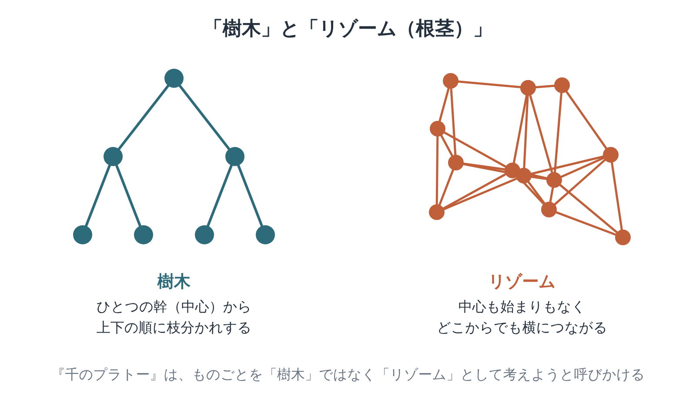

※本記事はアフィリエイト広告を利用しています。

## はじめに

「名前は聞いたことがあるけれど、開いた瞬間に閉じてしまった」。『千のプラトー』は、そんな声がとても多い哲学書です。専門の研究者でも、解釈が分かれるほどの本です。

それでも、この本の入り口にある「リゾーム」という考え方は、一度知ると世界の見え方が少し変わります。会社や組織、人と人とのつながりを考えるときにも、ふと思い出したくなる言葉なんです。

この記事では、難しい部分は思い切って置いておき、本書の入り口となる考え方を図でかみ砕きます。そのうえで、挫折しない読み方と、医療・介護職として受け取ったヒントを、できるだけやさしくまとめました。

全部わからなくて大丈夫です。気になる章から**Kindle（電子書籍）**で少しずつ読むのがおすすめ。いきなり原典がつらい方は、**Audible（オーディブル）**で哲学の入門書を聴いて、まず雰囲気をつかむのもいいですよ。どちらも無料体験があります。

**こんな人に読んでほしい**

- 現代思想に興味があるけれど、どこから入ればいいか分からない方
- 「リゾーム」という言葉を、ざっくりでいいから理解したい方
- 縦割りの組織や、上からの指示だけで動く仕組みに息苦しさを感じている方
- 利用者さんを、病名や要介護度という「ラベル」で見てしまうことに迷いがある医療・介護職の方

---

### 本の概要

| 項目 | 内容 |
|---|---|
| タイトル | 『千のプラトー──資本主義と分裂症』（原題：Mille Plateaux） |
| 著者 | ジル・ドゥルーズ、フェリックス・ガタリ（訳：宇野邦一、小沢秋広、田中敏彦、豊崎光一、宮林寛、守中高明） |
| 出版年月日 | 原著1980年（フランス）。日本語版は河出書房新社の単行本【要確認：単行本の刊行年】、2010年に河出文庫（上・中・下） |
| 出版国 | フランス（原著） |
| 出版時の著者の年齢 | ドゥルーズ55歳ごろ（1925年1月18日生まれ）、ガタリ49〜50歳（1930年4月30日生まれ） |
| ジャンル | 哲学書（現代思想） |
| 本の分量 | とても長め（文庫で上・中・下の3冊） |

---

### この本の内容

私たちは、物事を「中心から枝分かれするもの」として整理するのが得意です。家系図、会社の組織図、本の目次。どれも、一本の幹から順番に枝が伸びていく形。整理しやすいですよね。

ドゥルーズとガタリは、その考え方そのものに疑問を投げかけました。

もし、世界が「中心のない、どこからでもつながる網の目」でできているとしたら？　言葉、欲望、国家、音楽、動物。まったく違う話題を自由に行き来しながら、二人は新しいものの見方を描き出そうとします。

👇 **まずは気軽に『千のプラトー──資本主義と分裂症』を手に取ってみよう**

- **目次を確認しながら、刺さった言葉をハイライトで残したい方**
  👉 [Kindle Unlimited 30日間無料体験はこちら](【アフィリエイトURLを入れる】)
- **忙しくて本を開く時間がない方・耳で学びたい方**
  👉 [Audible 30日間無料体験で教養書を聴く](【アフィリエイトURLを入れる】) 【要確認：本書のAudible配信状況】

---

### この本に登場するキーワード

左の「樹木」は、ひとつの中心から順番に分かれていく形。右の「リゾーム」は、中心も始まりもなく、どこからでも横につながっていく形です。本書は、ものごとを右のように考えてみよう、と呼びかけます。

- **リゾーム（根茎）**：竹やショウガの地下茎のように、横に広がりながら、どこからでも新しい芽を出す植物の茎。本書では、中心をもたず、どこからでもつながっていくものの見方を表す言葉として使われます。
- **樹木**：一本の幹から枝分かれしていく、上下の順序がはっきりした形。体系的な学問や組織など、私たちの多くの考え方がこの形をしている、と二人は指摘します。
- **プラトー（高原）**：本書の章のこと。山の頂上のような「クライマックス」に向かうのではなく、なだらかに続く高原のように、それぞれが独立して読めるように書かれています。
- **脱領土化**：決まった場所や役割、意味から抜け出していく動き。逆に、新しい場所に落ち着き直すことを「再領土化」と呼びます。
- **生成変化**：何かが、固定された「もの」ではなく、別の何かへと変わり続けていくプロセスとして捉える考え方です。

---

## 図でわかる「樹木」と「リゾーム」

先ほどの図を、身近な例に置きかえてみましょう。

会社の組織図は、典型的な「樹木」です。社長から部長、課長、担当者へと、上から下に指示が流れていきます。どの情報も、決まった道を通らなければ伝わりません。

一方の「リゾーム」は、たとえば地域のゆるやかな人間関係。誰が中心というわけでもなく、あちこちで人と人が横につながっています。どこか一本の線が切れても、別の道を通って情報や助けが行き交います。始まりも終わりもありません。

本書は、「樹木が悪くて、リゾームが正しい」と単純に言っているわけではありません。

実際の世界では、両方が入りまじっています。大事なのは、つい樹木の形だけで世界を見てしまうくせに気づくこと。そこから、見えていなかったつながりが見えてくるんです。

---

## 『千のプラトー』入り口で出会う3つの言葉

※日本語は英語訳からの拙訳を含みます。お手持ちの訳書の表現に差し替えてください。【要確認：日本語版の訳文】

### 1. 二人で書いたけれど、もっと大勢がいた

> **「私たちは二人で『アンチ・オイディプス』を書いた。それぞれが何人分もいたので、すでにかなりの大人数だった」**
> （ドゥルーズ＝ガタリ『千のプラトー』序「リゾーム」の冒頭より）
>
> 原文（英語訳）：The two of us wrote Anti-Oedipus together. Since each of us was several, there was already quite a crowd.

本書の書き出しです。前作を二人で書いたけれど、一人ひとりの中には、たくさんの声や影響が入りまじっている。だから、実際には「大勢」で書いたのだ、と言っています。

一人の人間も、実は一つの中心をもった存在ではない。いきなり、本書全体の考え方を予告するような書き出し。ちょっとユーモラスでもあります。

### 2. 根ではなく、リゾームを

> **「根をはるな、リゾームをつくれ」**
> （ドゥルーズ＝ガタリ『千のプラトー』序「リゾーム」より）
>
> 原文（英語訳）：Make rhizomes, not roots.

本書の中でも、とりわけよく知られた呼びかけです。一か所に深く根をはって固まるのではなく、横へ横へとつながりを広げていこう、という意味に受け取れます。

もちろん、居場所や根っこが大切な場面もあります。それでも、行きづまったときに「別の方向へ伸びる道はないか」と考えるヒントになる言葉です。

### 3. なめらかな空間と、区切られた空間

> **「【要確認：原文を本で確かめて差し替え】」**
> （ドゥルーズ＝ガタリ『千のプラトー』、平滑空間と条里空間を論じるプラトーより）

自由に動き回れる海や草原のような「平滑空間」と、道や区画で区切られた都市や畑のような「条里空間」。二人は、空間の性質の違いから、社会や国家のあり方を考えていきます。

難しい章ですが、「区切られすぎた場所は、息苦しくなる」という感覚には、思い当たる方も多いはずです。

---

## 『千のプラトー』で挫折しないための読み方

| 読み方 | ポイント |
|---|---|
| 序「リゾーム」だけ読む | 本書の考え方の多くが、最初の章に詰まっている。ここだけでも十分に価値がある |
| 気になるプラトーから読む | 各章は独立して読めるように書かれている。音楽、動物、言葉など、興味のあるテーマから入ってよい |
| 入門書を先に読む | 解説書や入門書で地図を手に入れてから原典に戻ると、迷子になりにくい |
| 批判もあわせて読む | ソーカルとブリクモンの『「知」の欺瞞』は、本書を含む現代思想の科学用語の使い方を批判している。両方読むと、距離をとって向き合える |

---

## 『千のプラトー』を医療・介護職の目で読んで——横のつながりと、人をラベルで見ないこと

難解な本ですが、読みながら何度も、医療・介護の現場の姿が重なりました。

一つは、チームの形です。医療や介護の世界は、どうしても「樹木」の形になりがちです。医師の指示があり、そこから看護、リハビリ、介護へと情報が流れていく。もちろん、責任の所在をはっきりさせるために、それは必要な仕組みです。

でも実際の現場で利用者さんを支えているのは、樹木の線だけではありません。

ヘルパーさんと訪問看護師さんの立ち話、デイサービスの送迎で交わす一言、ご近所の方からの「最近元気がないみたい」という連絡。そうした横のつながりが、大切な気づきを運んでくれることがよくあります。

ケアマネとして心がけたいのは、樹木の線を守りながらも、リゾームのような横のつながりを育てることです。誰か一人を通さなければ情報が伝わらない仕組みは、その人が忙しいときに止まってしまいます。

もう一つは、「生成変化」という考え方。

私たちはつい、利用者さんを「認知症の方」「要介護3の方」と、ラベルで捉えてしまいます。でも人は、決まった「もの」ではありません。日々、変わり続けている存在です。昨日できなかったことが今日はできたり、新しい楽しみを見つけたりする。

ラベルは支援の入り口としては役立ちますが、その人のすべてではありません。認知症について正しく知ることは、ラベルの奥にいるその人を見るための第一歩です。[認知症の治療と相談先をまとめた記事](https://site.yanohide.com/posts/dementia-treatment-method)も、よかったら読んでみてください。

理学療法士の立場からも、「固定された状態」として人を見ない大切さを感じてきました。今の状態を評価しつつ、その人がこれからどう変わっていけるかに目を向ける。リハビリは、まさに生成変化に寄り添う仕事なのかもしれません。

全部は理解できなくても、心に残る言葉をいくつか持ち帰れる。哲学書との付き合い方としては、それで十分なのだと思います。

分からない本を前に、立ち止まってもいい。それもまた、一つの読み方です。

---

## よくある質問

**Q. 哲学の知識がまったくなくても読めますか？**

A. 原典をいきなり読むのは、正直かなり大変です。まず序章「リゾーム」だけを読むか、入門書で全体像をつかんでから挑戦するのがおすすめです。分からない部分は、分からないまま進んで大丈夫です。

**Q. 文庫は3冊ありますが、全部読む必要がありますか？**

A. 各章（プラトー）は独立して読めるように書かれているので、全部を順番に読む必要はありません。上巻の序章を読んだあとは、興味のあるテーマの章を選んで読む読み方も、著者たち自身がすすめています。

**Q. 『「知」の欺瞞』で批判されていると聞きましたが？**

A. ソーカルとブリクモンは、本書を含む現代思想の著作で、数学や物理学の用語が正確でない使われ方をしていると批判しました。その批判を知ったうえで、本書の思想としての面白さをどう受け取るかは、読む人それぞれに委ねられています。

---

## まとめ

『千のプラトー』のポイントは次の3つです。

1. **中心から枝分かれする「樹木」ではなく、どこからでもつながる「リゾーム」として世界を見る提案**
2. **各章が独立した「高原」として書かれ、好きなところから読める、型破りな哲学書**
3. **縦の指示系統だけでなく横のつながりを育て、人をラベルで決めつけないヒントをくれる**

まずは序章「リゾーム」だけ、Kindleの試し読みで開いてみてください。分からなくても、心に引っかかる言葉が一つ見つかれば十分です。哲学の入門書をAudibleで聴いてから戻ってくるのも、いい方法ですよ。

---

💡 **KindleやAudibleを使うなら、Amazonプライムもチェック**

Kindleで本を読んだりAudibleで聴いたりしている方は、すでにAmazonのアカウントをお持ちのはずです。そのまま登録できるAmazonプライムは、読書好きにとってコスパのよいサービスです。

- 📚 **Prime Reading**：対象のKindle本・雑誌・マンガが追加料金なしで読める（Kindle Unlimitedより対象は少なめ）
- 🎬 **Prime Video**：映画・ドラマが見放題
- 🎵 **Amazon Music Prime**：通勤中の音楽やポッドキャストにも
- 📦 **配送料無料**：紙の本を買うときもお得

料金は月額600円、年額なら5,900円（月あたり約492円）です（2026年10月時点）。映画を1〜2本レンタルするのと同じくらいの金額で、読む・観る・聴くがまとめて楽しめます。

※AudibleとKindle Unlimitedはプライムとは別の料金がかかります。

👉 [Amazonプライム 30日間無料体験はこちら](【アフィリエイトURLを入れる】)

---

🎁 **【30日間無料体験】あなたに合った方法で読書を始めよう**

- 🎧 **耳から聴く読書（Audible）**
  プロの朗読で、教養書やビジネス書を耳から学ぶ。無料体験期間中は聴き放題対象作品を楽しめます。
  👉 [Audible（オーディブル）無料体験に登録する](【アフィリエイトURLを入れる】)

- 📖 **スマホ・タブレットで読む（Kindle Unlimited）**
  対象の電子書籍が読み放題。気になった言葉はハイライトで保存できます。
  👉 [Kindle Unlimited 30日間無料体験に登録する](【アフィリエイトURLを入れる】)

- 📕 **紙の本・Kindle版を購入する**
  👉 [『千のプラトー──資本主義と分裂症』をAmazonで見る](【アフィリエイトURLを入れる】)

---

### この記事を書いた人

**矢野英人**｜つみたて読書

〜老後に効く教養を、耳とスマホで〜

本は読みたい。でも、時間も集中力も続かない。40代半ば、2児の父の私も同じです。

文学部で英文学を学び、リハビリ医療の専門職（理学療法士）に。介護の現場で18年、約1,000人の老いと暮らしを見てきました。

老いも死も、誰にでも必ず来る。仕事でも家族でも、そう実感してきました。それでも、知識や言葉の力は年をとっても伸びるといわれます。

お金も教養も、いちばんの元手は時間です。本を開くなら、人生でいちばん若い今日から。

老後に効くのは、お金と体と、本の貯金。Kindleとオーディブルで、忙しい大人でも続く読み方を紹介しています。

資格：理学療法士／介護支援専門員（ケアマネジャー）／2級FP技能士

---

### 参考情報

- [河出文庫 千のプラトー〈上〉（紀伊國屋書店ウェブストア）](https://www.kinokuniya.co.jp/f/dsg-01-9784309463421)
- [河出文庫 千のプラトー〈下〉（紀伊國屋書店ウェブストア）](https://www.kinokuniya.co.jp/f/dsg-01-9784309463452)
- [千のプラトー 下（ブクログ）](https://booklog.jp/item/1/4309463452)
