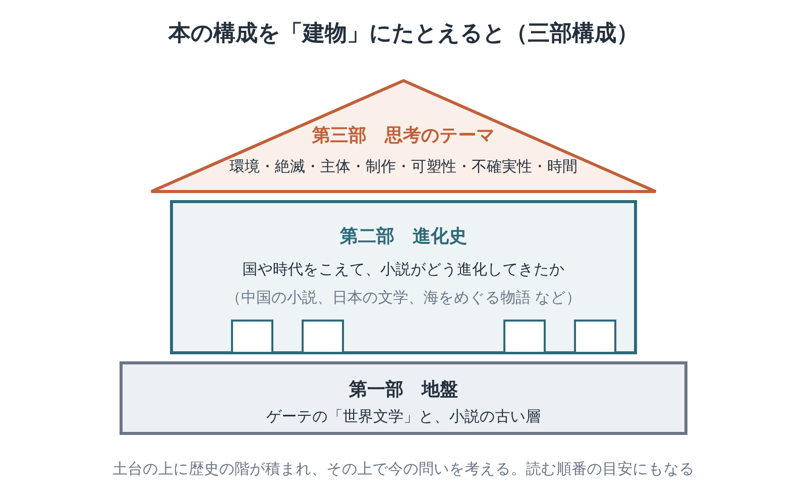
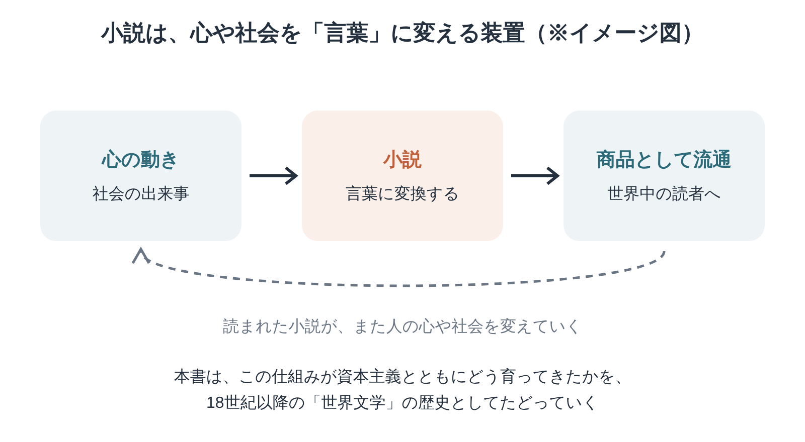

※本記事はアフィリエイト広告を利用しています。

## はじめに

書店で分厚い本を手に取り、少しページをめくってから、そっと棚に戻す。そんな経験は、誰にでもあると思います。

『世界文学のアーキテクチャ』は、512ページという、手に持つとずしりとくる重さのある一冊です。

タイトルの「アーキテクチャ」は、建物の設計や骨組みのことです。世界中の文学が、どんな骨組みで組み上がってきたのか。この本は、それを解き明かそうとしています。

（分厚い本は、買った時点で半分読んだ気になる。本棚に置くだけで筋肉がつかないのと同じで、教養もつかない。……リハビリの現場の理屈は、本にもそのまま当てはまるようです。）

けれども、扱っているテーマは意外と身近です。若いころに読んだ小説や、名前だけ知っている古典。それらが一本の流れでつながっている、という本です。

著者は文芸批評家の福嶋亮大さん。「小説」と「資本主義」の関係を手がかりに、ゲーテから現代までの文学を一つの建物のように描いています。

この記事では、本の構成と中心の考え方を2枚の図にまとめました。医療・介護職として読んで考えたことも書いています。

全部を一度に読む必要はありません。出版元が、本の入り口にあたる序章をウェブで無料公開しています。まずはそこで、文章との相性を確かめてみてください。

合いそうなら、**Kindle（電子書籍）**で少しずつ読むのがおすすめです。文学の背景を耳から知りたい方は、**Audible（オーディブル）**で文学史の教養書を聴く方法もあります。どちらも無料体験があります。

**こんな人に読んでほしい**

- 若いころに読んだ名作を、別の角度から見直したい方
- 文学と社会、経済のつながりに興味がある方
- 利用者さんの人生を記録に書くとき、言葉が足りないと感じたことのある医療・介護職の方
- 時間をかけて一冊の本と付き合いたい方

---

### 本の概要

| 項目 | 内容 |
|---|---|
| タイトル | 『世界文学のアーキテクチャ』 |
| 著者 | 福嶋亮大（文芸批評家） |
| 出版年月日 | 2025年3月17日（PLANETS／第二次惑星開発委員会） |
| 出版国 | 日本 |
| 出版時の著者の年齢 | 43〜44歳（1981年京都市生まれ）【要確認：生年月日】 |
| ジャンル | 文芸批評・文学史 |
| 本の分量 | とても長め（512ページ） |
| 初出 | PLANETSのウェブ連載（2023年3月開始）をもとに書籍化 |

---

### この本の内容

小説は昔からあったように思えます。ただ、文学の長い歴史で見ると、小説が主役になったのはごく最近のことです。

18世紀以降、小説は人の心や社会の出来事を言葉にし、本という商品になって世界に広がりました。その広がりは、資本主義の発展と深く結びついていたといいます。

（お金の専門家（FP）の目で、つい計算してしまう。4,620円で512ページ、1ページ約9円。ゲーテからメルヴィルまでの案内料としては……悪くないですね。）

小説はなぜ、これほど人の心と世界を動かしてきたのか。その「設計思想」は、いまの私たちに何を語りかけているのか。ゲーテから現代へと続く、長い旅が始まります。

まずは数ページ、のぞいてみるだけで十分です。

👇 **まずは気軽に『世界文学のアーキテクチャ』を手に取ってみよう**

- **目次を確認しながら、刺さった言葉をハイライトで残したい方**
  👉 [Kindle Unlimited 30日間無料体験はこちら](【アフィリエイトURLを入れる】)
- **忙しくて本を開く時間がない方・耳で学びたい方**
  👉 [Audible 30日間無料体験で教養書を聴く](【アフィリエイトURLを入れる】) 【要確認：本書のAudible配信状況】

---

### この本に登場するキーワード

本書は三部構成です。第一部は「世界文学」という考え方の土台。第二部は、国や時代をこえた小説の歩み。第三部は、いまにつながるテーマです。目次を開くときの地図として使ってください。

（住まいのバリアフリーを考える仕事柄、まず手すりを探してしまう。この建物にはない。代わりにあるのは目次と図。上る気があるなら、それで足りるのでしょう。）

- **世界文学**：ドイツの文豪ゲーテが広めた言葉です。各国の文学の寄せ集めではありません。国境をこえて読まれ、影響し合う文学のつながりを指します。
- **アーキテクチャ（設計思想）**：建物の設計のように、ものごとの骨組みを表す言葉です。本書は世界文学を、長い年月をかけて組み上がった設計思想の集まりとして見ています。
- **小説と資本主義**：小説は売り買いされる「商品」でもあります。出版や流通のしくみが、小説の中身や形を変えてきました。これが本書の大きな視点です。
- **言葉への変換**：人の心や社会の出来事を、言葉に置きかえて形にすること。本書は小説を、そのための装置としてとらえています。
- **第三部のテーマ**：環境、絶滅、主体、制作、可塑性、不確実性、時間。小説が抱えてきた問いを、いまの課題とつなげて考えます。

---

## 図でわかる「小説は心や社会を言葉に変える装置」

心や社会の出来事は、小説によって言葉になり、本として世界中の読者に届きます。読まれた小説は、人の心や社会を少しずつ変えていく。このめぐりが資本主義とともに大きくなった、というのが本書の見取り図です。

（申し送りも、三人を経由すれば元の話は別物になる。言葉は伝わる途中で目減りするもの。小説はその目減りごと、商品にしてしまったのかもしれませんね。）

身近な例で考えてみます。

ある時代の人々の悩みや、町の空気。それ自体には形がありません。

小説家は、形のないものを物語にして、本という器に入れます。本は売られ、海をこえ、会ったこともない人の手に渡ります。

読んだ人は、物語を通して、自分の気持ちや世の中の見え方を少しだけ変えていく。つまり、心と社会のあいだを、言葉が川の水のようにめぐっているのです。

本書は、この流れがいつ、どこで生まれ、どう太くなったのかをたどります。ゲーテから中国の小説、日本の文学、海の物語まで、視野はとても広いです。

---

## 『世界文学のアーキテクチャ』読みどころの3つの場面

※本書は著作権のある作品のため、本文の言葉は原文を確認できたものだけを引用します。下の3か所は、お手元の本で原文を確かめて差し替えてください。【要確認：原文を本で確かめて差し替え】

### 1. 世界文学の「建築家」としてのゲーテ

> **「【要確認：原文を本で確かめて差し替え】」**
> （福嶋亮大『世界文学のアーキテクチャ』第一章「世界文学の建築家ゲーテ」より）

本書は、ゲーテを「世界文学」という建物の設計者として描くところから始まります。ただの大作家としては扱いません。

文学を、国ごとに飾られた宝物ではなく、つながり合う一つの建物として見る。この見方の切りかえが、本書の入り口です。

（ゲーテが世界文学の設計者なら、ケアマネ（介護プランを立てる相談役）は暮らしの設計者だろうか。違うのは、こちらの設計図には毎月「見直し」の欄があること。……そこは大きな違いですね。）

### 2. 世界文学は「未完のオープン・システム」

> **「未完のオープン・システム」**
> （福嶋亮大『世界文学のアーキテクチャ』ウェブ連載版の序章で、世界文学をとらえる言葉として使われている表現）【要確認：書籍版での表記】

世界文学は、完成した名作のリストではありません。新しい作品を迎え入れながら、いまも変わり続けている開かれた仕組みです。

古い本を読むことも、新しい本を読むことも、同じ建物の中を歩くことになります。終わりのない建物は、どこか人の一生に似ています。

（ブログ記事も、公開したら終わりではない。順位が落ちれば書き直す。Webの文章は、最初から「未完のオープン・システム」だったのかもしれません。）

### 3. 不確実性は、小説的思考の核心

> **「【要確認：原文を本で確かめて差し替え】」**
> （福嶋亮大『世界文学のアーキテクチャ』第三部、不確実性を「小説的思考の核心」として論じる章より）

先が見えないことが、小説という形の芯にある。目次でこのテーマを見たとき、思わず手が止まりました。

結末がわからないから、人はページをめくります。そして、私たちの毎日も同じかもしれません。明日がわからないまま、今日のページをめくっています。

（先が読めないのが小説の核心なら、介護保険制度もかなり小説的だ。3年ごとに改定されて、結末はまだ誰も知らない。……続きが気になる、と言っていいものかどうか。）

---

## 『世界文学のアーキテクチャ』はどう読む？ 大著と付き合うコツ

宇野常寛さんは本書について、ページあたりの内容の密度がとても高いと書いています。一気に読むと、途中で疲れてしまうかもしれません。

| 読み方 | ポイント |
|---|---|
| 序章をウェブで読む | 出版元のウェブメディア「遅いインターネット」で序章が特別公開されている。まずここで文章との相性を確かめる |
| 図の「建物」を地図にする | 第一部で土台をつかめば、第二部・第三部は気になる章から読んでもよい |
| 名作と行き来する | 取り上げられた作家（ゲーテ、シェイクスピア、メルヴィルなど）の作品を、気が向いたときに少しずつ読む |

急ぐ必要はありません。何年もかけて、気になったときに開いては閉じ、また本棚に戻す。そんな付き合い方が合う本です。

（続かない運動プログラムは、効果がないのと同じ。リハビリで何度も確かめてきたことだ。読書も、たぶん同じでしょう。1日5ページなら、続く気がします。）

---

## 『世界文学のアーキテクチャ』を医療・介護職の目で読んで——「拒否あり」の一行に、物語は入りきらない

本書は、小説を「心や社会の出来事を言葉に置きかえる装置」として読み解きます。読みながら私が思い浮かべたのは、文学ではなく介護記録でした。

介護の記録は、たいてい一日の業務が終わったあとに、限られた時間の中で書かれます。

記録には、決まった言葉が並びます。「著変なし（大きな変化なし）」「拒否あり」「様子観察」。

便利な言葉です。けれども、「拒否あり」の一行に、その方が嫌がった理由は入りません。お風呂が寒かったのか。介助する人が苦手だったのか。その日は気が向かなかっただけなのか。

小説は、その「なぜ」を何百ページもかけて書くものです。記録は、それを一行に縮めるもの。同じ「言葉にする」営みでも、向きはまるで反対です。

（「著変なし」は、書く側には合理的な言葉だ。変化がないことを最短で伝えられる。困るのは、変化に気づいていないときにも、同じ一行で済んでしまうこと。）

記録も小説のように丁寧に書くべきか。人手の足りない現場で、それを求めるのは酷な話です。

私はブログで、専門用語を読者の言葉に置きかえることを大事にしてきました。言いかえるたびに、何かを削っているのだと思います。

短く書かないと読まれない。短くすると、こぼれ落ちる。本書はこの問いに答えをくれません。こぼれ落ちているものがある、という事実だけを静かに見せてくれます。

第三部の「不確実性」と「時間」も、現場の感覚と重なりました。

ケアプランには目標を書きますが、年を重ねた方の暮らしは、計画どおりに進まないことのほうが多いのが現実です。転倒、入院、ご家族の事情。モニタリング（定期的な見直し）のたびに書き直しになります。

先が見えないことを前提に考える。本書のこの視点は、カンファ（職員どうしの打ち合わせ）で計画を練り直す現場にとっては、ありふれた日常の景色かもしれません。

立ち止まった言葉が一つあります。「可塑性」です。本書では、文学の形が変わっていく力のような意味で使われています。リハビリの仕事をしてきた私は、脳や体が回復していく力のほうを思い浮かべてしまいます。

同じ言葉でも、生きてきた場所が違えば響きが変わる。職種ごとに言葉がすれ違う、多職種の会議を思い出しました。

この本を読んでも、明日から記録が長くなるわけではありません。「拒否あり」と書く手が、一瞬止まるようになるかもしれない。それくらいの小さな変化でいいのだと思います。

---

## よくある質問

**Q. 文学の知識がなくても読めますか？**

A. 取り上げられる作家は幅広く、批評の専門用語も出てきます。すべてをわかろうとしなくて大丈夫です。

知っている作家や、気になるテーマの章から開いてみてください。ウェブで公開されている序章で、相性を確かめてから買うのも一つの方法です。

**Q. どんな人が書いた本ですか？**

A. 著者の福嶋亮大さんは、1981年京都市生まれの文芸批評家です。本書は、PLANETSのウェブ連載をもとにまとめられました。

**Q. 古典の名作を読んでいなくても楽しめますか？**

A. 楽しめます。本書を読むと、ゲーテやシェイクスピア、メルヴィルを読みたくなるはずです。気になった作品から、一冊ずつ手に取ってみてください。

---

## まとめ

『世界文学のアーキテクチャ』のポイントを3つにまとめます。

1. **ゲーテから現代まで、世界文学を一つの「建物」として描き直す512ページの大著**
2. **小説を「心や社会を言葉に変える装置」ととらえ、資本主義とともに育った歴史をたどる**
3. **人の物語を言葉にすることは、何かをこぼすことでもある。介護記録の一行を通して、そのことを教えてくれます**

最初は、無料で読める序章から開いてみてください。合えばKindleで少しずつ。取り上げられた名作をAudibleで聴きながら読むと、この大きな建物の中が少しずつ見えてきます。

（ケアプランの目標も、多すぎると誰も覚えていない。大事なことは3つまで。本のまとめも、そのルールでいいことにしておきます。）

---

💡 **KindleやAudibleを使うなら、Amazonプライムもチェック**

Kindleで本を読んだりAudibleで聴いたりしている方は、すでにAmazonのアカウントをお持ちのはずです。そのまま登録できるAmazonプライムは、読書好きにとってコスパのよいサービスです。

- 📚 **Prime Reading**：対象のKindle本・雑誌・マンガが追加料金なしで読める（Kindle Unlimitedより対象は少なめ）
- 🎬 **Prime Video**：映画・ドラマが見放題
- 🎵 **Amazon Music Prime**：通勤中の音楽やポッドキャストにも
- 📦 **配送料無料**：紙の本を買うときもお得

料金は月額600円、年額なら5,900円（月あたり約492円）です（2026年10月時点）。映画を1〜2本レンタルするのと同じくらいの金額で、読む・観る・聴くがまとめて楽しめます。

※AudibleとKindle Unlimitedはプライムとは別の料金がかかります。

👉 [Amazonプライム 30日間無料体験はこちら](【アフィリエイトURLを入れる】)

---

🎁 **【30日間無料体験】あなたに合った方法で読書を始めよう**

- 🎧 **耳から聴く読書（Audible）**
  プロの朗読で、教養書やビジネス書を耳から学ぶ。無料体験期間中は聴き放題対象作品を楽しめます。
  👉 [Audible（オーディブル）無料体験に登録する](【アフィリエイトURLを入れる】)

- 📖 **スマホ・タブレットで読む（Kindle Unlimited）**
  対象の電子書籍が読み放題。気になった言葉はハイライトで保存できます。
  👉 [Kindle Unlimited 30日間無料体験に登録する](【アフィリエイトURLを入れる】)

- 📕 **紙の本・Kindle版を購入する**
  👉 [『世界文学のアーキテクチャ』をAmazonで見る](【アフィリエイトURLを入れる】)

---

### この記事を書いた人

**矢野英人**｜介護現場のリハビリ専門職（理学療法士）・ケアマネジャー。18年以上、介護施設やデイサービス、ご自宅への訪問で約1,000人のリハビリを担当し、ケアマネとしても10年以上、ご本人とご家族の相談に関わってきました。

医療・介護の現場の目線で、名作や教養書の読みどころを紹介しています。

---

### 参考情報

- [世界文学のアーキテクチャ（版元ドットコム）](https://www.hanmoto.com/bd/isbn/9784911149034)
- [世界文学のアーキテクチャ はじめに――世界・小説・商品（遅いインターネット）](https://slowinternet.jp/article/worldliterature01/)
- [福嶋亮大『世界文学のアーキテクチャ』について（宇野常寛 note）](https://note.com/wakusei2nduno/n/nb7ec9e8f8c54)
- [世界文学のアーキテクチャ（紀伊國屋書店ウェブストア）](https://www.kinokuniya.co.jp/f/dsg-01-9784911149034)
- [世界文学のアーキテクチャ（PLANETS 連載）](https://ch.nicovideo.jp/wakusei2nd/blomaga/ar2144447)
