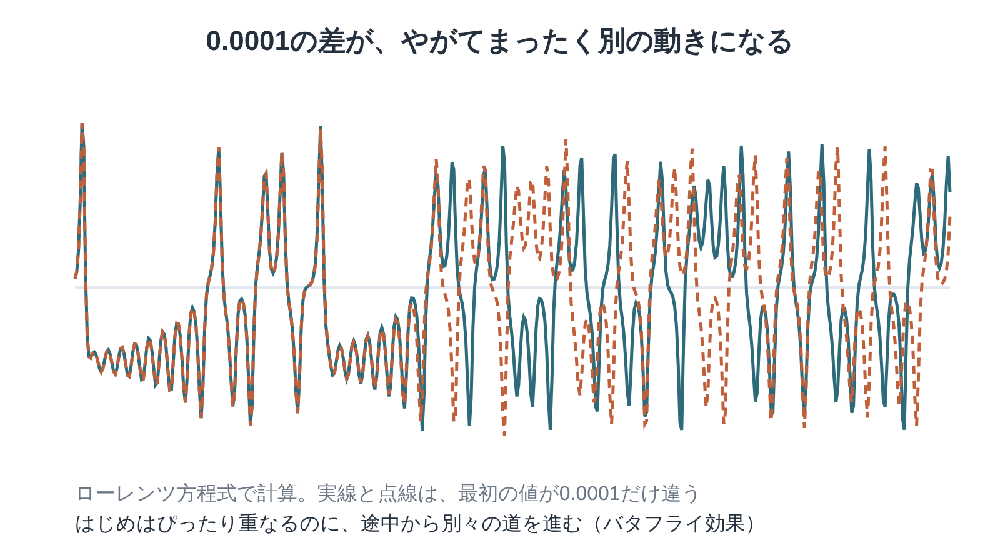

※本記事はアフィリエイト広告を利用しています。

## はじめに

「ブラジルで蝶が羽ばたくと、テキサスで竜巻が起きる」。こんな言葉を、どこかで耳にしたことはありませんか。いわゆる「バタフライ効果」です。

『カオス』は、このふしぎな現象をはじめ、「規則どおりに動いているはずなのに、未来が予測できない」世界を見つけた科学者たちの物語です。

著者のジェイムズ・グリックは科学ジャーナリスト。数式ではなく、人と発見のドラマとして、新しい科学の誕生を描いています。

科学が苦手でも、心配いりません。この記事では、バタフライ効果を実際に計算した図で見ていただきながら、本書のキーワード、読みどころ、そして医療・介護職として考えたことを、やさしくまとめていきます。

文庫で500ページを超える厚さなので、**Kindle（電子書籍）**で少しずつ読み進めるのがおすすめです。

科学者たちの人間ドラマは、**Audible（オーディブル）**で関連する教養書を聴いて背景を知っておくと、ぐっと身近になりますよ。どちらも無料体験があります。

**こんな人に読んでほしい**

- 「バタフライ効果」の本当の意味を、きちんと知りたい方
- 科学の本は苦手だけれど、物語として楽しめる一冊を探している方
- 利用者さんの小さな変化に、日々気を配っている医療・介護職の方
- 天気予報はなぜ外れるのか、ふと疑問に思ったことがある方

---

### 本の概要

| 項目 | 内容 |
|---|---|
| タイトル | 『カオス──新しい科学をつくる』（原題：Chaos: Making a New Science） |
| 著者 | ジェイムズ・グリック（訳：大貫昌子） |
| 出版年月日 | 原著1987年10月29日（Viking）。日本語版は新潮文庫【要確認：日本語版の刊行年】 |
| 出版国 | アメリカ（原著） |
| 出版時の著者の年齢 | 33歳（1954年8月1日生まれ）【要確認：生年月日】 |
| ジャンル | 科学ノンフィクション |
| 本の分量 | 長め（文庫536ページ） |
| 受賞歴 | 原著は全米図書賞、ピュリツァー賞の最終候補に選ばれた |

---

### この本の内容

ニュートン以来、科学者たちは「法則さえ分かれば、未来は計算できる」と信じてきました。天気も、惑星の動きも、正確な式と最初の状態が分かれば予測できるはずでした。

ところが1960年代、気象学者のエドワード・ローレンツは、コンピューターでの天気の計算で、思いがけない結果に出会います。

ほんのわずかな違いが、なぜまったく別の未来につながるのか。その発見から、分野を越えた「カオス」の研究が広がっていく様子が、人間ドラマとして描かれていきます。

👇 **まずは気軽に『カオス──新しい科学をつくる』を手に取ってみよう**

- **目次を確認しながら、刺さった言葉をハイライトで残したい方**
  👉 [Kindle Unlimited 30日間無料体験はこちら](【アフィリエイトURLを入れる】)
- **忙しくて本を開く時間がない方・耳で学びたい方**
  👉 [Audible 30日間無料体験で教養書を聴く](【アフィリエイトURLを入れる】) 【要確認：本書のAudible配信状況】

---

### この本に登場するキーワード

ローレンツの方程式を実際に計算した図です。実線と点線は、出発点がたった0.0001違うだけ。前半はぴったり重なっていますが、ある時点から、まったく別の動きを始めます。

- **カオス**：決まったルール（方程式）に従って動いているのに、長い先の予測がほとんど不可能になる状態。でたらめとは違い、ちゃんと法則はあるんです。
- **初期値鋭敏性（バタフライ効果）**：最初の状態のほんのわずかな違いが、時間とともに大きくふくらんでいく性質。図の2本の線が、その様子を表しています。
- **ストレンジ・アトラクター**：カオスの動きが描く、ふしぎな形の軌跡。毎回同じ道はたどらないのに、全体としては決まった形のまわりを回り続けます。
- **ファイゲンバウム定数**：まったく違う現象から、同じ数字が何度もあらわれることを見つけた発見。カオスの世界にも、共通のルールがひそんでいることを示しました。
- **フラクタル**：マンデルブロが見つけた、部分が全体に似ている形。カオスの軌跡を拡大すると、フラクタルな構造があらわれます。

---

## 図でわかる「バタフライ効果」はどうして起きる？

本書の中でも特に有名なのが、ローレンツの小さな「失敗」のエピソードです。

計算をやり直す手間を省こうと、ローレンツは途中の数字を、0.506127ではなく0.506と、少し丸めて打ち込みました。違いはわずか1万分の1ほど。ところが、しばらくすると、計算された天気はまったく別のものになっていたんです。

上の図は、そのときと同じように、出発点をほんの少しだけずらして計算したものです。最初はほとんど同じなのに、違いが少しずつ大きくなり、ある時点から別々の道を歩き始めます。

ここで大事なのは、計算が「間違っている」わけではないこと。ルールどおりに正しく計算しても、出発点を完璧に知ることはできないから、遠い未来は予測できない。天気予報が数日先までしか当たらない理由も、ここにあります。

---

## 『カオス』世界の見方が変わる3つの場面

※本書は著作権のある作品のため、本文の言葉は原文を確認できたものだけを引用します。【要確認：原文を本で確かめて差し替え】

### 1. 数字を丸めた、その小さなひと手間

> **「【要確認：原文を本で確かめて差し替え】」**
> （グリック『カオス』、ローレンツが計算結果の食い違いに気づく場面より）

コーヒーを飲みに席を外し、戻ってきたら計算結果がまるで違っていた。そんな身近な場面から、科学の大発見が始まります。

天才のひらめきではなく、ちょっとした違和感を見過ごさなかったこと。それが新しい科学の入り口になった、というところに胸が熱くなります。

### 2. 蝶の羽ばたきは竜巻を起こすか

> **「ブラジルで一匹の蝶が羽ばたくと、テキサスで竜巻が起きるか」**
> （エドワード・ローレンツが1972年に行った講演の題名より。本書でも紹介されている）

「バタフライ効果」という言葉が広まるきっかけになった、ローレンツの講演の題名を日本語にしたものです。

蝶が竜巻を「起こす」というより、小さな違いが積み重なって、予測を不可能にしてしまう、という意味。言葉のインパクトが強いぶん、誤解されやすい言葉でもあります。

本書を読むと、この言葉が単なるキャッチコピーではなく、地道な計算と観察から生まれた問いだったことがよく分かります。

### 3. 分野を越えて、同じ「形」が見つかる

> **「【要確認：原文を本で確かめて差し替え】」**
> （グリック『カオス』、多くの分野の研究者がカオスに出会っていく場面より）

気象学、生物学、物理学、数学。まったく別の分野の研究者たちが、それぞれの場所で同じような「ふしぎな振る舞い」に出会っていきます。

最初は周囲に理解されず、孤独な研究を続けた人も少なくありませんでした。分野の壁を越えてつながっていく過程は、まるで群像劇を読んでいるようです。

---

## 『カオス』はどう読む？ 厚い本を楽しむコツ

| 読み方 | ポイント |
|---|---|
| 人物を追いかける | 理論よりも、登場する科学者たちの人柄やエピソードに注目すると、小説のように読み進められる |
| 最初の章だけでも読む | ローレンツの章だけで、バタフライ効果の本質はしっかりつかめる |
| 関連書と行き来する | マンデルブロの『フラクタル幾何学』や、ワールドロップの『複雑系』とあわせると、科学の流れが見えてくる |

---

## 『カオス』を医療・介護職の目で読んで——小さな変化を見逃さないこと、予測しすぎないこと

読み終えていちばん心に残ったのは、「小さな違いが、やがて大きな差になる」というバタフライ効果の考え方でした。これは、ケアの現場で日々感じていることそのものです。

少し食事を残すようになった。歩くときに、ほんの少し足が上がらなくなった。会話の中で、同じ質問が増えた。どれも、その日だけ見れば小さな変化です。けれど、そのまま見過ごしていると、数か月後に転倒や体調の悪化として大きく表れることがあります。

ローレンツが計算結果の小さな食い違いを見過ごさなかったように、私たちも「いつもと少し違う」に気づける目を大切にしたいと思います。

物忘れのような小さな変化が気になったときは、早めの相談が大切です。認知症の進み方や相談先については、[認知症の治療と相談先をまとめた記事](https://site.yanohide.com/posts/dementia-treatment-method)も参考にしてみてください。

一方で、本書は「どれだけ頑張っても、遠い未来は予測しきれない」ことも教えてくれます。

ケアプランを立てるとき、私たちはつい「半年後にはここまで回復する」と見通しを立てたくなります。目標は必要です。ただ、人の体や暮らしは、天気と同じくらい予測が難しいもの。思ったより早く良くなる方もいれば、予想外のことで立ち止まる方もいます。

だからこそ、計画は一度立てたら終わりではなく、こまめに見直すことが欠かせません。カオスの世界では、予測は「数日先まで」が精一杯。介護も、目の前の変化に合わせて舵を切り続けることが大切なんだと思います。

ストレンジ・アトラクターの話も、どこか人の暮らしに似ていると感じました。毎日まったく同じ一日はないのに、その人なりの生活のリズムや「型」は、ちゃんとある。

その型を知っておくことが、「いつもと違う」に気づく土台になります。

朝はゆっくり起きる方なのか、夕方に疲れが出やすい方なのか。そうした一人ひとりの「いつも」が、変化を見つける物差しになるんです。理学療法士として、まずは利用者さんの「いつも」をよく知ることから始めたい。そう改めて思わせてくれた一冊でした。

---

## よくある質問

**Q. 科学の知識がなくても読めますか？**

A. 数式はほとんど出てこず、天気や水道の蛇口のしずくのような身近な例も登場します。科学者たちのエピソードを中心に書かれているので、予備知識がなくても読めます。分からない専門用語は、雰囲気をつかむくらいで読み進めて大丈夫です。

**Q. 「カオス」は「でたらめ」という意味ですか？**

A. 日常語ではそう使われますが、本書の「カオス」は少し違います。決まった法則に従っているのに、長い先の予測ができない状態のことです。でたらめではなく、秩序の中にひそむ予測不能性、と考えると分かりやすいでしょう。

**Q. 『複雑系』（ワールドロップ）とは何が違いますか？**

A. 『カオス』は、単純な法則から予測不能な動きが生まれる現象を中心に描いた本です。

『複雑系』は、たくさんの要素が影響し合って秩序が生まれる仕組みや、それを研究したサンタフェ研究所の人々を描いています。『カオス』を先に読むと、『複雑系』の話がぐっと入りやすくなります。

**Q. 古い本ですが、今読む価値はありますか？**

A. 原著は1987年の刊行ですが、新しい科学が生まれる瞬間を描いた物語としての面白さは色あせていません。その後の複雑系やネットワーク科学につながる出発点を知るのにも、うってつけです。

---

## まとめ

『カオス』のポイントは次の3つです。

1. **決まったルールで動いているのに未来が予測できない「カオス」の発見を、人間ドラマとして描いた科学ノンフィクション**
2. **ローレンツのバタフライ効果をはじめ、小さな違いが大きな差を生む仕組みが分かる**
3. **小さな変化に気づく目と、予測しすぎず柔軟に見直す姿勢を教えてくれる**

まずはローレンツの章だけでも読んでみてください。Kindleなら、気になった科学者の名前をすぐに検索できて便利です。科学の物語にはまったら、Audibleで関連する本を聴いてみるのもいいですよ。

---

💡 **KindleやAudibleを使うなら、Amazonプライムもチェック**

Kindleで本を読んだりAudibleで聴いたりしている方は、すでにAmazonのアカウントをお持ちのはずです。そのまま登録できるAmazonプライムは、読書好きにとってコスパのよいサービスです。

- 📚 **Prime Reading**：対象のKindle本・雑誌・マンガが追加料金なしで読める（Kindle Unlimitedより対象は少なめ）
- 🎬 **Prime Video**：映画・ドラマが見放題
- 🎵 **Amazon Music Prime**：通勤中の音楽やポッドキャストにも
- 📦 **配送料無料**：紙の本を買うときもお得

料金は月額600円、年額なら5,900円（月あたり約492円）です（2026年10月時点）。映画を1〜2本レンタルするのと同じくらいの金額で、読む・観る・聴くがまとめて楽しめます。

※AudibleとKindle Unlimitedはプライムとは別の料金がかかります。

👉 [Amazonプライム 30日間無料体験はこちら](【アフィリエイトURLを入れる】)

---

🎁 **【30日間無料体験】あなたに合った方法で読書を始めよう**

- 🎧 **耳から聴く読書（Audible）**
  プロの朗読で、教養書やビジネス書を耳から学ぶ。無料体験期間中は聴き放題対象作品を楽しめます。
  👉 [Audible（オーディブル）無料体験に登録する](【アフィリエイトURLを入れる】)

- 📖 **スマホ・タブレットで読む（Kindle Unlimited）**
  対象の電子書籍が読み放題。気になった言葉はハイライトで保存できます。
  👉 [Kindle Unlimited 30日間無料体験に登録する](【アフィリエイトURLを入れる】)

- 📕 **紙の本・Kindle版を購入する**
  👉 [『カオス──新しい科学をつくる』をAmazonで見る](【アフィリエイトURLを入れる】)

---

### この記事を書いた人

**矢野英人**｜人生の後半に効く本の案内人

本は読みたい。でも、時間も集中力も続かない。40代半ば、2児の父の私も同じです。

文学部で英文学を学び、リハビリ医療の専門職（理学療法士）に。介護の現場で18年、約1,000人の老いと暮らしを見てきました。

仕事でも家族でも実感したのは、老いも死も、誰にでも必ず来るということ。だから備えは、少しでも早いほうがいい。本を開くなら、人生でいちばん若い今日から。

老後に効くのは、お金と体と、本の貯金。Kindleとオーディブルで、忙しい大人でも続く読み方を紹介しています。

資格：理学療法士／介護支援専門員（ケアマネジャー）／2級FP技能士

---

### 参考情報

- [カオス 新しい科学をつくる（新潮文庫）の感想（読書メーター）](https://bookmeter.com/books/40044)
- [Chaos: Making a New Science（AbeBooks）](https://www.abebooks.com/9780140092509/CHAOS-Making-New-Science-Gleick-0140092501/plp)
- ["Chaos" explores tenets of new scientific theory（Dartmouth Library Archives）](https://archives-manuscripts.dartmouth.edu/repositories/5/archival_objects/629286)
