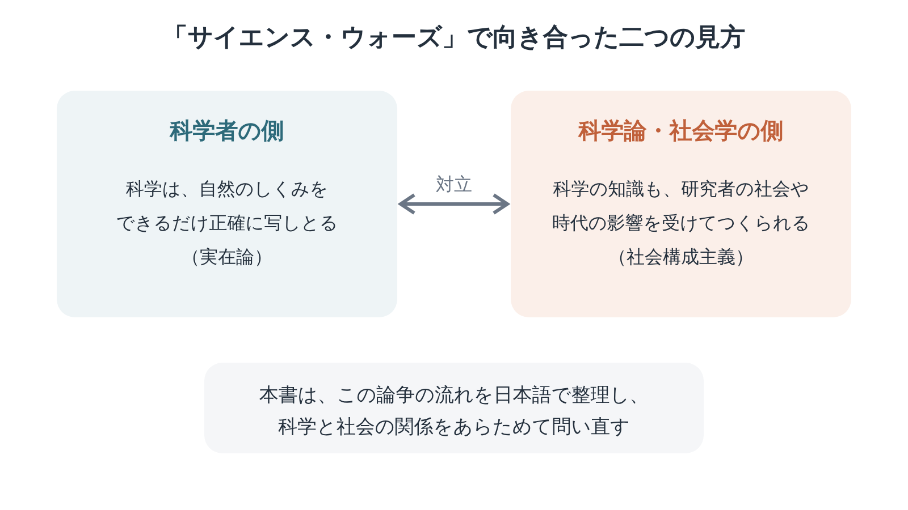

※本記事はアフィリエイト広告を利用しています。

## はじめに

「科学的に正しい」とは何か。1990年代のアメリカでは、この問いをめぐって、学者どうしが「戦争」と呼ばれるほど激しく争いました。

『サイエンス・ウォーズ』は、科学思想史の研究者・金森修さんが、その論争をたどり、科学と社会の関係を問い直した本です。

<!-- 表紙画像：Amazonアソシエイトの画像付きリンクをここに貼る -->

「サイエンス・ウォーズ」は、直訳すると「科学戦争」。武器ではなく、論文と本で戦われた言葉の争いを指します。

この本を読むと、次の3つが見えてきます。

- 科学者と科学論の研究者が、何をめぐって争ったのか
- ソーカル事件が、論争のなかで持った意味
- 科学をあがめず、軽んじもしない付き合い方のヒント

（年を重ねると、「科学的に」と言われて安心する一方で、どこか身構えもする。……健康診断の結果票を前にすると、とくにそうですね。）

日本語で書かれた学術書なので、翻訳書よりは読み進めやすい一冊です。電子版で読むなら、**Kindle**で気になった論点にハイライトを付けながら進めると、あとで振り返れます。

通勤中は**Audible（オーディブル）**で科学史や哲学の入門書を聴き、背景をつかんでおく。硬い学術書も、耳と電子書籍を組み合わせれば手が届きます。どちらも無料体験があります。

**こんな人に読んでほしい**

- 「科学的に正しい」とは何か、一度立ち止まって考えたい方
- 『「知」の欺瞞』を読んで、論争の全体像を知りたくなった方
- 健康情報やニュースの「エビデンス」に振り回されがちな方
- 科学哲学に、日本語の本から入ってみたい方

---

### この記事を書いた人

:::author
name: 矢野英人
tagline: つみたて読書
catch: 〜耳とスマホで自己投資〜
avatarUrl: /avatars/profile-avatar.png

本は読みたい。でも、時間も集中力も続かない。40代半ば、2児の父の私も同じです。

文学部からリハビリ医療の専門職へ。介護の現場で18年、約1,000人の老いを見てきました。

老いは誰にでも来る。それでも、知識は年をとっても伸びるといわれます。お金も教養も、元手は時間。本を開くなら、人生でいちばん若い今日から。

資格：理学療法士／介護支援専門員（ケアマネジャー）／2級FP技能士
:::

---

### 本の概要

| 項目 | 内容 |
|---|---|
| タイトル | 『サイエンス・ウォーズ』 |
| 著者 | 金森修（1954-2016）（科学思想史・フランス哲学の研究者） |
| 出版年月日 | 2000年（東京大学出版会）。2014年に新装版 |
| 出版国 | 日本 |
| 出版時の著者の年齢 | 45〜46歳（1954年札幌生まれ）【要確認：生年月日】 |
| ジャンル | 科学論・科学哲学 |
| 本の分量 | 中くらい〜長め（単行本1冊） |
| 受賞歴 | 2000年 サントリー学芸賞（思想・歴史部門） |

---

### この本の内容

科学者は、自然のしくみをできるだけ正確に明らかにしようとします。科学を外から研究する人たちは、「科学の知識も、社会や時代の影響を受けてつくられる」と考えました。

この二つの見方が、1990年代のアメリカで正面からぶつかります。ソーカル事件も、この流れの中で起きた出来事でした。

（同じ出来事でも、立つ場所が違えば見え方が変わる。職場の会議でも、家族の話し合いでも、よく見かける光景ですね。）

科学は客観的な真理なのか、社会がつくり出したものなのか。**金森さんは、この問いにどんな見取り図を与えたのか。**その中身は、本で確かめてみてください。

:::speech
speaker: 読者
side: left
tone: stone

学術書って、専門家向けで敷居が高そうです……
:::

:::speech
speaker: 矢野英人
side: right
tone: sky

論争の物語として読むと、意外と追いかけやすいですよ。目次から気になる章を一つどうぞ。
:::

👇 **まずは気軽に『サイエンス・ウォーズ』を手に取ってみよう**

- **目次を確認しながら、刺さった言葉をハイライトで残したい方**
  👉 [Kindle Unlimited 30日間無料体験はこちら](【アフィリエイトURLを入れる】)
- **忙しくて本を開く時間がない方・耳で学びたい方**
  👉 [Audible 30日間無料体験で教養書を聴く](【アフィリエイトURLを入れる】) 【要確認：本書のAudible配信状況】

---

### この本に登場するキーワード

左は「科学は自然をありのままに写しとる」と考える科学者の側。右は「科学も人の営みである以上、社会の影響から自由ではない」と考える側です。

（左右どちらにも、うなずける部分がある。年を重ねるほど、どちらか一方に決めるのが難しくなる気がします。）

- **サイエンス・ウォーズ**：1990年代のアメリカで起きた、科学者と科学論の研究者との論争。生物学者グロスと数学者レヴィットが1994年に出した『高次の迷信』が、火種の一つになりました。
- **科学論**：科学そのものを研究の対象にする分野。科学の歴史、哲学、社会学などを含みます。
- **社会構成主義**：知識や事実は、社会の中での人々のやり取りを通じてつくられる、という考え方。科学の知識にもあてはまるのかが、争点になりました。
- **実在論**：私たちの考えとは関係なく世界は存在し、科学はそれをとらえようとしている、という立場です。
- **ソーカル事件**：物理学者ソーカルが思想誌にでたらめな論文を載せ、あとで種明かしをした出来事。論文が載った『ソーシャル・テキスト』の号も、「サイエンス・ウォーズ」という特集でした。

---

## 図でわかる「科学は誰のものか」という問い

:::speech
speaker: 読者
side: left
tone: stone

「社会構成主義」って言われても、正直ピンときません……
:::

:::speech
speaker: 矢野英人
side: right
tone: sky

薬が世に出るまでの道のりで考えると、二つの立場の違いが見えてきますよ。
:::

ある薬が「効く」とわかるまでには、たくさんの研究が重ねられます。その結果は、自然の事実に支えられている。ここは科学者の側の主張です。

どの病気の研究にお金がつくのか。どんな結果が論文になりやすいのか。こちらには社会の事情が関わります。

科学論の側が光を当てたのは、この部分でした。

どちらも、ある意味では正しいのです。

**問題は、どちらか一方だけを極端に押し進めたときに起きました。**「科学は社会の産物にすぎない」と言いすぎれば、科学の成果が軽く扱われる。逆に「科学は社会と無関係だ」と言いきれば、研究の進め方のかたよりが見えなくなります。

（健康番組を見て「やっぱり科学はすごい」と思い、翌週には別の説に首をかしげる。私の中でも、小さな論争がくり返されているようです。）

---

## 『サイエンス・ウォーズ』考えが深まる3つの読みどころ

※本書は著作権のある作品のため、本文の言葉は原文を確認できたものだけを引用します。下の3か所は、お手持ちの本で原文を確かめて差し替えてください。【要確認：原文を本で確かめて差し替え】

### 1. 論争は、なぜ「戦争」になったのか

> **「【要確認：原文を本で確かめて差し替え】」**
> （金森修『サイエンス・ウォーズ』、論争が激しくなった背景を描く部分より）

科学者から見れば、科学の成果を軽く扱われることは、自分たちの仕事を否定されるように感じられました。科学論の側にも、科学を問い直すことには意味がある、という思いがありました。

お互いの言い分を並べると、ただの言い争いではなかったことが見えてきます。**それぞれの誇りと危機感が、正面からぶつかっていた。**

（自分の仕事を外から論じられると、むっとする。その感情までふくめて論争だったと思うと、学者もずいぶん人間くさいですね。）

### 2. ソーカル事件をどう受けとめるか

> **「【要確認：原文を本で確かめて差し替え】」**
> （金森修『サイエンス・ウォーズ』、ソーカル事件を検討する部分より）

『「知」の欺瞞』を読むと、ソーカルの側の言い分がよくわかります。本書は、その出来事を論争全体の流れの中に置き直して考えていく。

一つの事件だけを見て結論を出さず、背景や文脈まで含めて考える。この姿勢そのものが、本書から受け取れることの一つです。

同じ事件を、別の距離から見る。二冊を並べると、その違いがはっきりします。

（ニュースの見出しだけで判断しがちな毎日です。事件の前後を知ると、見え方がひっくり返ることもある。……見出しは短すぎるのかもしれません。）

### 3. 科学と社会の、よりよい関係を探して

> **「【要確認：原文を本で確かめて差し替え】」**
> （金森修『サイエンス・ウォーズ』、科学と社会の関係を考える部分より）

科学をただあがめるのでも、ただ疑うのでもない。成果は尊重しながら、その使われ方や進め方には、社会の一員として目を配る。

そんな付き合い方を考える手がかりが、本書のあちこちに置かれています。どこまでを科学者にまかせ、どこから市民が口を出すのか。線の引き方は、読む人にゆだねられています。

（人生の後半は、医療や科学の判断を迫られる場面が増えていく。まかせきりにも、疑いすぎにもならない距離感を、いまのうちに探しておきたいところです。）

---

## 『サイエンス・ウォーズ』はどんな順番で読むといい？

| 読み方 | ポイント |
|---|---|
| 『「知」の欺瞞』とあわせて | ソーカルの側の主張と、論争全体を整理した本書を読み比べると、立体的に理解できる |
| 科学論の入門として | 日本語で書かれているので、翻訳書が苦手な方でも読みやすい |
| 気になる章から | 論争の歴史、ソーカル事件、科学と社会の関係など、関心のある部分から読んでもよい |

金森さんは、フランス哲学と科学思想史、生命倫理学を専門にした研究者です。医療や命をめぐる問いにも通じる視点が、文章の端々に顔を出します。

（専門の違う人の本を読むと、同じ景色が少し違って見える。読書は、ひとりで開ける小さな多職種会議なのかもしれませんね。）

---

## 『サイエンス・ウォーズ』を医療従事者の目で読んで——エビデンスと、その人の物語のあいだで

読みながら、カンファ（職員どうしの話し合い）の場面を何度も思い出しました。

リハビリや介護の世界でも、根拠に基づいた支援、いわゆるエビデンスに基づく実践が求められています。研究で効果が確かめられた方法を選ぶのは、利用者さんを守るためでもあります。

私もブログでは、確かな根拠を置き、専門用語は読者の言葉に置き換えることを決めごとにしてきました。読みやすくしても、現場の正確さは譲らない。そこは揺らぎません。

それでも、研究の数字だけでは決められない場面は、現場にいくらでもあります。

研究の対象になった人たちと、目の前の90歳の方が同じとは限りません。ご本人は、平均的な効果よりも「家の中を自分で歩きたい」という一点を大事にしていることもある。

（論文の「平均」の中に、目の前の一人はいない。わかっていても、根拠を示さないと計画は通らない。……現場は、毎日が小さなサイエンス・ウォーズです。）

リハビリの専門職としては、根拠のある方法を、その人の目標に合わせて組み立て直す腕が問われます。エビデンスと物語は、対立するというより、組み合わせて使う道具に近い。

本書が描いた論争は、こうした現場の迷いと地続きです。根拠を軽んじれば、効果のない支援でご本人の時間を奪いかねない。根拠だけを押しつければ、ご本人の「こうしたい」が置き去りになります。

リハビリの計画を立てるときも、医学的な見通しと、ご本人やご家族の思いの両方を並べて見ます。正直に言えば、時間に追われて、どちらかが薄くなる日もある。

この迷いは、読者のみなさんにもいずれ来るものかもしれません。親の治療方針、自分の健康診断の結果。数字と気持ちのどちらを信じるか、決めきれない場面です。

認知症についても、まず根拠のある情報を知ることが出発点になります。

科学をあがめすぎず、疑いすぎず。言葉にすると簡単ですが、次のカンファでどちらの声が大きくなるのかは、まだわかりません。

---

## よくある質問

**Q. 科学論の知識がなくても読めますか？**

A. 専門的な用語も出てきますが、日本語で書かれているので、翻訳書よりはとっつきやすいはずです。わからない言葉は、雰囲気をつかむくらいで読み進めて大丈夫です。

**Q. 『サイエンス・ウォーズ』はKindleで読めますか？ オーディブル（Audible）版はありますか？**

A. 電子版や朗読版の有無は、Amazonや東京大学出版会のページで確かめてください。【要確認：サイエンス・ウォーズのKindle版・Audible版】

本書が手に入りにくい形式でも、科学史や科学哲学の入門書をAudibleで聴いておくと、論争の背景が頭に入りやすくなります。倍速で聴き、気になった章だけ本で読み返す方法もあります。

**Q. 科学者の側と科学論の側、どちらが正しいのですか？**

A. 本書は、どちらかに軍配を上げるための本ではありません。白黒をはっきりさせたい方には、もどかしく感じられるかもしれません。読み終えたあと、自分なりの考えを持てることが、いちばんの収穫だと思います。

**Q. 『「知」の欺瞞』とどちらを先に読むべきですか？**

A. ソーカル事件そのものに興味があるなら『「知」の欺瞞』、論争全体の流れを知りたいなら本書からがおすすめです。両方を読むと、同じ出来事が立場によってどう見えるかがわかります。

---

## まとめ

1. **1990年代の「科学は客観的か、社会の産物か」をめぐる論争を、日本語で整理したサントリー学芸賞受賞作**
2. **科学者と科学論、どちらの立場にも決めつけず、科学と社会の関係を考え直せる**
3. **エビデンスと、その人の物語をどう組み合わせるかを考えるきっかけになる**

論争をたどった金森さんが、科学と社会のあいだにどんな橋をかけようとしたのか。その答えは、本の後半で少しずつ見えてきます。

背景はAudibleの入門書で耳から、本書はKindleや紙で気になる章から。『「知」の欺瞞』と行き来しながら読むと、論争が立体的に見えてきます。

（「正しさ」を誰かにまかせきりにしない。それも、老後にじわじわ効いてくる本の貯金なのかもしれません。）

---

💡 **KindleやAudibleを使うなら、Amazonプライムもチェック**

Kindleで本を読んだりAudibleで聴いたりしている方は、すでにAmazonのアカウントをお持ちのはずです。そのまま登録できるAmazonプライムは、読書好きにとってコスパのよいサービスです。

- 📚 **Prime Reading**：対象のKindle本・雑誌・マンガが追加料金なしで読める（Kindle Unlimitedより対象は少なめ）
- 🎬 **Prime Video**：映画・ドラマが見放題
- 🎵 **Amazon Music Prime**：通勤中の音楽やポッドキャストにも
- 📦 **配送料無料**：紙の本を買うときもお得

料金は月額600円、年額なら5,900円（月あたり約492円）です（2026年10月時点）。映画を1〜2本レンタルするのと同じくらいの金額で、読む・観る・聴くがまとめて楽しめます。

※AudibleとKindle Unlimitedはプライムとは別の料金がかかります。

👉 [Amazonプライム 30日間無料体験はこちら](【アフィリエイトURLを入れる】)

---

🎁 **【30日間無料体験】あなたに合った方法で読書を始めよう**

- 🎧 **耳から聴く読書（Audible）**
  プロの朗読で、教養書やビジネス書を耳から学ぶ。無料体験期間中は聴き放題対象作品を楽しめます。
  👉 [Audible（オーディブル）無料体験に登録する](【アフィリエイトURLを入れる】)

- 📖 **スマホ・タブレットで読む（Kindle Unlimited）**
  対象の電子書籍が読み放題。気になった言葉はハイライトで保存できます。
  👉 [Kindle Unlimited 30日間無料体験に登録する](【アフィリエイトURLを入れる】)

- 📕 **紙の本・Kindle版を購入する**
  👉 [『サイエンス・ウォーズ』をAmazonで見る](【アフィリエイトURLを入れる】)

---

### 参考情報

- [サントリー学芸賞 2000年受賞 金森修『サイエンス・ウォーズ』（サントリー文化財団）](https://www.suntory.co.jp/sfnd/prize_ssah/detail/2000sr1.html)
- [金森修の本（ブクログ）](https://booklog.jp/author/%E9%87%91%E6%A3%AE%E4%BF%AE)
- [東京大学 教員の著作を著者自らが語る広場](https://www.u-tokyo.ac.jp/biblioplaza/ja/B_00193.html)
- [金森修 著者紹介（版元ドットコム）](https://www.hanmoto.com/bd/isbn/9784326102525)
- [Higher Superstition（Wikipedia英語版）](https://en.wikipedia.org/wiki/Higher_Superstition)
- [Sokal affair（Wikipedia英語版）](https://en.wikipedia.org/wiki/Sokal_affair)
