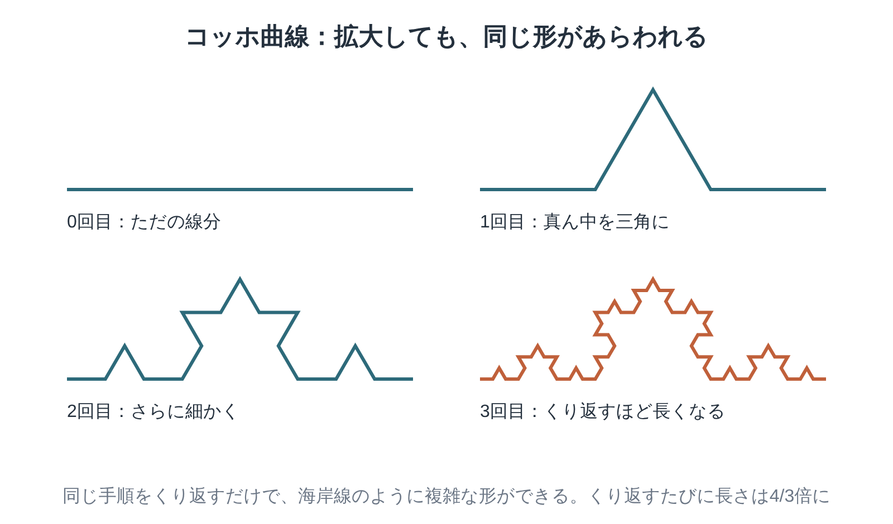

※本記事はアフィリエイト広告を利用しています。

## はじめに

ブロッコリーの一房を手に取ってみてください。小さな房をよく見ると、全体と同じような形をしていますよね。さらに小さな粒も、また同じ形。この「部分が全体に似ている」性質を、数学の言葉で「フラクタル」と呼びます。

『フラクタル幾何学』は、その考え方を世界に広めた数学者ブノワ・マンデルブロの代表作です。雲や山、海岸線のように、定規とコンパスでは描けない「でこぼこした自然の形」を、数学で扱えるようにした一冊です。

正直に言うと、専門的な内容も多い本なんです。でも、全部を理解しなくて大丈夫。この記事では、いちばん大事な考え方を図でかみ砕き、読みどころと読み方のコツ、そして医療・介護職として受け取ったヒントをまとめました。

図版の多い本なので、拡大して眺められる**Kindle（電子書籍）**が便利です。数学の背景をまず耳で知りたい方は、**Audible（オーディブル）**で科学の教養書を聴いてみるのもおすすめ。どちらも無料体験があります。

**こんな人に読んでほしい**

- 「フラクタル」という言葉は知っているけれど、意味をきちんと知りたい方
- 自然の形の美しさに、数学の目から触れてみたい方
- 人を一つの数字や物差しで評価することに、違和感を覚えている医療・介護職の方
- 難しい名著に、一度は挑戦してみたい方

---

### 本の概要

| 項目 | 内容 |
|---|---|
| タイトル | 『フラクタル幾何学』（原題：The Fractal Geometry of Nature） |
| 著者 | B・マンデルブロ（監訳：広中平祐） |
| 出版年月日 | 原著1982年（W. H. Freeman）。日本語版は1985年（日経サイエンス社）、2011年2月にちくま学芸文庫（上下巻） |
| 出版国 | アメリカ（原著） |
| 出版時の著者の年齢 | 57〜58歳（1924年11月20日生まれ、2010年没） |
| ジャンル | 数学・科学の専門書（一般読者向けの記述も多い） |
| 本の分量 | 長め（文庫で上下巻）。ちくま学芸文庫版は出版社で品切れの表示あり |

---

### この本の内容

学校で習う幾何学は、直線や円、三角形といった「なめらかな形」の世界でした。けれど、まわりを見わたすと、自然の形はほとんどがでこぼこしています。

マンデルブロは、そうした不規則な形にも、実は「くり返し」という共通のルールがひそんでいることに気づきました。

海岸線、雲、木の枝、株価のグラフまで。ばらばらに見える自然の形が、一つの考え方でつながっていく。その驚きが、この本には詰まっています。

👇 **まずは気軽に『フラクタル幾何学』を手に取ってみよう**

- **目次を確認しながら、刺さった言葉をハイライトで残したい方**
  👉 [Kindle Unlimited 30日間無料体験はこちら](【アフィリエイトURLを入れる】)
- **忙しくて本を開く時間がない方・耳で学びたい方**
  👉 [Audible 30日間無料体験で教養書を聴く](【アフィリエイトURLを入れる】) 【要確認：本書のAudible配信状況】

---

### この本に登場するキーワード

まっすぐな線の真ん中を、三角形の山に置きかえる。その手順を何度もくり返すと、拡大しても同じ形があらわれる複雑な曲線ができます。これがフラクタルのいちばん分かりやすい例、「コッホ曲線」です。

- **フラクタル**：どこを拡大しても、似たような形がくり返し顔を出す性質のこと。マンデルブロがラテン語の「砕けた」という言葉からつくった言葉です。
- **自己相似**：部分と全体が似ていること。コッホ曲線のように完全に同じ形をくり返すものもあれば、海岸線のように「だいたい似ている」ものもあります。
- **海岸線の長さのパラドックス**：海岸線の長さは、使う物差しの細かさで変わってしまう、という問題。細かい物差しで測るほど、入り江の一つひとつを拾うので、長さはどんどん伸びていきます。
- **フラクタル次元**：線は1次元、面は2次元。でも、ギザギザの海岸線は「1と2のあいだ」の中途半端な次元をもつ、と考えます。どれくらい複雑かを表す物差しです。
- **くり返し（反復）**：単純な手順を何度もくり返すだけで、驚くほど複雑な形が生まれる。図のコッホ曲線は、その代表例です。手順そのものは、小学生でも描けるほど簡単なんですよ。

---

## 図でわかる「海岸線はどれくらい長い？」

先ほどのコッホ曲線を、もう一度見てみてください。手順を1回くり返すごとに、線の長さは4/3倍になります。くり返せばくり返すほど、長さはどこまでも伸びていきます。

これと同じことが、本物の海岸線でも起きるんです。地図の上で1kmの物差しを当てて測るのと、10mの物差しで岩の一つひとつに沿って測るのとでは、結果が大きく違ってきますよね。

つまり、海岸線には「本当の長さ」が一つに決まらないんです。決まっているのは、物差しを細かくしたときに長さがどれくらいのペースで伸びるか、という性質のほう。マンデルブロは、それこそが形の特徴を表すと考えました。

少しふしぎな話ですが、この考え方を知ると、山の稜線や木の枝を見る目が変わります。散歩の途中で、ぜひ「くり返し」を探してみてください。

---

## 『フラクタル幾何学』世界の見え方が変わる3つの言葉

### 1. 雲は球ではない

> **「雲は球ではなく、山は円錐ではなく、海岸線は円ではない。樹皮はなめらかではなく、稲妻はまっすぐには進まない」**
> （マンデルブロ『フラクタル幾何学』冒頭の章より）
>
> 原文：Clouds are not spheres, mountains are not cones, coastlines are not circles,
>
> and bark is not smooth, nor does lightning travel in a straight line.

本書の考え方を、たった一文で言い表した有名な言葉です。日本語は英語原文からの拙訳です。【要確認：日本語版の訳文】

学校の幾何学は、自然を「きれいな形」に近づけて理解しようとしてきました。マンデルブロは、その逆を行きます。でこぼこを、でこぼこのまま理解しようとしたんです。

この一文を読むと、身のまわりの「なめらかでないもの」が、急にいとおしく見えてくるから不思議です。

### 2. 測り方で、長さが変わる

> **「【要確認：原文を本で確かめて差し替え】」**
> （マンデルブロ『フラクタル幾何学』、海岸線の長さを論じる章より）

イギリスの海岸線の長さを例に、測り方によって答えが変わることを示した部分。

当たり前だと思っていた「長さ」という考え方が、ぐらりと揺らぐ瞬間があります。物差しを変えれば、見えてくるものも変わる。数学の話でありながら、ものの見方そのものを問う章です。

### 3. 単純なくり返しが、複雑さを生む

> **「【要確認：原文を本で確かめて差し替え】」**
> （マンデルブロ『フラクタル幾何学』、さまざまなフラクタル図形を紹介する章より）

本書には、単純な手順のくり返しから生まれる、目を見張るような図形がたくさん登場します。

複雑なものの裏には、案外シンプルなルールが隠れているかもしれない。そう思えるだけで、難しい問題に向き合う気持ちが少し軽くなります。

---

## 『フラクタル幾何学』はどう読む？ 挫折しないためのコツ

本書は、数式や専門用語も多い本格的な専門書です。最初から順番に読もうとすると、途中で手が止まってしまうかもしれません。

| 読み方 | ポイント |
|---|---|
| 図版を眺める | まずは数式を飛ばして、図やカラー図版をゆっくり眺める。形の美しさから入るのがいちばんの近道 |
| 冒頭の章だけ読む | 「なぜ自然の形はでこぼこなのか」という問題提起の部分だけでも、本書の芯はつかめる |
| 入門書と組み合わせる | 先に『カオス』（グリック）や『禁断の市場』など一般向けの本を読み、背景をつかんでから戻ってくる |

ちくま学芸文庫版は出版社で品切れの表示があるので、図書館や電子書籍、古書も選択肢に入れてみてください。

---

## 『フラクタル幾何学』を医療・介護職の目で読んで——人を一つの物差しで測らない

数学の本なのに、読みながら何度も利用者さんの顔が浮かびました。いちばん響いたのは、「物差しを変えると、長さが変わる」という海岸線の話です。

リハビリや介護の現場では、歩ける距離、要介護度、テストの点数など、いくつもの数字でその人の状態を表します。数字はとても大切です。ただ、どの物差しを当てるかで、見えてくる姿はまったく変わってしまいます。

たとえば、検査では「歩行距離50m」の方でも、自宅の中では家具を伝いながら、台所や庭まで自分で動いていることがあります。粗い物差しでは見えなかった暮らしの細かな動きが、細かい物差しで見るとたくさん見つかるんです。

以前、一人暮らしの利用者さんの家具の配置を変えたことで、歩行器での室内の移動がぐっと楽になったことがありました。数字の上では小さな変化でも、その方の暮らしの中では大きな意味がありました。

ケアマネとしてケアプランを考えるときも同じです。

要介護度という大きな物差しだけでは、その方が本当に困っていることは見えてきません。朝の着替えに何分かかるのか、どの段差で足が止まるのか。細かい物差しに持ちかえたとき、はじめて支援の手がかりが見つかります。

もう一つ、「部分が全体に似ている」というフラクタルの考え方も心に残りました。

ベッドから起き上がる、靴をはく、お茶をいれる。そんな小さな動作一つに、その方のこれまでの生活や、大切にしてきたことがにじみ出ることがあります。

一つの場面を丁寧に見ることが、その人全体を理解する入り口になる。現場で感じてきたことを、数学の言葉で言い当ててもらったような気がしました。

人の体そのものにも、気管支や血管のように、枝分かれをくり返す形がたくさんあると言われています。私たちは、毎日フラクタルと一緒に生きているのかもしれませんね。

一つの数字で人を判断しない。物差しを持ちかえながら、その人の「でこぼこ」をそのまま受けとめる。難しい本でしたが、ケアの基本に立ち返らせてくれる一冊でした。

---

## よくある質問

**Q. 数学が苦手でも読めますか？**

A. 全部を理解するのは、正直なところ難しいと思います。でも、数式を飛ばして図版と冒頭の章を眺めるだけでも、フラクタルの考え方は十分に味わえます。

**Q. フラクタルは何の役に立つのですか？**

A. 海岸線や山の形の分析、コンピューターグラフィックス、金融市場の研究など、多くの分野で使われてきました。同じ著者の『禁断の市場』は、市場への応用を一般向けに書いた本です。

**Q. どの版で読めばいいですか？**

A. 日経サイエンス社の単行本（1985年）と、ちくま学芸文庫の上下巻（2011年）があります。文庫版は品切れの表示があるため、図書館や古書、電子書籍の有無も確かめてみてください。【要確認：電子書籍の有無】

**Q. 入門としてほかにおすすめの本はありますか？**

A. フラクタルとつながりの深いカオスの話を知るなら、ジェイムズ・グリックの『カオス』が読みやすい一般書です。物語のように科学の歴史をたどれます。

---

## まとめ

『フラクタル幾何学』のポイントは次の3つです。

1. **雲や海岸線のような「でこぼこした自然の形」を、数学で扱えるようにした記念碑的な本**
2. **「部分が全体に似ている」「測り方で長さが変わる」という、ものの見方を変える考え方が詰まっている**
3. **人や物事を一つの物差しで決めつけず、細部から全体を見るヒントをくれる**

まずは図版を眺めるだけでもかまいません。Kindleで図を拡大しながら、気になったページから読んでみてください。科学の教養をもっと広げたくなったら、Audibleで関連する本を探してみるのもいいですよ。

---

💡 **KindleやAudibleを使うなら、Amazonプライムもチェック**

Kindleで本を読んだりAudibleで聴いたりしている方は、すでにAmazonのアカウントをお持ちのはずです。そのまま登録できるAmazonプライムは、読書好きにとってコスパのよいサービスです。

- 📚 **Prime Reading**：対象のKindle本・雑誌・マンガが追加料金なしで読める（Kindle Unlimitedより対象は少なめ）
- 🎬 **Prime Video**：映画・ドラマが見放題
- 🎵 **Amazon Music Prime**：通勤中の音楽やポッドキャストにも
- 📦 **配送料無料**：紙の本を買うときもお得

料金は月額600円、年額なら5,900円（月あたり約492円）です（2026年10月時点）。映画を1〜2本レンタルするのと同じくらいの金額で、読む・観る・聴くがまとめて楽しめます。

※AudibleとKindle Unlimitedはプライムとは別の料金がかかります。

👉 [Amazonプライム 30日間無料体験はこちら](【アフィリエイトURLを入れる】)

---

🎁 **【30日間無料体験】あなたに合った方法で読書を始めよう**

- 🎧 **耳から聴く読書（Audible）**
  プロの朗読で、教養書やビジネス書を耳から学ぶ。無料体験期間中は聴き放題対象作品を楽しめます。
  👉 [Audible（オーディブル）無料体験に登録する](【アフィリエイトURLを入れる】)

- 📖 **スマホ・タブレットで読む（Kindle Unlimited）**
  対象の電子書籍が読み放題。気になった言葉はハイライトで保存できます。
  👉 [Kindle Unlimited 30日間無料体験に登録する](【アフィリエイトURLを入れる】)

- 📕 **紙の本・Kindle版を購入する**
  👉 [『フラクタル幾何学』をAmazonで見る](【アフィリエイトURLを入れる】)

---

### この記事を書いた人

**矢野英人**｜人生の後半に効く本の案内人

文学部で英文学を学んだあと、リハビリの専門職（理学療法士）に転身。介護の現場で18年、約1,000人の老いや病、暮らしと向き合ってきました。

家族の障害や事故を通して、人が何にすがり、どう立ち直るのかも見てきました。文学は、その答えを探すための道具だと思っています。

40代半ば、2児の父。仕事と子育ての合間に、Kindleとオーディブルで古典や教養書を読んでいます。

資格：理学療法士／介護支援専門員（ケアマネジャー）／2級FP技能士

---

### 参考情報

- [フラクタル幾何学 上（ちくま学芸文庫・筑摩書房）](https://www.chikumashobo.co.jp/product/9784480093561)
- [フラクタル幾何学 下（ちくま学芸文庫・筑摩書房）](https://www.chikumashobo.co.jp/product/9784480093578/)
- [The Fractal Geometry of Nature（Wikipedia）](https://en.wikipedia.org/wiki/The_Fractal_Geometry_of_Nature)
- [フラクタル幾何学（物質・材料研究機構 図書館）](https://library.nims.go.jp/manifestations/39252)
