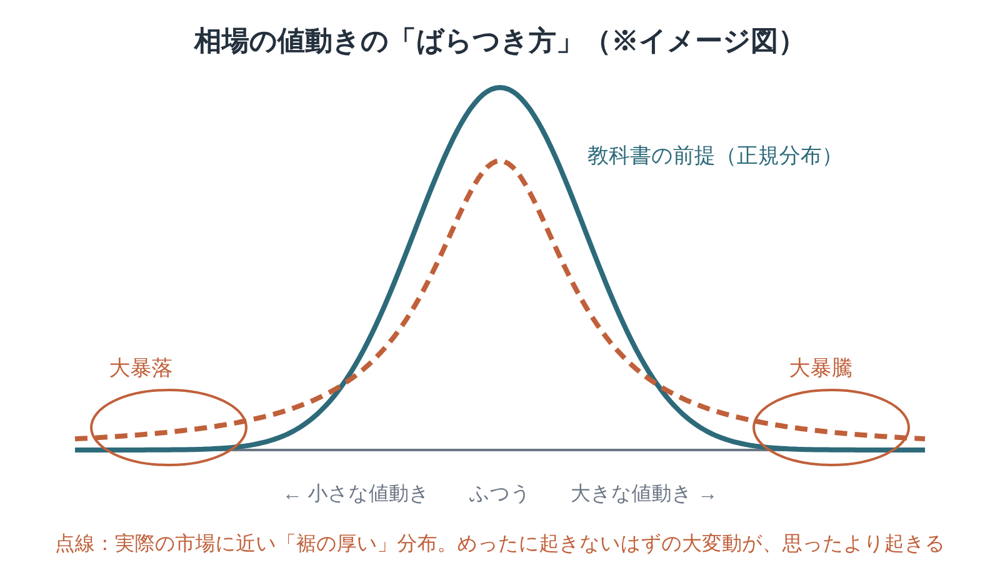

※本記事はアフィリエイト広告を利用しています。

## はじめに

「株価の暴落なんて、百年に一度の出来事でしょう？」。そう思っていたのに、ニュースでは何年かに一度「歴史的な暴落」という言葉を見かけますよね。

『禁断の市場』は、その違和感にまっすぐ答えてくれる本です。

著者は、海岸線や雲の形を数学で表す「フラクタル」を生み出した数学者ブノワ・マンデルブロ。金融の教科書が前提にしてきた「値動きはおとなしく、ほどほどにばらつく」という考え方そのものに、待ったをかけます。

難しそうに聞こえますが、大丈夫です。この記事では、本書の考え方を図でかみ砕き、キーワード、読みどころ、そしてFP2級をもつ医療・介護職として「老後や介護のお金」に引きつけて考えたことをまとめました。

数式はほとんど出てこない一般向けの本です。

分厚さが気になる方は、**Kindle（電子書籍）**で章ごとに少しずつ読むのがおすすめ。移動時間には**Audible（オーディブル）**で経済の教養書を聴く習慣をつくるのもいいですよ。どちらも無料体験があります。

**こんな人に読んでほしい**

- 新NISAなどで投資を始めたけれど、「暴落」が怖くて仕方ない方
- 老後資金や介護費用の備えを、数字の面から考えたい方
- 「想定外」がなぜくり返されるのか、根っこから知りたい方
- フラクタルという言葉を聞いたことはあるけれど、よく分からない方

---

### 本の概要

| 項目 | 内容 |
|---|---|
| タイトル | 『禁断の市場──フラクタルでみるリスクとリターン』（原題：The (Mis)Behavior of Markets） |
| 著者 | ベノワ・B・マンデルブロ、リチャード・L・ハドソン（監訳：高安秀樹／訳：雨宮絵理、高安美佐子、冨永義治、山崎和子） |
| 出版年月日 | 原著2004年。日本語版は2008年6月12日（東洋経済新報社） |
| 出版国 | アメリカ・イギリス（原著） |
| 出版時の著者の年齢 | マンデルブロ79〜80歳（1924年11月20日生まれ、2010年没） |
| ジャンル | 教養書（金融・数学・リスク論） |
| 本の分量 | 中くらい〜長め（単行本1冊） |

---

### この本の内容

金融の世界では長いあいだ、値動きは「おおむね平均のまわりに集まり、極端な動きはめったに起きない」と考えられてきました。保険や投資のリスク計算も、その前提の上に組み立てられています。

ところが現実の相場では、教科書の計算ではほとんど起こらないはずの大暴落が、何度もくり返されてきました。

いったい何が間違っていたのでしょうか。マンデルブロは、数十年にわたる研究から、市場の本当の「ゆれ方」を描き出していきます。

👇 **まずは気軽に『禁断の市場──フラクタルでみるリスクとリターン』を手に取ってみよう**

- **目次を確認しながら、刺さった言葉をハイライトで残したい方**
  👉 [Kindle Unlimited 30日間無料体験はこちら](【アフィリエイトURLを入れる】)
- **忙しくて本を開く時間がない方・耳で学びたい方**
  👉 [Audible 30日間無料体験で教養書を聴く](【アフィリエイトURLを入れる】) 【要確認：本書のAudible配信状況】

---

### この本に登場するキーワード

実線が教科書の前提、点線が実際の市場に近い形です。両端（すそ）の高さの違いが、「めったに起きないはずの大変動」の起こりやすさの違いを表しています。

- **正規分布（ベルカーブ）**：多くの値が平均のまわりに集まり、極端な値はほとんど出ない分布。身長や試験の点数などに当てはまりやすい形です。従来の金融理論は、値動きもこの形だと考えてきました。
- **裾の厚い分布（ファットテール）**：極端な値が、正規分布で考えるよりずっと多く出る分布。図の点線のように、両端がなかなかゼロに近づきません。本書の主張の中心にある考え方です。
- **フラクタル**：一部分を拡大すると、全体と似た形があらわれる性質。マンデルブロは、1日の値動きのグラフと1年の値動きのグラフが、見分けがつかないほど似ていることに注目しました。
- **変動の集中（ボラティリティ・クラスタリング）**：大きな値動きは、ばらばらに起きるのではなく、続けて起きやすい性質。「荒れる時期」と「静かな時期」がかたまって訪れます。
- **長期記憶**：過去の値動きの影響が、思った以上に長く残る性質。今日の相場が、ずっと前の出来事の「余韻」を引きずっていることがあります。
- **リスクとリターン**：もうけ（リターン）を得るには、損をする可能性（リスク）を引き受ける必要がある、という金融の基本。本書は、そのリスクの大きさが従来の計算より大きく見積もられるべきだと説きます。

---

## 『禁断の市場』リスクの見方が変わる3つの読みどころ

※本書は著作権のある作品のため、本文の言葉は原文を確認できたものだけを引用します。下の3か所は、お手持ちの本で原文を確かめて差し替えてください。【要確認：原文を本で確かめて差し替え】

### 1. 「平均」だけ見ていると、大事なものを見落とす

> **「【要確認：原文を本で確かめて差し替え】」**
> （マンデルブロ＆ハドソン『禁断の市場』、従来の金融理論の前提を検証する章より）

平均のリターンが同じでも、その途中でどれだけ大きく揺れるかは、人によってまるで違う体験になりますよね。

本書は、平均やばらつきの「標準的な数字」だけで市場を語ることの危うさを、何度も指摘します。

金融の専門家たちが長く使ってきた計算の土台そのものを問い直しているところに、この本の迫力があります。数字がきれいに整っているほど、その外側にあるものに気づきにくくなるんです。

家計でいえば、「平均的な月の支出」だけで予算を組むと、冠婚葬祭や急な入院の月に足りなくなる。それと同じ構造です。

### 2. 1日のグラフと1年のグラフは、よく似ている

> **「【要確認：原文を本で確かめて差し替え】」**
> （マンデルブロ＆ハドソン『禁断の市場』、値動きのフラクタル性を説明する章より）

1日の細かな値動きと、何年にもわたる大きな値動きを並べると、目盛りを隠せばどちらがどちらか分からない。これが本書の言う「フラクタル」な市場の姿です。

小さなゆれの中に、大きなゆれと同じ形がひそんでいる。だからこそ、小さな波を軽く見てはいけないとも言えます。

この考え方は、同じ著者の代表作『フラクタル幾何学』ともつながっています。気になった方は、ぜひあわせて読んでみてください。

### 3. 荒れるときは、続けて荒れる

> **「【要確認：原文を本で確かめて差し替え】」**
> （マンデルブロ＆ハドソン『禁断の市場』、変動の集中と長期記憶を扱う章より）

市場が大きく動いた翌日は、また大きく動きやすい。静かな日々のあとには、静かな日々が続きやすい。値動きには「荒れ模様の季節」があるという指摘です。

一度の大暴落よりも、荒れる時期が続くことのほうが家計にはこたえます。気持ちが落ち着かないまま判断を重ねてしまうからです。

荒れる時期は必ず来る、と最初から知っておくこと。それだけで、慌てて売ってしまう失敗はぐっと減らせるはずです。

---

## 『禁断の市場』は、どんな人がどう読む？

本書は数式をほとんど使わず、たとえ話や歴史的なエピソードで話が進みます。それでも、金融の基本用語がまったく初めての方には、少しハードルが高く感じられるかもしれません。

| 読み方 | 向いている人 |
|---|---|
| 最初から順に読む | 金融理論の歴史もふくめて、じっくり理解したい人 |
| 図やエピソードの多い章から拾い読み | 「なぜ暴落は思ったより起きるのか」だけ先に知りたい人 |
| 『ブラック・スワン』とセットで読む | リスクの考え方を、数学と哲学の両面から押さえたい人 |

投資の「必勝法」を教えてくれる本ではありません。リスクとの付き合い方を根本から考え直したい人のための一冊です。

---

## 『禁断の市場』を医療・介護職の目で読んで——老後と介護のお金を「すその厚さ」で考える

私はFP2級の資格ももっていて、介護の相談の中でお金の話になることも少なくありません。本書を読んで、まず思い浮かんだのは「介護費用こそ、すその厚い世界だ」ということでした。

介護にかかる期間や費用は、人によって本当に大きく違います。短い期間で済む方もいれば、十年以上続く方もいる。平均の数字だけを見て「これくらい用意しておけば大丈夫」と考えるのは、本書の言う正規分布の思い込みにとても近いんです。

だからこそ、平均ではなく「長引いたらどうなるか」を一度は考えておきたいところです。施設の費用がどれくらいかかるのかは、[老人ホームの費用と、安くするための対策の記事](https://site.yanohide.com/posts/nursinghome-expensive)で具体的にまとめています。

もう一つ心に残ったのは、「荒れるときは続けて荒れる」という指摘です。

介護の現場でも、転倒、入院、認知症の進行と、ご家族にとって大変な出来事が立て続けに起こる時期があります。ひとつ落ち着いたと思ったら、また次がやってくる。そんな「荒れ模様の季節」に、ご家族が疲れ切ってしまうことがあるんです。

本書を読んで、そうした時期は「運が悪かった」のではなく、ある意味で起こりやすいものなのだと捉え直せました。前もって知っていれば、ショートステイや保険外のサービスなど、頼れる先を早めに確保しておくことができます。

ケアマネとしてお伝えしたいのは、落ち着いている時期こそ準備のチャンスだということです。サービス事業所との顔つなぎや、家族の役割分担の話し合いは、波が来てからではなかなか進みません。

投資でも介護でも、大事なのは「平均的な未来」に賭けすぎないこと。想定より大きな波が来ても倒れない余裕を、お金と人のつながりの両方で持っておくこと。数学の本から、思いがけず暮らしの知恵をもらった気がします。

リスクを怖がりすぎる必要はありません。ただ、「めったに起きないはず」の出来事が実はそこまで珍しくない、と知っておくだけで、慌てずにすむ場面はきっと増えるはずです。

---

## よくある質問

**Q. 数学が苦手でも読めますか？**

A. 一般向けに書かれていて、数式はほとんど出てきません。ただ、金融の用語はいくつか出てくるので、分からない言葉は調べながら、図やエピソードを頼りに読み進めるのがおすすめです。

**Q. 投資で勝つための本ですか？**

A. いいえ。値動きの性質を正しく知り、リスクを甘く見積もらないための本です。読み終えると、投資の宣伝文句を少し冷静に眺められるようになります。「確実にもうかる方法」は書かれていませんし、著者もそうした考え方には慎重です。

**Q. 『ブラック・スワン』とはどう違いますか？**

A. 『禁断の市場』は、市場の値動きを数学（フラクタル）の目で分析した本です。『ブラック・スワン』は、予測できない大きな出来事と、それを見落とす人間の考え方のくせを扱った本。テーマは近いので、続けて読むと理解が深まります。

**Q. 古い本ですが、今読んでも役に立ちますか？**

A. 原著は2004年の刊行で、2008年の金融危機より前に書かれています。それでも「大きな変動は思ったより起きる」という指摘は、その後の出来事でむしろ説得力を増したと言えるでしょう。

---

## まとめ

『禁断の市場』のポイントは次の3つです。

1. **市場の値動きは「おとなしいベルカーブ」ではなく、すその厚い分布をしている**
2. **値動きはフラクタルで、荒れる時期はかたまってやってくる**
3. **平均に頼りすぎず、大きな波が来ても倒れない備えを考えさせてくれる**

少し骨のある本なので、まずはKindleの試し読みで冒頭の章をのぞいてみてください。リスクの本をもっと読みたくなったら、Audibleで経済の教養書を聴きながら、次の一冊を探すのも楽しいですよ。

---

💡 **KindleやAudibleを使うなら、Amazonプライムもチェック**

Kindleで本を読んだりAudibleで聴いたりしている方は、すでにAmazonのアカウントをお持ちのはずです。そのまま登録できるAmazonプライムは、読書好きにとってコスパのよいサービスです。

- 📚 **Prime Reading**：対象のKindle本・雑誌・マンガが追加料金なしで読める（Kindle Unlimitedより対象は少なめ）
- 🎬 **Prime Video**：映画・ドラマが見放題
- 🎵 **Amazon Music Prime**：通勤中の音楽やポッドキャストにも
- 📦 **配送料無料**：紙の本を買うときもお得

料金は月額600円、年額なら5,900円（月あたり約492円）です（2026年10月時点）。映画を1〜2本レンタルするのと同じくらいの金額で、読む・観る・聴くがまとめて楽しめます。

※AudibleとKindle Unlimitedはプライムとは別の料金がかかります。

👉 [Amazonプライム 30日間無料体験はこちら](【アフィリエイトURLを入れる】)

---

🎁 **【30日間無料体験】あなたに合った方法で読書を始めよう**

- 🎧 **耳から聴く読書（Audible）**
  プロの朗読で、教養書やビジネス書を耳から学ぶ。無料体験期間中は聴き放題対象作品を楽しめます。
  👉 [Audible（オーディブル）無料体験に登録する](【アフィリエイトURLを入れる】)

- 📖 **スマホ・タブレットで読む（Kindle Unlimited）**
  対象の電子書籍が読み放題。気になった言葉はハイライトで保存できます。
  👉 [Kindle Unlimited 30日間無料体験に登録する](【アフィリエイトURLを入れる】)

- 📕 **紙の本・Kindle版を購入する**
  👉 [『禁断の市場──フラクタルでみるリスクとリターン』をAmazonで見る](【アフィリエイトURLを入れる】)

---

### この記事を書いた人

**矢野英人**｜人生の後半に効く本の案内人

文学部で英文学を学んだあと、リハビリ医療の専門職（理学療法士）に転身。介護の現場で18年、約1,000人の老いや病、暮らしと向き合ってきました。

医療の世界で大切なのは、感覚ではなくファクト（事実と根拠）。全国学会での発表も経験しました。本の紹介でも、研究やデータで裏をとるようにしています。

家族の障害や事故を通して、人が何にすがり、どう立ち直るのかも見てきました。読書は、その答えを探すための道具だと思っています。

老後に効くのは、お金と体と、本の貯金。知識は複利で増えるから、始めるならミドルのうちに。

40代半ば、2児の父。仕事と子育ての合間に、Kindleとオーディブルで古典や教養書を"つみたて"ています。

資格：理学療法士／介護支援専門員（ケアマネジャー）／2級FP技能士

---

### 参考情報

- [禁断の市場（ブックオフオンライン）](https://shopping.bookoff.co.jp/used/0015907081)
- [The (Mis)Behavior of Markets（Microsoft Research）](https://www.microsoft.com/en-us/research/?p=184417)
- [マンデルブロ邦訳リスト（ameqlist）](https://ameqlist.com/sfm/mandelbr.htm)
