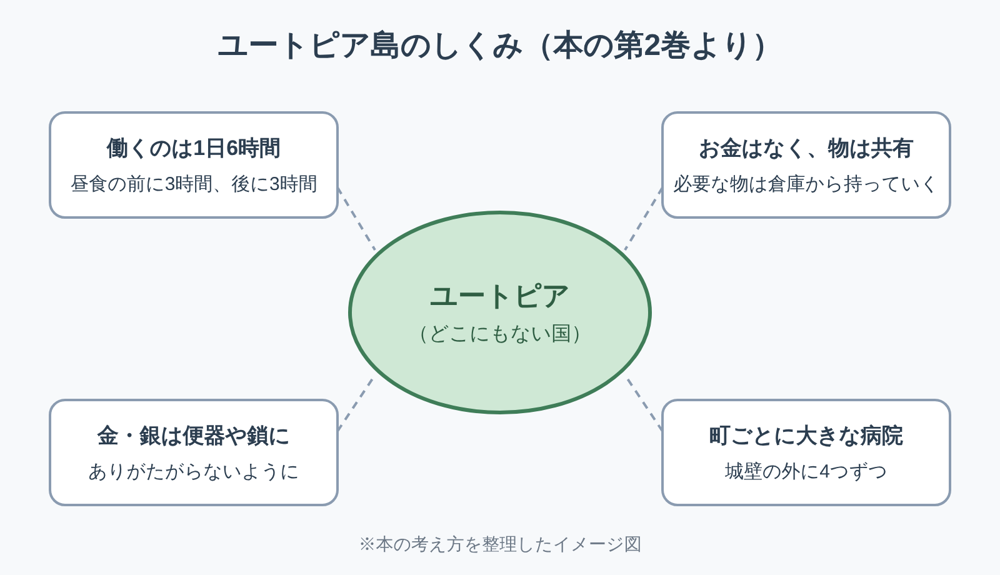

※本記事はアフィリエイト広告を利用しています。

📚 **この記事は、本を読む前の「下読みノート」です。**要点・時代背景・読みどころを先につかんでおくと、オーディオブックでも、Kindleでも、紙の本でも、迷わず効率よく読み進められます。

## はじめに

500年前の本に、「働くのは1日6時間で足りる」と書かれていました。

『ユートピア』は、イングランドの法律家トマス・モアが1516年に出した本です。遠い島の理想の国を語りながら、当時のヨーロッパ社会のおかしさを突いています。

<!-- 表紙画像：Amazonアソシエイトの画像付きリンクをここに貼る -->

「ユートピア」は、モアがギリシャ語からつくった言葉で、「どこにもない場所」という意味です。いまでは「理想郷」を指す言葉として、世界中で使われています。

この本を読むと、わかることは3つです。

- 「羊が人を食う」と言われた、当時の社会のゆがみ
- お金も私有財産もない国の、くらしのしくみ
- 理想を描いたモア本人が、最後に書いた意外な一言

**理想の国の話を読むと、自分の職場の「ここだけは変えたい」が、なぜか一つずつ浮かんでくる。古典の効き目は、案外そんなところにあるのかもしれません。**

文庫で200ページほどの、短めの古典です。

**Kindle（電子書籍）**なら、岩波文庫の平井正穂訳を、スマホで少しずつ読めます。耳で聴ける日本語版は、2026年10月時点で見つかりません。**島のしくみを描いた第2巻から読み始めても、十分に楽しめます。**

**こんな人に読んでほしい**

- 長時間労働や、働き方に疑問を感じている方
- 「ユートピア」という言葉の元になった本を読んでみたい方
- お金と幸せの関係を、少し離れた場所から考えたい方
- 短めの古典から、教養の読書を始めたい方

---

### この記事を書いた人

:::author
name: 矢野英人
tagline: つみたて読書
catch: 〜耳とスマホで自己投資〜
avatarUrl: /avatars/profile-avatar.png

本は読みたい。でも、時間も集中力も続かない。40代半ば、2児の父の私も同じです。

このサイトでは、読む前の「地図」をつくっています。要点と時代背景を先に知っておけば、耳でも、スマホでも、紙でも、短い時間で深く読めます。

文学部からリハビリ医療の専門職へ。介護の現場で18年、約1,000人の老いを見てきました。

老いは誰にでも来る。でも、知識は年をとっても伸びる。始めるなら、人生でいちばん若い今日から。

資格：理学療法士／介護支援専門員（ケアマネジャー）／2級FP技能士
:::

---

### 本の概要

| 項目 | 内容 |
|---|---|
| タイトル | 『ユートピア』（原題：Utopia。ラテン語で書かれた） |
| 著者 | トマス・モア（1478-1535）（訳：平井正穂／澤田昭夫 ほか） |
| 出版年月日 | 1516年12月（ルーヴェンで出版。友人エラスムスらが手伝った） |
| 出版国 | ルーヴェン（現在のベルギー）で出版。著者はイングランドの人 |
| 出版時の著者の年齢 | 38歳（1478年2月7日生まれ） |
| ジャンル | 社会思想・政治哲学（物語の形をとった対話） |
| 本の分量 | 短め（岩波文庫で258ページ） |
| オーディオブック（Audible） | ✕ 日本語の朗読版は見つからず（英語版のみ）（2026年10月時点） |
| Kindle（電子書籍） | ◯ 平井正穂訳（岩波文庫）にKindle版あり（2026年10月時点） |
| 映像作品 | ◯ 関連作：モアの生涯を描いた映画『わが命つきるとも』（1966年） |

---

### この本の内容

外交の仕事でフランドル（いまのベルギーあたり）を訪れたモアは、ラファエル・ヒスロデイという旅人に出会います。新大陸への航海に加わり、遠い島「ユートピア」で5年を過ごしたという男です。

ヒスロデイは、イングランドの社会を厳しく批判します。盗みを死刑にしても、盗みは減らない。そもそも人を盗みに追いこむしくみがある、と。

そして語られるのが、誰もお金を持たず、1日6時間しか働かない島の話です。そんな国が、本当にうまく回るのでしょうか？

**「理想の国」の話は、聞き手の不満を映す鏡にもなる。夢中で聞いているときほど、自分が何に疲れているかがわかってしまいます。**

:::speech
speaker: 読者
side: left
tone: stone

500年前の思想の本なんて、難しすぎて読めない気がします……
:::

:::speech
speaker: 矢野英人
side: right
tone: sky

旅人の話を聞く形なので、意外と読みやすいですよ。第2巻の島の話から読んでも大丈夫です。
:::

👇 **まずは気軽に『ユートピア』を手に取ってみよう**

- **📱 Kindleでスマホから読み、島のしくみをハイライトしたい方**
  👉 [『ユートピア』（岩波文庫）のKindle版をAmazonで見る](【アフィリエイトURLを入れる】)
  👉 [Kindle Unlimited 30日間無料体験はこちら](【アフィリエイトURLを入れる】)
- **📕 紙の文庫で、気になったページに付箋を貼りたい方**
  👉 [『ユートピア』の文庫をAmazonで見る](【アフィリエイトURLを入れる】)

---

### この本に登場する人物

この本は、旅人ヒスロデイの話を、作者モア本人が聞き手となって聞く、対話の形で書かれています。第1巻は議論、第2巻はヒスロデイによる島の紹介が中心です。

- **ラファエル・ヒスロデイ**：話の主役となる旅人で、架空の人物。名前はギリシャ語で「ほら話の名人」といった意味だと言われます。
- **トマス・モア**：作者自身が、聞き手として登場。ヒスロデイの話に耳を傾けつつ、ときどき反論もはさみます。
- **ピーター・ジャイルズ**：アントワープの町の役人で、モアの友人。実在の人物で、モアにヒスロデイを引き合わせます。
- **モートン枢機卿**：ヒスロデイの思い出話に出てくる、実在のイングランドの大司教。少年時代のモアは、この人の屋敷で仕えていました。
- **ユートプス王**：島をつくったとされる伝説の王。陸続きだった土地を掘り割らせて、島にしたと語られます。
- **その他の人々**：モートンの食卓で議論する法律家、言い合いを始める修道士と道化など。

**理想の国の話を、わざと「ほら話の名人」に語らせる。本気なのか冗談なのか、最初から読者を試しているようで、なかなか食えない書き手です。**

---

### この本に登場するキーワード

本の第2巻で語られる島のしくみを、4つにまとめたイメージ図です。どれも、当時のヨーロッパと正反対になるように描かれています。

- **ユートピア**：「どこにもない場所」を意味する、モアの造語。理想郷を指す言葉として広まり、反対の意味の「ディストピア」という言葉も生まれました。
- **1日6時間の労働**：島の人は、昼食の前に3時間、後に3時間だけ働きます。怠け者がおらず、ぜいたく品も作らないので、それで足りるという理屈です。
- **共有の倉庫**：島にはお金がありません。各家の代表が、町の倉庫から必要な物を持っていきます。
- **金と銀**：島では、金や銀を便器や罪人の鎖に使います。人が金をありがたがらないようにするための工夫です。

**金の便器は、ぜいたくの象徴ではなく、金を笑いものにするための道具。発想を逆さにすると、見慣れたものの値打ちがぐらりと揺れますね。**

---

### 作品と執筆時の時代背景

- **社会**：羊毛のために畑を牧場に変える「囲い込み」が進み、村を追われる農民が増えていました。
- **科学技術**：大航海の時代で、アメリゴ・ヴェスプッチの航海記が1507年ごろに印刷され、広く読まれました。
- **流行**：古代の学問を学び直す「人文主義」が広がり、友人エラスムスの『痴愚神礼讃』が1511年に出ています。
- **数字**：『ユートピア』は1516年にラテン語で出版され、英語訳が出たのは35年後の1551年でした。

新しい大陸が見つかり、「世界にはまだ知らない国がある」と信じられた時代です。ヒスロデイも、ヴェスプッチの航海に加わった人物とされています。

この本は、ヨーロッパの学者の共通語だったラテン語で書かれました。出版の翌年の1517年には、ルターが宗教改革の口火を切っています。

のちにモアは、国王ヘンリー8世の離婚と、教会のトップに立つことに反対しました。

そのため1535年に処刑されています。理想の国を描いた人が、現実の国と最後までぶつかった。その事実が、この本を読むときの重さを変えます。

---

## 『ユートピア』500年前の社会を射ぬく3つの言葉

※原作はラテン語で書かれ、著作権が切れています。広く読まれてきた英語訳から引き、日本語は私の訳で添えます。

### 1. 羊が人を食う

> **"your sheep, which are naturally mild, and easily kept in order, may be said now to devour men"**
> （モア『ユートピア』第1巻、ヒスロデイがイングランドを批判する場面より）
> 訳：本来はおとなしく、手のかからない羊が、いまや人を食っていると言える

ヒスロデイが、イングランドで盗みが減らない理由を説明する場面です。地主が羊を飼うために畑を囲い、農民は家も仕事も失う。行き場のない人が盗みに走る、という流れです。

もうかる仕組みが、気づかないうちに人を追い出していく。その構図は、形を変えていまも見かけます。

**数字の上では効率がよくなっても、その分だけ、どこかで誰かの居場所が減っていることがある。決算書に載らない「羊」の存在は、つい見落としがちです。**

### 2. 町ごとに、小さな町ほどの病院

> **"They have belonging to every town four hospitals, that are built without their walls,**
> **and are so large that they may pass for little towns"**
> （モア『ユートピア』第2巻、島の人々の暮らしを語る場面より）
> 訳：どの町にも、城壁の外に4つの病院がある。とても大きく、小さな町と見まちがうほどだ

島の人が、病人をどう世話しているかを語る一節です。病院は広く、必要な物がそろい、腕のいい医者がつきっきりで診ます。家で寝ているより病院に行きたがる人が多い、とまで書かれています。

病院をここまで手厚く描いたところに、モアの考える「豊かさ」がよく表れています。

**理想の国を考えるとき、病院のことまで思いが及ぶ。その細やかさに、500年前の書き手の体温を感じます。**

### 3. 願うけれど、期待はしない

> **"there are many things in the commonwealth of Utopia that I rather wish, than hope"**
> （モア『ユートピア』第2巻の結び、モア自身の感想より）
> 訳：ユートピアの国には、私たちの国でも見たいと願うことが多い。ただ、そうなると期待しているわけではない

ヒスロデイの長い話を聞き終えたモアが、最後に書きとめる言葉です。理想の国をほめちぎって終わるのではなく、少し距離をとって締めくくります。

この一文があるので、「モアは本当にユートピアを理想と考えていたのか」は、いまも研究者のあいだで議論が続いています。

**願うことと、期待することは違う。**この区別は、人生の後半の目標の立て方にも通じる気がします。

**大きな理想は、半分くらいあきらめながら持つと、長持ちする。期待しすぎないことで続けられる願いも、たしかにあるのでしょうね。**

---

## 『ユートピア』はどの翻訳で読む？ 平井訳か澤田訳か

:::speech
speaker: 読者
side: left
tone: stone

訳がいくつかあると、どれを選べばいいか迷ってしまいます。
:::

:::speech
speaker: 矢野英人
side: right
tone: sky

迷ったら、Kindle版がある平井正穂訳からで大丈夫です。あとで別の訳と読み比べるのも楽しいですよ。
:::

| 訳者 | 出版社・レーベル | 特徴 | こんな人に |
|---|---|---|---|
| 平井正穂 | 岩波文庫 | 1957年から読み継がれる定番の訳。Kindle版あり | まず一冊を手軽に読みたい人 |
| 澤田昭夫 | 中公文庫（改版1993年） | イェール大学版の全集を底本にした訳 | 背景まで詳しく知りたい人 |

迷ったら、平井正穂訳のKindle版を試し読みで開いてみてください。第2巻の島の話までたどり着けば、続きを読むかどうかの判断がつきます。

**訳を選ぶのは、旅の案内人を選ぶのに似ている。定番の案内人から始めて、気に入ったら別の人の話も聞く。古典の楽しみ方としては、それで十分です。**

---

## 『ユートピア』を医療従事者の目で読んで——「6時間で足りる」は夢物語か

いちばん引っかかったのは、1日6時間の労働で国が回る、という話です。理由は、怠ける人がおらず、むだな物を作らないから。読みながら、自分の職場の一日を思い浮かべてしまいました。

リハビリや介護の現場は、人手不足が当たり前になっています。記録が終わらず、残業になる日もあります。6時間で帰れる職場は、まさに「どこにもない場所」です。

ただ、モアの理屈には耳が痛いところもあります。むだな会議、二度手間の書類、形だけの決まり。それを減らせば、時間はもう少し生まれるのかもしれません。

**理想の国は遠くても、むだを一つ減らすことなら、明日からでもできる。そのくらいの距離感で読むのが、ちょうどいい気がします。**

島の病院の描き方にも、手が止まりました。広くて、物がそろい、医者がつきっきり。

500年前の人が思い描いた理想の病院に、いまの現場はどこまで近づけているのか。答えはすぐには出ません。せめて、目の前の一人に使える時間を、むだな作業から少しでも取り戻したいところです。

---

## よくある質問

**Q. 『ユートピア』は、オーディブル（Audible）で聴ける？ Kindleで読める？**

A. 日本語の朗読版は、2026年10月時点でAudibleにありません（英語版のみ）。Kindle版は、平井正穂訳の岩波文庫で出ています。

澤田昭夫訳の中公文庫に電子版があるかは、確認できませんでした。【要確認：中公文庫版の電子版】

**Q. 難しいですか？ どれくらいで読めますか？**

A. 文庫で200ページほどなので、1日20ページずつなら10日ほどで読めます。第1巻は議論が多く、少し重め。島の暮らしを描いた第2巻から読むと入りやすいです。

**Q. ユートピアは、本当に理想の国として描かれているのですか？**

A. はっきりした答えはありません。結びでモア自身が距離をとっているため、皮肉として読む人もいます。読む人によって受けとり方が変わるのが、この本の面白さです。

**Q. 映画やドラマはありますか？**

A. 『ユートピア』そのものの映像化は見つかりませんでした。モアの生涯を描いた映画『わが命つきるとも』（1966年）があり、アカデミー賞作品賞を受けています。

---

## まとめ

1. **「羊が人を食う」社会を批判し、遠い島の理想の国を描いた500年前の本**
2. **1日6時間労働、お金のない暮らし、手厚い病院など、いまの働き方にも問いを投げる**
3. **理想を描いたモア自身が、最後にどんな距離をとったのかは、結びで確かめたいところ**

まずはKindleで平井正穂訳を開き、第2巻の島の話から読んでみてください。短い古典なので、通勤の行き帰りでも、半月ほどで最後のページにたどり着けます。

**どこにもない国の話を読んで、いまいる場所を少しだけ良くしたくなる。古典の使い道として、これ以上のものはないのかもしれません。**

---

💡 **Kindleを使うなら、Amazonプライムもチェック**

Kindleで本を読んでいる方は、すでにAmazonのアカウントをお持ちのはずです。そのまま登録できるAmazonプライムは、読書好きにとってコスパのよいサービスです。

- 📚 **Prime Reading**：対象のKindle本・雑誌・マンガが追加料金なしで読める（Kindle Unlimitedより対象は少なめ）
- 🎬 **Prime Video**：映画・ドラマが見放題
- 🎵 **Amazon Music Prime**：通勤中の音楽やポッドキャストにも
- 📦 **配送料無料**：紙の本を買うときもお得

料金は月額600円、年額なら5,900円（月あたり約492円）です（2026年10月時点）。映画を1〜2本レンタルするのと同じくらいの金額で、読む・観る・聴くがまとめて楽しめます。

※Kindle Unlimitedはプライムとは別の料金がかかります。

👉 [Amazonプライム 30日間無料体験はこちら](【アフィリエイトURLを入れる】)

---

🎁 **【30日間無料体験】あなたに合った方法で読書を始めよう**

- 📖 **スマホ・タブレットで読む（Kindle Unlimited）**
  対象の電子書籍が読み放題。気になった言葉はハイライトで保存できます。
  👉 [Kindle Unlimited 30日間無料体験に登録する](【アフィリエイトURLを入れる】)

- 📕 **紙の本・Kindle版を購入する**
  👉 [『ユートピア』をAmazonで見る](【アフィリエイトURLを入れる】)

---

### 参考情報

- [ユートピア（岩波書店。平井正穂訳、1957年刊、258ページ）](https://www.iwanami.co.jp/book/b247178.html)
- [ユートピア（岩波文庫）Kindle版（Amazon.co.jp。Kindle版の根拠）](https://www.amazon.co.jp/dp/B00RF1QD0I)
- [改版 ユートピア（中公文庫・澤田昭夫訳、1993年。紀伊國屋書店）](https://www.kinokuniya.co.jp/f/dsg-01-9784122019911)
- [トマス・モアのオーディオブック（Audible。英語版『Utopia』のみ）](https://www.audible.co.jp/author/%E3%83%88%E3%83%9E%E3%82%B9%E3%83%BB%E3%83%A2%E3%82%A2/B00KJMM92G)
- [Thomas More and his Utopia: The Leuven Connection（The Brussels Times。1516年12月、ルーヴェンでの出版）](https://brusselstimes.com/39946/thomas-more-and-his-utopia-the-leuven-connection)
- [Thomas More's Utopia（Marxists.org。英語訳の本文。6時間労働・病院の記述）](https://www.marxists.org/reference/archive/more/works/utopia/ch6.html)
- [Utopia（Austria-Forum。英語訳の本文。羊の一節と結びの一節）](https://austria-forum.org/web-books/en/utopia00en1516isds/000086)
- [Hospitals in Sir Thomas More's Utopia（Hektoen International。医学史から見た病院の記述）](https://hekint.org/2021/03/02/hospitals-in-sir-thomas-mores-utopia-1516/)
- [Utopian literature（Britannica Kids。囲い込みへの抗議として書かれた）](https://kids.britannica.com/students/article/utopian-literature/277526)
- [More, Sir Thomas（SF Encyclopedia。ヴェスプッチの航海記、『痴愚神礼讃』との関係）](https://sf-encyclopedia.com/entry/more_sir_thomas)
- [Thomas More: Utopia（The Anarchist Library。1551年の英訳、ヴェスプッチの航海記の印刷）](https://theanarchistlibrary.org/library/thomas-more-utopia.html)
- [Raphael Hythloday（Shmoop。名前の意味「ほら話」）](https://www.shmoop.com/study-guides/utopia-more/raphael-hythloday.html)
- [Summary: Hythloday at Cardinal Morton's（SparkNotes。モートン枢機卿の食卓の場面）](https://www.sparknotes.com/philosophy/more/section2/)
- [Utopia（LitCharts。結びの一文の読み方）](https://assets.litcharts.com/lit/utopia/book-2-conclusion)
