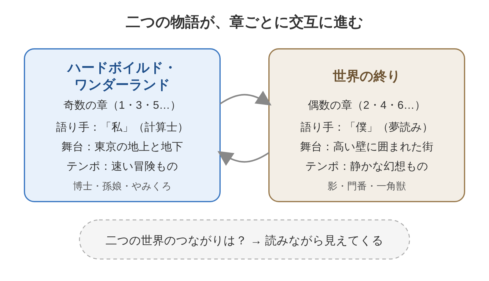

※本記事はアフィリエイト広告を利用しています。

📚 **この記事は、本を読む前の「下読みノート」です。**要点・時代背景・読みどころを先につかんでおくと、オーディオブックでも、Kindleでも、紙の本でも、迷わず効率よく読み進められます。

## はじめに

奇数の章と偶数の章で、まったく別の物語が進んでいく。そんな変わった作りの長編で、村上春樹さんは36歳のときに谷崎潤一郎賞を受けました。

『世界の終りとハードボイルド・ワンダーランド』は、東京の地下をかけまわる「私」と、壁に囲まれた街で暮らす「僕」の物語を、章ごとに入れかえながら描く長編小説です。

<!-- 表紙画像：Amazonアソシエイトの画像付きリンクをここに貼る -->

「ハードボイルド」は、感情をおさえた乾いた語り口の探偵小説のこと。「ワンダーランド」は、ふしぎの国という意味です。題名だけで、二つの世界の手ざわりの違いが伝わってきます。

この本を読むと、わかることは3つです。

- 二つの物語が、なぜ交互に語られるのか
- 心や記憶をなくすとは、どういうことか
- 2023年の新作『街とその不確かな壁』の原点

**記憶をなくす街と、記憶をいじられる男。年をとるにつれて物忘れが増えてくると、この題材は少しだけ他人ごとではなくなりますね。**

**Audible（オーディブル）**では、俳優の大森南朋さんが上下巻を朗読しています。上巻だけで13時間ほどなので、通勤や家事の時間にこつこつ聴くのに向いた長さです。

ややこしい構成も、耳で聴けば章ごとの空気の違いがはっきりわかります。

気になった場面は**電子書籍**で読み返す。がっつり活字に向き合わなくても、この長編の骨組みは十分につかめます。Audibleには無料体験もあります。

**こんな人に読んでほしい**

- 村上春樹の代表作を、ひとつは押さえておきたい方
- ふしぎな話は好きでも、長編を読み切る自信がない方
- 物忘れや「自分らしさ」について、ふと考えることが増えた方
- 新作『街とその不確かな壁』を読む前に、原点を知りたい方

---

### この記事を書いた人

:::author
name: 矢野英人
tagline: つみたて読書
catch: 〜耳とスマホで自己投資〜
avatarUrl: /avatars/profile-avatar.png

本は読みたい。でも、時間も集中力も続かない。40代半ば、2児の父の私も同じです。

このサイトでは、読む前の「地図」をつくっています。要点と時代背景を先に知っておけば、耳でも、スマホでも、紙でも、短い時間で深く読めます。

文学部からリハビリ医療の専門職へ。介護の現場で18年、約1,000人の老いを見てきました。

老いは誰にでも来る。でも、知識は年をとっても伸びる。始めるなら、人生でいちばん若い今日から。

資格：理学療法士／介護支援専門員（ケアマネジャー）／2級FP技能士
:::

---

### 本の概要

| 項目 | 内容 |
|---|---|
| タイトル | 『世界の終りとハードボイルド・ワンダーランド』 |
| 著者 | 村上春樹（1949-） |
| 出版年月日 | 1985年6月15日（新潮社、書き下ろし） |
| 出版国 | 日本 |
| 出版時の著者の年齢 | 36歳（1949年1月12日生まれ） |
| ジャンル | 長編小説 |
| 本の分量 | 長め（新潮文庫で上下2冊） |
| 受賞歴 | 第21回谷崎潤一郎賞（1985年） |
| オーディオブック（Audible） | ◯ あり（朗読：大森南朋。上巻2022年12月、下巻2023年2月配信）（2026年10月時点） |
| Kindle（電子書籍） | ◯ 電子版あり（新潮文庫の上下合本版、2020年12月配信。Kindleでの扱いは要確認）（2026年10月時点） |
| 映像作品 | ✕ なし |

---

### あらすじ

「私」は、データを頭の中で暗号に変える「計算士」です。ある日、謎の老博士に呼ばれ、ゆっくり昇るエレベーターで研究室へ向かいます。そこで頼まれた仕事が、「私」を東京の地下の冒険へ引きこんでいきます。

もう一つの世界では、「僕」が高い壁に囲まれた街にやって来る。街に入るとき、「僕」は自分の影を切りはなされました。図書館で一角獣の頭骨から「古い夢」を読む日々が始まります。

まるで別々に見える二つの物語は、どこで重なっていくのでしょうか？

**片方は銃や地下道が出てくる冒険もの、片方は雪の降る静かな街。2冊の本を交互に読んでいるような、ぜいたくな気分になります。**

:::speech
speaker: 読者
side: left
tone: stone

話が二つあるって、途中で混乱しそうで不安です……
:::

:::speech
speaker: 矢野英人
side: right
tone: sky

朗読で聴くと、章が変わるたびに空気が切りかわるのでわかりやすいですよ。迷ったら下の図を見返してください。
:::

👇 **まずは気軽に『世界の終りとハードボイルド・ワンダーランド』を手に取ってみよう**

- **🎧 忙しくて本を開く時間がない方・耳で物語にひたりたい方**
  👉 [Audible 30日間無料体験で『世界の終りとハードボイルド・ワンダーランド』を聴く](【アフィリエイトURLを入れる】)
- **📱 あらすじを確かめながら、刺さった言葉をハイライトで残したい方**
  👉 [Kindle Unlimited 30日間無料体験はこちら](【アフィリエイトURLを入れる】)【要確認：Kindle版の有無】

---

### 主な登場人物

左が奇数の章、右が偶数の章です。読んでいる章がどちらの世界かを意識するだけで、ぐっと迷いにくくなります。

奇数の章は「私」が、偶数の章は「僕」が語ります。どちらも、その章の主人公自身です。

**ハードボイルド・ワンダーランド（奇数の章）**

- **私**：35歳の計算士。仕事はきっちりこなしますが、どこか世の中から一歩ひいて暮らしています。
- **老博士**：地下に研究室をかまえる科学者。「私」に、ある計算の仕事を頼みます。
- **博士の孫娘**：ピンクの服を着た17歳の少女。「私」を博士のもとへ案内し、冒険にもついてきます。
- **図書館のリファレンス係の女性**：一角獣について調べる「私」を手伝う女性。とてもよく食べます。

**世界の終り（偶数の章）**

- **僕**：壁に囲まれた街に来たばかりの男。図書館で、一角獣の頭骨から古い夢を読む「夢読み」になります。
- **影**：街に入るときに「僕」から切りはなされた影。門番のもとで、別々に暮らすことになります。
- **図書館の女の子**：「僕」の夢読みを手伝う、街の図書館の少女。
- **その他の人々**：街の出入りを見張る門番、「僕」の近くに住む元軍人の大佐、金色の毛の一角獣、東京の地下にひそむ「やみくろ」など。

どちらの世界にも、図書館で働く女性がいます。二人の重なりに気づくと、物語の見え方が少し変わってきます。

**影と別れて暮らす男の話を読むと、自分の影がちゃんと足もとにあるか、つい確かめたくなる。夕方の帰り道だけ、少し長く見えます。**

---

### 作品と執筆時の時代背景

- **社会**：1985年5月、職場での男女の平等をめざす男女雇用機会均等法が成立しました。
- **科学技術**：同じ年、茨城県で「科学万博（つくば万博）」が開かれ、未来の技術が紹介されました。
- **流行**：9月にファミコン用ソフト『スーパーマリオブラザーズ』が発売され、大ヒット。
- **数字**：つくば万博の入場者は、半年でおよそ2,033万人にのぼりました。

コンピューターが会社に入りはじめ、情報が値打ちをもつようになったころです。データを守る「計算士」と、それを盗む「記号士」が争う設定に、その時代の気配がにじんでいます。

この作品は1985年、第21回谷崎潤一郎賞を受けました。もとになったのは、村上さんが1980年に文芸誌に出した中編「街と、その不確かな壁」です。

その中編は、2023年に長編『街とその不確かな壁』として、もう一度書き直されました。40年ちかく、同じ街を書き続けたことになります。

---

## 『世界の終りとハードボイルド・ワンダーランド』二つの世界をつなぐ3つの言葉

※村上春樹さんの作品は著作権が守られています。引用はごく短くし、検索で確かめられなかった言葉は【要確認】として場面だけを書きました。公開前に、お手持ちの本で表記とページを確かめてください。

:::speech
speaker: 読者
side: left
tone: stone

一角獣とか影とか、正直ファンタジーは苦手なんですよね。
:::

:::speech
speaker: 矢野英人
side: right
tone: sky

設定はふしぎでも、描かれているのは「心をなくしたくない」というごく身近な気持ちです。
:::

**ふしぎな設定は、たぶん包み紙のようなもの。中身は、だれでも一度は抱える不安や迷いだったりします。**

### 1. ゆっくり昇るエレベーター

> **「エレベーターはきわめて緩慢な速度で上昇をつづけていた。」**
> （村上春樹『世界の終りとハードボイルド・ワンダーランド』上巻、第1章の書き出しより）【要確認：ページ】

物語の最初の一文です。「私」は、ボタンも表示もない、やけに遅いエレベーターに乗っています。どこへ向かうのか、どれくらいかかるのか、まったくわかりません。

読者もまた、行き先のわからない箱に乗せられて物語へ入っていきます。**待たされる時間そのものが、ふしぎな世界への入り口**になっているのです。

結果をすぐ求めがちな毎日に、この遅さは逆に効きます。急いでも速くならない場面では、落ちついて待つしかありません。

**エレベーターが遅いと、人は自分の人生まで考えはじめる。病院の待合室が妙に哲学的な場所なのも、たぶん同じ理由でしょうね。**

### 2. 切りはなされた影が語ること

> **「【要確認：原文を本で確かめて差し替え】」**
> （村上春樹『世界の終りとハードボイルド・ワンダーランド』、影が「僕」にこの街のおかしさを語る場面より）

街では、影をもつことが許されていません。切りはなされた影は、少しずつ弱っていきます。その影が、「僕」にだけ街のあやしさを打ち明けます。

影は、人の心や記憶の一部のようにも読めます。穏やかで争いのない街は、そのかわりに何かを手ばなした場所なのかもしれない。

**安らぎと引きかえに、何を失うのか。**この問いが、偶数の章の芯にあります。

**悩みのない暮らしは、たぶん楽です。ただ、悩みごと自分の一部を手ばなすとなると、急に惜しくなるから人間はややこしい。**

### 3. 博士が語る、意識の奥の「核」

> **「【要確認：原文を本で確かめて差し替え】」**
> （村上春樹『世界の終りとハードボイルド・ワンダーランド』、博士が「私」に、人の意識の奥にあるものについて説明する場面より）

地下の研究室で、博士は「私」の頭の中で起きていることを語りはじめます。人はだれでも、自分でも見えない心の奥をもっている。その話が、二つの世界をつなぐ大きな手がかりになります。

答えの手前で止めておくと、ここから物語は一気に動きだします。自分のことは、自分がいちばんわかっていない。**その事実に向き合う勇気**を、この場面はそっと問いかけてきます。

**自分の頭の中に、自分の知らない部屋がある。そう考えると、物忘れもちょっとした未知の探検に見えてきます。……鍵の置き場所だけは、探検しないでほしいのですが。**

---

## 『世界の終りとハードボイルド・ワンダーランド』を医療従事者の目で読んで——記憶が薄れても残るもの

私がいちばん長く考えこんだのは、「僕」が一角獣の頭骨から古い夢を読む場面です。街の人が手ばなした心のかけらが、骨の中に静かに残っている。その設定が、認知症の方と関わる時間に重なりました。

認知症では、新しいことから忘れやすく、昔の記憶ほど残りやすいとされています。昨日の昼ごはんは出てこなくても、若いころの仕事の話になると、急に言葉がはっきりする方もいます。

正直に言えば、忙しい日はそうした話をじっくり聞く余裕がありません。リハビリの時間は限られていて、記録も待っています。

**話を聞くのも夢読みの仕事に似ていて、すぐには役に立たない。けれど、本人の顔つきはたしかに変わることがあります。**

私たちが大事にしているのは、本人がわかるように、ていねいに説明することです。内容を覚えていられなくても、そのときに安心できたかどうかは、表情に出ます。

読み終えて、心はどこにしまわれているのか、という問いが残りました。記憶が薄れても、その人の中のどこかで、まだ何かが光っている。そう考えるほうが、現場の実感には近い気がします。

---

## よくある質問

**Q. 大森南朋さんの朗読版はある？ 電子書籍で読むなら、どの版になりますか？**

A. Audibleで、大森南朋さんの朗読による上下巻が配信されています（2026年10月時点）。感情をこめすぎない語り口で、乾いた奇数の章によく合います。

電子書籍は、新潮文庫の上下巻を1冊にまとめた「合本版」が出ています。Kindleストアでの扱いと読み放題の対象かどうかは、購入前にAmazonで確かめてください。【要確認：Kindle版・Kindle Unlimitedの対象か】

**Q. 村上春樹の作品の中で、難しいほうですか？**

A. 設定がこみいっているぶん、最初の数章はとまどうかもしれません。奇数の章と偶数の章で世界が入れかわる、とわかっていれば、あとは冒険小説として読み進められます。

**Q. 『街とその不確かな壁』とは、どちらを先に読むべき？**

A. どちらも、壁に囲まれた街をめぐる物語です。刊行順に、この作品から読むと、村上さんが40年ちかくかけて同じ街をどう書きかえたのかがよく見えてきます。

**Q. 結末は、すっきりしますか？**

A. 結末は書きませんが、きれいに説明しつくす終わり方ではありません。読み終えたあとも、自分ならどうするかを考えつづける余韻が残ります。

---

## まとめ

1. **奇数の章は東京の冒険、偶数の章は壁に囲まれた街。二つの物語が交互に進む**
2. **心や記憶を手ばなすとはどういうことかを、ふしぎな設定で問いかける**
3. **谷崎潤一郎賞の受賞作で、新作『街とその不確かな壁』の原点でもある**

二つの世界がどこで出会うのかは、最後の章まで読んだ人だけが知っています。

まずは大森南朋さんの朗読で上巻の第1章だけ聴いてみる。気に入った一文は電子書籍で探し直す。そんな入り方が、この長編には合っています。

**知識は年をとっても伸びる、と言われると少し安心します。物忘れが増えるぶん、本の貯金で取りかえしておきたいところですね。**

---

💡 **KindleやAudibleを使うなら、Amazonプライムもチェック**

Kindleで本を読んだりAudibleで聴いたりしている方は、すでにAmazonのアカウントをお持ちのはずです。そのまま登録できるAmazonプライムは、読書好きにとってコスパのよいサービスです。

- 📚 **Prime Reading**：対象のKindle本・雑誌・マンガが追加料金なしで読める（Kindle Unlimitedより対象は少なめ）
- 🎬 **Prime Video**：映画・ドラマが見放題
- 🎵 **Amazon Music Prime**：通勤中の音楽やポッドキャストにも
- 📦 **配送料無料**：紙の本を買うときもお得

料金は月額600円、年額なら5,900円（月あたり約492円）です（2026年10月時点）。映画を1〜2本レンタルするのと同じくらいの金額で、読む・観る・聴くがまとめて楽しめます。

※AudibleとKindle Unlimitedはプライムとは別の料金がかかります。

👉 [Amazonプライム 30日間無料体験はこちら](【アフィリエイトURLを入れる】)

---

🎁 **【30日間無料体験】あなたに合った方法で読書を始めよう**

- 🎧 **耳から聴く読書（Audible）**
  大森南朋さんの朗読で『世界の終りとハードボイルド・ワンダーランド』の世界にひたる。無料体験期間中は聴き放題対象作品を楽しめます。
  👉 [Audible（オーディブル）無料体験に登録する](【アフィリエイトURLを入れる】)

- 📖 **スマホ・タブレットで読む（Kindle Unlimited）**
  対象の電子書籍が読み放題。気になった言葉はハイライトで保存できます。
  👉 [Kindle Unlimited 30日間無料体験に登録する](【アフィリエイトURLを入れる】)

- 📕 **紙の本・電子版を購入する**
  👉 [『世界の終りとハードボイルド・ワンダーランド』をAmazonで見る](【アフィリエイトURLを入れる】)

---

### 参考情報

- [世界の終りとハードボイルド・ワンダーランド（Wikipedia日本語版。1985年6月の刊行、谷崎潤一郎賞、二つの世界が交互に進む構成、中編「街と、その不確かな壁」との関係）](https://ja.wikipedia.org/wiki/%E4%B8%96%E7%95%8C%E3%81%AE%E7%B5%82%E3%82%8A%E3%81%A8%E3%83%8F%E3%83%BC%E3%83%89%E3%83%9C%E3%82%A4%E3%83%AB%E3%83%89%E3%83%BB%E3%83%AF%E3%83%B3%E3%83%80%E3%83%BC%E3%83%A9%E3%83%B3%E3%83%89)
- [村上春樹（Wikipedia日本語版。1949年1月12日生まれ）](https://ja.wikipedia.org/wiki/%E6%9D%91%E4%B8%8A%E6%98%A5%E6%A8%B9)
- [Audible版『世界の終りとハードボイルド・ワンダーランド（上）』（Audible。朗読：大森南朋）](https://www.audible.co.jp/pd/%E4%B8%96%E7%95%8C%E3%81%AE%E7%B5%82%E3%82%8A%E3%81%A8%E3%83%8F%E3%83%BC%E3%83%89%E3%83%9C%E3%82%A4%E3%83%AB%E3%83%89%E3%83%BB%E3%83%AF%E3%83%B3%E3%83%80%E3%83%BC%E3%83%A9%E3%83%B3%E3%83%89%EF%BC%88%E4%B8%8A%EF%BC%89-%E3%82%AA%E3%83%BC%E3%83%87%E3%82%A3%E3%82%AA%E3%83%96%E3%83%83%E3%82%AF/B0BPK9RGJ7)
- [世界の終りとハードボイルド・ワンダーランド（上）Audible版（Amazon。再生時間13時間2分）](https://www.amazon.co.jp/dp/B0BPK9MQVP)
- [Audible 村上春樹4作品がオーディオブックに追加（livedoorニュース。上巻は2022年12月28日配信）](https://news.livedoor.com/article/detail/23381692/)
- [Audibleの村上春樹作品（PHILE WEB、2023年2月1日。下巻の配信開始）](https://www.phileweb.com/sp/news/hobby/202302/01/6160.html)
- [世界の終りとハードボイルド・ワンダーランド(上下)合本版（新潮社。電子書籍、2020年12月18日配信）](https://www.shinchosha.co.jp/ebook/E047861/)
- [世界の終りとハードボイルド・ワンダーランド〔下〕（新潮社。新潮文庫）](https://www.shinchosha.co.jp/book/100158/)
- [『世界の終りとハードボイルド・ワンダーランド』を読む2（Costa Rica 307。第1章冒頭のエレベーターの一文）](https://riktoh.hatenablog.com/entry/2024/12/20/135800)
- [男女雇用機会均等法（Wikipedia日本語版。1985年5月成立）](https://ja.wikipedia.org/wiki/%E7%94%B7%E5%A5%B3%E9%9B%87%E7%94%A8%E6%A9%9F%E4%BC%9A%E5%9D%87%E7%AD%89%E6%B3%95)
- [国際科学技術博覧会（Wikipedia日本語版。つくば万博、入場者約2,033万人）](https://ja.wikipedia.org/wiki/%E5%9B%BD%E9%9A%9B%E7%A7%91%E5%AD%A6%E6%8A%80%E8%A1%93%E5%8D%9A%E8%A6%A7%E4%BC%9A)
- [スーパーマリオブラザーズ（Wikipedia日本語版。1985年9月発売）](https://ja.wikipedia.org/wiki/%E3%82%B9%E3%83%BC%E3%83%91%E3%83%BC%E3%83%9E%E3%83%AA%E3%82%AA%E3%83%96%E3%83%A9%E3%82%B6%E3%83%BC%E3%82%BA)

矢野英人
