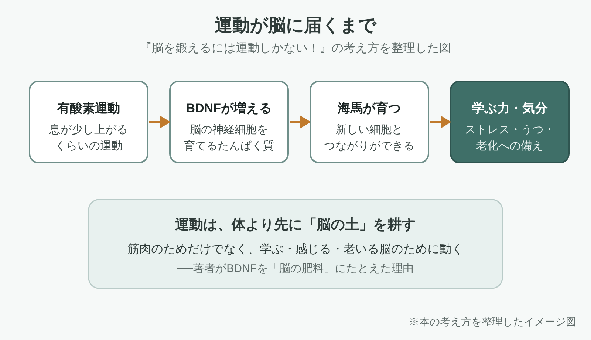

※本記事はアフィリエイト広告を利用しています。

📚 **この記事は、本を読む前の「下読みノート」です。**要点・時代背景・読みどころを先につかんでおくと、オーディオブックでも、Kindleでも、紙の本でも、迷わず効率よく読み進められます。

## はじめに

脳にいちばん効くのは、パズルでも計算ドリルでもなく、息が上がる運動かもしれません。

『脳を鍛えるには運動しかない！』は、アメリカの精神科医ジョン J. レイティさんが、運動で脳が育つしくみを研究から説いた本です。2008年に原書が出て、日本語版は2009年にNHK出版から出ました。

<!-- 表紙画像：Amazonアソシエイトの画像付きリンクをここに貼る -->

体のための運動、という常識が、この本で裏返ります。走ると、まず脳が変わる。著者はそう言い切ります。

この本を読むと、わかることは3つです。

- 運動が脳の神経細胞を育てるしくみ
- ストレスやうつ、ADHDと運動の意外な関係
- 年をとっても脳がおとろえにくい動き方

**健康診断の数字より、もの忘れのほうが気になりだす年ごろがある。体のためでは腰が重くても、脳のためと言われると、少し話が変わってきますね。**

単行本で345ページ。研究の話が多く、活字だけだと少しほねが折れます。

**Audible（オーディブル）**なら朗読は約13時間なので、通勤の行き帰りで2週間ほど。ページを全部めくらなくても、「明日は少し歩こう」と思えたら元は取れます。

事例の章は耳で聴き、BDNFなど用語の多い章だけ**Kindle（電子書籍）**で読み返すと楽です。どちらも無料体験から始められます。

**こんな人に読んでほしい**

- 運動不足は気になるのに、動く理由が見つからない方
- 40代に入り、集中力やもの覚えのおとろえにあせりを感じている方
- ストレスや気分の落ちこみを、薬以外の方法でも整えたい方
- 親の物忘れや、自分の老後の脳が心配な方

---

### この記事を書いた人

:::author
name: 矢野英人
tagline: つみたて読書
catch: 〜耳とスマホで自己投資〜
avatarUrl: /avatars/profile-avatar.png

本は読みたい。でも、時間も集中力も続かない。40代半ば、2児の父の私も同じです。

このサイトでは、読む前の「地図」をつくっています。要点と時代背景を先に知っておけば、耳でも、スマホでも、紙でも、短い時間で深く読めます。

文学部からリハビリ医療の専門職へ。介護の現場で18年、約1,000人の老いを見てきました。

老いは誰にでも来る。でも、知識は年をとっても伸びる。始めるなら、人生でいちばん若い今日から。

資格：理学療法士／介護支援専門員（ケアマネジャー）／2級FP技能士
:::

---

### 本の概要

| 項目 | 内容 |
|---|---|
| タイトル | 『脳を鍛えるには運動しかない！ 最新科学でわかった脳細胞の増やし方』（原題：Spark: The Revolutionary New Science of Exercise and the Brain） |
| 著者 | ジョン J. レイティ（1948-）、エリック・ヘイガーマン（生年【要確認】）（訳：野中香方子） |
| 出版年月日 | 原書：2008年1月10日（Little, Brown）。日本語版：2009年3月20日（日本放送出版協会＝現NHK出版） |
| 出版国 | アメリカ |
| 出版時の著者の年齢 | レイティ：原書の刊行時に59〜60歳ごろ（1948年生まれ）【要確認：生年月日】 |
| ジャンル | 脳科学・健康の教養書 |
| 本の分量 | 345ページ（単行本）／中くらい〜やや長め |
| オーディオブック（Audible） | ◯ あり（朗読：井上智博、約13時間19分）（2026年10月時点） |
| Kindle（電子書籍） | ◯ あり（2026年10月時点） |
| 映像作品 | ✕ なし |

---

### この本の内容

著者のレイティさんは、ハーバード大学医学部で精神医学を教えてきた精神科医です。ADHD（注意欠如・多動症）の本でも知られています。

はじまりは、イリノイ州ネーパーヴィルの学校で始まった、授業前の朝の体育でした。運動した生徒の成績がのびたのは、なぜなのか。著者は脳の研究をたどり、学習・ストレス・うつ・加齢まで話を広げます。

運動は、脳の中で何をしているのでしょうか？

**体育の時間は、勉強の時間を削るもの。子どものころそう思っていた側から見ると、なかなか痛い話の始まり方です。**

:::speech
speaker: 読者
side: left
tone: stone

運動の本って、結局「毎日走れ」で終わる気がして、手が伸びないんですよね……
:::

:::speech
speaker: 矢野英人
side: right
tone: sky

この本の主役は筋肉より脳です。まずは耳で、朝の体育の章だけ聴いてみてください。
:::

👇 **まずは気軽に『脳を鍛えるには運動しかない！』を手に取ってみよう**

- **通勤や家事の合間に、耳で研究の話をつかみたい方**
  👉 [Audible 30日間無料体験で『脳を鍛えるには運動しかない！』を聴く](【アフィリエイトURLを入れる】)
- **用語を確かめながら、気になった一文をハイライトで残したい方**
  👉 [Kindle Unlimited 30日間無料体験はこちら](【アフィリエイトURLを入れる】)
- **📕 紙の本で、付箋を貼りながら読みたい方**
  👉 [『脳を鍛えるには運動しかない！』をAmazonで見る](【アフィリエイトURLを入れる】)

---

### この本に登場するキーワード

左から右へ、運動のききめが脳に届く順番を並べました。本の中心は、2つ目の箱のBDNFです。

:::speech
speaker: 読者
side: left
tone: stone

BDNFとか海馬とか、カタカナと漢字だらけで難しそうです。
:::

:::speech
speaker: 矢野英人
side: right
tone: sky

「運動すると、脳の肥料が増える」。最初はこの一行だけ覚えておけば十分です。
:::

- **BDNF（脳由来神経栄養因子）**：脳の神経細胞を育て、つながりを強くするたんぱく質。著者はこれを「脳の肥料」にたとえ、運動で増えると説明します。
- **海馬**：もの覚えや学びにかかわる脳の部分。新しい神経細胞が生まれる場所として、本の中でくり返し登場します。
- **ネーパーヴィルの朝の体育**：1時間目の前に行う体育の授業。心拍計をつけて走る生徒たちの姿が、本の第1章を飾ります。
- **悩み別の章立て**：学習、ストレス、不安、うつ、注意欠陥障害、依存症、ホルモンの変化、加齢。運動がそれぞれにどう働くかを、1章ずつ見ていきます。

身も蓋もない事実も一つ。BDNFの研究の多くは動物実験です。「脳の肥料」という比喩は、人の脳への効果を大きく見せすぎると批判する研究者もいます。

**「肥料」と聞くと、まいた分だけ育つ気がしてしまう。家庭菜園でも、肥料をやりすぎて枯らす人がいるのですが。**

---

### 作品と執筆時の時代背景

- **社会**：2008年9月、米投資銀行リーマン・ブラザーズが破綻し、世界的な金融危機が広がりました。
- **科学技術**：2007年に米国で初代iPhoneが登場し、2008年7月には日本でもiPhone 3Gが発売されました。
- **流行**：日本では2005年発売のゲーム「脳トレ」が大ヒットし、「脳を鍛える」が身近な言葉になっていた時期です。
- **数字**：2007〜2008年、米国の成人の肥満率は33.8%で、およそ3人に1人にあたります。

原書が出た2008年のアメリカは、座りっぱなしの暮らしと肥満が大きな社会問題でした。体育を「脳のための授業」として見直す本の書き出しは、そうした空気への反論になっています。

日本語版は2009年3月に出ました。脳トレの余韻が残るなかで、「脳を鍛える」には体を動かすことだと説く題は目を引きます。

その後も版を重ね、紙と電子をあわせて14万部をこえたと出版社が発表しました。2023年10月の増刷のときには、15万部をこえるロングセラーと紹介されています。

---

## 『脳を鍛えるには運動しかない！』読み終えると歩きたくなる3つの言葉

※著作権のある作品のため、引用は確かめられた短い言葉にとどめます。残りは本で原文を確かめて差し替えてください。

### 1. BDNFは「脳の肥料」

> **「Miracle-Gro for the brain」（脳のための肥料）**
> （John J. Ratey『Spark』原書より。訳は筆者。Miracle-Groはアメリカで有名な園芸用肥料の商品名）

本のまんなかにある比喩です。著者は、運動で増えるたんぱく質BDNFを、植物をぐんぐん育てる肥料にたとえました。日本語版でどう訳されているかは、本で確かめてください。

むずかしい物質の名前が、このたとえ一つで急に身近になります。脳は生まれつき決まったもの、という思いこみがゆらぐ一言でもあります。

ふだんの暮らしなら、「運動は脳に水やりをする時間」と考えると続けやすいかもしれません。体重計の数字が動かない日にも、やる意味が残るからです。

**数字が変わらないと続かないのは、ダイエットも貯金も同じ。目に見えない脳の残高なら、毎日少しずつ積み立てた気になれそうです。**

### 2. うつと運動

> **「【要確認：原文を本で確かめて差し替え】」**
> （ジョン J. レイティ『脳を鍛えるには運動しかない！』第5章（うつ）より）

うつの章で、運動が気分の落ちこみにどう働くかを語る一節を入れる予定の場所です。著者は精神科医として、運動を治療の一部に組みこむ考えを示します。

運動さえすれば薬はいらない、という話ではありません。薬や心理療法と並ぶ選択肢の一つとして、運動を見直そうという主張です。

気分が沈む日は、動く気力そのものがわいてきません。そんな日に「10分だけ外を歩く」くらいの低い目標を置く。この章は、その小さな一歩の意味を教えてくれます。

**落ちこんでいる人に「運動しなよ」と言うのは簡単で、言われた側はたいてい腹が立つ。言い方の練習のほうが、運動より難しいのかもしれません。**

### 3. 年をとっても脳は育つ

> **「【要確認：原文を本で確かめて差し替え】」**
> （ジョン J. レイティ『脳を鍛えるには運動しかない！』第9章（加齢）より）

加齢の章で、年をとった脳にも運動が効くと述べる一節を入れる予定の場所です。著者は、老いを止めることはできなくても、遅らせる手はあると考えます。

脳のおとろえは年とともに避けられない、と思いこんでいる人は多いでしょう。この章は、その思いこみに研究で答えようとします。

人生の後半のそなえというと、お金の話が先に立ちます。けれども、体を動かす習慣も、早く始めるほど効いてくる「積み立て」の一つです。

**老後の資金は計算できるのに、老後の脳の残高は誰も教えてくれない。通帳があれば、もう少し真面目に歩く気もします。**

---

## 13時間の朗読を、挫折せずに聴き切るコツ

:::speech
speaker: 読者
side: left
tone: stone

13時間って長いですね。途中で飽きてしまいそうです。
:::

:::speech
speaker: 矢野英人
side: right
tone: sky

ぜんぶを順番に聴かなくて大丈夫です。自分の悩みに近い章から聴いてみてください。
:::

この本は、第1章で全体の話をしたあと、悩み別に章が分かれています。ストレスが気になるなら第3章、親の老いが気になるなら第9章、というように選べます。

耳で聴くときは、1.2倍くらいの速さがおすすめです。研究者の名前や数字は聞きながして、「何をしたら、脳の何が変わったか」だけを追いかけると迷いません。

気になった章は、Kindleでもう一度読む。用語や数字は、目で見たほうが頭にのこります。

**本を読み終えたら運動する、と決めると一生運動しない気がする。聴きながら歩けば、読書と運動を同時に片づけられますね。**

---

## 『脳を鍛えるには運動しかない！』を医療従事者の目で読んで——「動いたほうがいい」の、その先

いちばん引っかかったのは、運動が筋肉より先に、気分や意欲を変えるという主張です。リハビリの専門職として入所・通所・訪問の場で歩く練習にかかわってきた私には、うなずける部分と、そう簡単ではない部分の両方がありました。

現場では「動いたほうがいいのはわかっているんだけど」という声を耳にすることがあります。ひざの痛み、息切れ、持病、その日の気分。本が理想とする、心拍数をしっかり上げる運動を、そのまま高齢の方に当てはめるのは無理な日も多いのです。

**理想の運動量と、今日の体調のあいだ。現場の仕事は、ほとんどそのすき間で起きている気がします。**

それでも、この本の説明の仕方からは学ぶことがありました。BDNFを「脳の肥料」と言い換える。根拠を置いたうえで、相手の言葉に置き換える工夫です。

介護予防のセミナーでも、「転ばないため」だけでは動く理由になりにくいことがあります。「頭のためにも」という一言が、腰を上げるきっかけになるのかもしれません。

比喩が強すぎると「歩けば認知症にならない」と受け取られかねません。認知症の進行を遅らせる方法は、運動のほかにもいくつもあります。現場の正確さは、ゆずれないところです。

40代の私たちの脳には、今日の通勤の階段が、どれくらい効いているのでしょうか。

---

## よくある質問

**Q. 『脳を鍛えるには運動しかない！』は、オーディブル（Audible）やKindleで読めますか？**

A. どちらもあります（2026年10月時点）。Audible版は井上智博さんの朗読で、約13時間19分です。

Kindle版もNHK出版から出ています。聴き放題・読み放題の対象かどうかは時期で変わるので、登録前に商品ページで確かめてください。【要確認：聴き放題・読み放題の対象か】

**Q. 理系の知識がなくても読めますか？**

A. 読めます。脳の物質の名前はたくさん出てきますが、学校や患者さんの具体的なエピソードが多く、話の筋は追いやすい本です。1日1章のペースなら、10日ほどで読み終えられる量です。

**Q. アンデシュ・ハンセン『運動脳』とは、どう違いますか？**

A. どちらも運動と脳の関係を扱った本です。この本は、学習・ストレス・うつ・ADHD・依存症・加齢と、悩みごとに章が分かれているのが特徴です。気になる症状がはっきりしている方は、こちらから読むと目当ての章にすぐたどり着けます。

**Q. 高齢の親にすすめても大丈夫ですか？**

A. 加齢の章は、親の世代にも読んでほしい内容です。持病があって息が上がる運動が心配なときは、始める前にかかりつけ医に相談してください。

---

## まとめ

1. **運動はBDNF（脳の肥料）を増やし、海馬など脳の土台を育てる、と説く本**
2. **学習・ストレス・うつ・ADHD・加齢と、悩み別の章から読める**
3. **どれくらいの運動を、どれくらい続ければよいか。著者の答えは最終章にあります**

まずはAudibleで、自分の悩みに近い章を一つ聴いてみてください。気になった数字や用語は、Kindleで読み返すと定着します。

**脳の貯金は、本と散歩の両方で増やせる。この本を聴きながら歩けば、利回りは2倍ということで。**

---

💡 **KindleやAudibleを使うなら、Amazonプライムもチェック**

Kindleで本を読んだりAudibleで聴いたりしている方は、すでにAmazonのアカウントをお持ちのはずです。そのまま登録できるAmazonプライムは、読書好きにとってコスパのよいサービスです。

- 📚 **Prime Reading**：対象のKindle本・雑誌・マンガが追加料金なしで読める（Kindle Unlimitedより対象は少なめ）
- 🎬 **Prime Video**：映画・ドラマが見放題
- 🎵 **Amazon Music Prime**：通勤中の音楽やポッドキャストにも
- 📦 **配送料無料**：紙の本を買うときもお得

料金は月額600円、年額なら5,900円（月あたり約492円）です（2026年10月時点）。映画を1〜2本レンタルするのと同じくらいの金額で、読む・観る・聴くがまとめて楽しめます。

※AudibleとKindle Unlimitedはプライムとは別の料金がかかります。

👉 [Amazonプライム 30日間無料体験はこちら](【アフィリエイトURLを入れる】)

---

🎁 **【30日間無料体験】あなたに合った方法で読書を始めよう**

- 🎧 **耳から聴く読書（Audible）**
  プロの朗読で『脳を鍛えるには運動しかない！』の世界に浸る。無料体験期間中は聴き放題対象作品を楽しめます。
  👉 [Audible（オーディブル）無料体験に登録する](【アフィリエイトURLを入れる】)

- 📖 **スマホ・タブレットで読む（Kindle Unlimited）**
  対象の電子書籍が読み放題。気になった言葉はハイライトで保存できます。
  👉 [Kindle Unlimited 30日間無料体験に登録する](【アフィリエイトURLを入れる】)

- 📕 **紙の本・Kindle版を購入する**
  👉 [『脳を鍛えるには運動しかない！』をAmazonで見る](【アフィリエイトURLを入れる】)

---

### 参考情報

- [脳を鍛えるには運動しかない！（版元ドットコム。ISBN 9784140813539、日本放送出版協会）](https://www.hanmoto.com/bd/isbn/9784140813539)
- [脳を鍛えるには運動しかない！（カーリル。2009年3月20日、345ページ）](https://calil.jp/book/4140813539)
- [脳を鍛えるには運動しかない！（CiNii Books。345, 5p、原著2008年の翻訳）](https://ci.nii.ac.jp/ncid/BA89614538)
- [脳を鍛えるには運動しかない！（紀伊國屋書店ウェブストア。目次）](https://www.kinokuniya.co.jp/f/dsg-01-9784140813539)
- [Audible版『脳を鍛えるには運動しかない！ 最新科学でわかった脳細胞の増やし方』（audible.co.jp。朗読者・配信の根拠）](https://www.audible.co.jp/pd/%E8%84%B3%E3%82%92%E9%8D%9B%E3%81%88%E3%82%8B%E3%81%AB%E3%81%AF%E9%81%8B%E5%8B%95%E3%81%97%E3%81%8B%E3%81%AA%E3%81%84%EF%BC%81%E3%80%80%E6%9C%80%E6%96%B0%E7%A7%91%E5%AD%A6%E3%81%A7%E3%82%8F%E3%81%8B%E3%81%A3%E3%81%9F%E8%84%B3%E7%B4%B0%E8%83%9E%E3%81%AE%E5%A2%97%E3%82%84%E3%81%97%E6%96%B9-%E3%82%AA%E3%83%BC%E3%83%87%E3%82%A3%E3%82%AA%E3%83%96%E3%83%83%E3%82%AF/B0FG5KGQ9N)
- [Audible版の紹介記事（ネタとぴ。朗読：井上智博、約13時間19分）](https://netatopi.jp/article/2082442.html)
- [Kindle版（Amazon.co.jp。ASIN B00JDLBEFW、Kindle版の根拠）](https://www.amazon.co.jp/dp/B00JDLBEFW)
- [Spark（Hachette Book Group。原書の紹介、ネーパーヴィルの事例、著者紹介）](https://www.hachettebookgroup.com/titles/eric-hagerman/spark/9780316113519/)
- [Spark（iMusic。原書の刊行日2008年1月10日、Little, Brown）](https://imusic.ie/books/9780316113502/john-ratey-2008-spark-hardcover-book)
- [Spark（Wake County Public Libraries。著者標目「Ratey, John J., 1948-」）](https://catalog.wake.gov/Record/488165)
- [Miracle-Gro for Your Brain（Farnam Street。BDNFの比喩）](https://fs.blog/miracle-grow-for-your-brain/)
- [Risky science metaphor: BDNF as 'Miracle-Gro for the brain'（The Niche。比喩への批判）](https://ipscell.com/2016/11/risky-science-metaphor-bdnf-as-miracle-gro-for-the-brain/)
- [『脳を鍛えるには運動しかない！』増刷で紙・電子累計14万部（PR TIMES。NHK出版の発表）](https://prtimes.jp/main/html/rd/p/000000242.000018219.html)
- [ベストセラー『脳を鍛えるには運動しかない！』増刷（認知症ねっと。2023年10月、15万部突破）](https://info.ninchisho.net/archives/38028)
- [Prevalence and Trends in Obesity Among US Adults, 1999-2008（Flegal ほか、JAMA 2010。成人の肥満率33.8%）の紹介記事（ScienceDaily）](https://www.sciencedaily.com/releases/2010/01/100113111907.htm)
- [リーマン・ショック（Wikipedia日本語版。2008年9月15日）](https://ja.wikipedia.org/wiki/%E3%83%AA%E3%83%BC%E3%83%9E%E3%83%B3%E3%83%BB%E3%82%B7%E3%83%A7%E3%83%83%E3%82%AF)
- [iPhone 3G（Wikipedia日本語版。2008年7月11日に日本で発売）](https://ja.wikipedia.org/wiki/IPhone_3G)
- [脳を鍛える大人のDSトレーニング（Wikipedia日本語版。2005年発売）](https://ja.wikipedia.org/wiki/%E8%84%B3%E3%82%92%E9%8D%9B%E3%81%88%E3%82%8B%E5%A4%A7%E4%BA%BA%E3%81%AEDS%E3%83%88%E3%83%AC%E3%83%BC%E3%83%8B%E3%83%B3%E3%82%B0)
