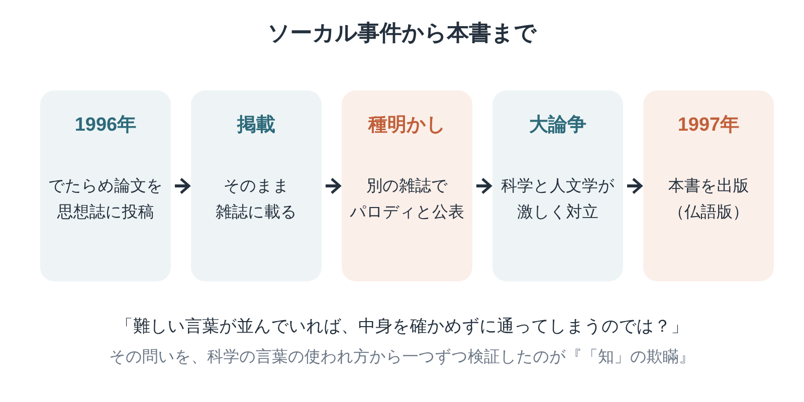

※本記事はアフィリエイト広告を利用しています。

## はじめに

「量子」「波動」「エネルギー」。健康食品や開運グッズの広告で、こうした科学っぽい言葉を見かけることはありませんか。

なんとなくすごそうに聞こえるけれど、よく考えると意味が分からない。そんなもやもやを感じたことがある方に、ぜひ知ってほしい本があります。

『「知」の欺瞞』は、二人の物理学者が、有名な思想家たちの文章に出てくる数学や物理学の言葉の使われ方を、一つずつ検証した本です。きっかけは、学術誌を舞台にした、あるいたずらでした。

思想や科学の話と聞くと身構えてしまいますが、大丈夫です。この記事では、本書が生まれるまでの流れを図で整理し、キーワード、読みどころ、そして医療・介護の情報を扱う立場から考えたことを、やさしくまとめました。

文庫で手に入るので、**Kindle（電子書籍）**で気になる思想家の章から読むのも手軽です。科学と社会の関係について、**Audible（オーディブル）**で教養書を聴いて背景を知っておくのもおすすめ。どちらも無料体験があります。

**こんな人に読んでほしい**

- 難しい専門用語が並ぶ文章に、どこか違和感を覚えることがある方
- 健康情報や広告の「科学っぽさ」を、きちんと見分けられるようになりたい方
- ご家族に専門的な話を伝える機会が多い医療・介護職の方
- 「ソーカル事件」について、くわしく知りたい方

---

### 本の概要

| 項目 | 内容 |
|---|---|
| タイトル | 『「知」の欺瞞──ポストモダン思想における科学の濫用』（原題：Impostures intellectuelles／英語版：Fashionable Nonsense） |
| 著者 | アラン・ソーカル、ジャン・ブリクモン（訳：田崎晴明、大野克嗣、堀茂樹） |
| 出版年月日 | 原著1997年（フランス）。日本語版は2000年5月24日（岩波書店）、2012年2月に岩波現代文庫 |
| 出版国 | フランス（原著） |
| 出版時の著者の年齢 | ソーカル42歳（1955年1月24日生まれ）、ブリクモン44〜45歳（1952年生まれ）【要確認：著者の生年月日】 |
| ジャンル | 科学論・思想批評 |
| 本の分量 | 中くらい〜長め（文庫1冊） |

---

### この本の内容

1996年、物理学者のアラン・ソーカルは、思想の学術誌に一本の論文を送りました。中身は、最新の物理学と現代思想の言葉をつなぎ合わせた、わざと意味の通らない文章です。

ところが、その論文はそのまま雑誌に掲載されてしまいます。

なぜ、こんなことが起きたのか。ソーカルは同じ物理学者のブリクモンとともに、有名な思想家たちの文章を取り上げ、科学の言葉がどのように使われているのかを確かめていきます。

👇 **まずは気軽に『「知」の欺瞞──ポストモダン思想における科学の濫用』を手に取ってみよう**

- **目次を確認しながら、刺さった言葉をハイライトで残したい方**
  👉 [Kindle Unlimited 30日間無料体験はこちら](【アフィリエイトURLを入れる】)
- **忙しくて本を開く時間がない方・耳で学びたい方**
  👉 [Audible 30日間無料体験で教養書を聴く](【アフィリエイトURLを入れる】) 【要確認：本書のAudible配信状況】

---

### この本に登場するキーワード

でたらめな論文が掲載され、ソーカル自身が別の雑誌で「あれはパロディだった」と明かしたことで、大きな論争が起きました。その問いを、より丁寧に検証したのが本書です。

- **ソーカル事件**：1996年、ソーカルが思想誌『ソーシャル・テキスト』に、意図的にでたらめな論文を投稿し、掲載されたあとで種明かしをした出来事です。
- **ポストモダン思想**：20世紀後半に、主にフランスで広がった思想の流れ。真理や理性といった近代の考え方を問い直す立場で、文学や社会学にも大きな影響を与えました。
- **科学用語の濫用**：数学や物理学の言葉を、正確な意味を理解しないまま、あるいは比喩として説明もなく使うこと。本書が批判の中心に置いたのは、この点です。
- **相対主義**：真理は時代や社会によって変わり、どれが正しいとは言えない、という考え方。本書は、行き過ぎた相対主義についても議論しています。
- **取り上げられた思想家**：ラカン、クリステヴァ、ボードリヤール、ドゥルーズとガタリなど、当時とても影響力のあった人々です。

---

## 図でわかる「ソーカル事件」は何を問いかけたのか

図の流れを、もう少しかみ砕いてみましょう。

ソーカルが送った論文の題名は「境界を侵犯すること：量子重力の変形解釈学に向けて」。量子重力という、最先端の物理学の言葉と、思想の言葉を組み合わせた、いかにも難しそうな題名です。

もし編集者が、物理学の部分を専門家に確かめていたら、すぐに中身のおかしさに気づいたはずでした。けれど論文は、そのまま掲載されてしまったんです。

この出来事が突きつけたのは、「難しい言葉が並んでいれば、中身を確かめなくても通ってしまうのではないか」という問いでした。そこから、科学者と人文学者のあいだで、激しい議論が巻き起こっていきます。

---

## 『「知」の欺瞞』読みどころの3つの場面

※本書は著作権のある作品のため、本文の言葉は原文を確認できたものだけを引用します。【要確認：原文を本で確かめて差し替え】

### 1. いたずら論文の題名

> **「境界を侵犯すること──量子重力の変形解釈学に向けて」**
> （ソーカルが1996年に『ソーシャル・テキスト』誌に投稿した論文の題名。本書の付録でも取り上げられている）
>
> 原題：Transgressing the Boundaries: Towards a Transformative Hermeneutics of Quantum Gravity

題名を読んだだけで、思わず笑ってしまう方もいるかもしれません。難しそうな言葉をこれでもかと重ねた、いかにも「それらしい」題名です。

この題名がそのまま通ってしまったこと自体が、事件の本質をよく表しています。日本語訳は拙訳です。【要確認：日本語版での訳題】

### 2. 思想家の文章を、一つずつ確かめる

> **「【要確認：原文を本で確かめて差し替え】」**
> （ソーカル＆ブリクモン『「知」の欺瞞』、思想家たちの文章を検証する各章より）

本書の大部分は、有名な思想家の文章を引用し、そこに出てくる数学や物理学の用語の使い方が正しいかどうかを、一つずつ確かめる作業にあてられています。

地道で、ときに容赦のない検証です。ただ、著者たちは思想そのものを全否定しているわけではなく、「科学の言葉の使い方」に的を絞っている点も押さえておきたいところです。

### 3. 分からないものは、分からないと言う

> **「【要確認：原文を本で確かめて差し替え】」**
> （ソーカル＆ブリクモン『「知」の欺瞞』、相対主義と知的誠実さを論じる章より）

難しい言葉で書かれていると、読む側は「分からないのは自分の勉強不足だ」と思いがちです。本書は、その思い込みに一石を投じます。

分からないものを分かったふりをしないこと。書く側にも読む側にも求められる、知的な誠実さの話として読めます。

専門家でも、分からないことはたくさんあります。「分からない」と素直に言える人のほうが、かえって信頼できる。そんなことも考えさせられる章です。

---

## 『「知」の欺瞞』を読むときに知っておきたいこと

| ポイント | 内容 |
|---|---|
| 批判されている側の言い分 | 批判された思想家や支持者からは、「比喩として使っただけだ」「文脈を無視している」という反論もあった |
| あわせて読みたい本 | 金森修『サイエンス・ウォーズ』は、この論争を含む科学と社会をめぐる議論を日本語で整理している |
| 『千のプラトー』との関係 | 本書が取り上げた一人がドゥルーズとガタリ。原典と批判を両方読むと、自分なりの距離感をつかめる |

どちらか一方の言い分だけを鵜呑みにせず、両方を読んで考えることこそが、本書の精神にかなった読み方だと思います。

---

## 『「知」の欺瞞』を医療・介護職の目で読んで——科学っぽい言葉を見分け、分かる言葉で伝える

読みながら、真っ先に思い浮かんだのは、医療や健康をめぐる情報のことでした。

医療・介護の世界にも、「科学っぽい言葉」はたくさんあふれています。「〇〇で免疫力がアップ」「認知症に効く△△」。言葉だけを見ると、いかにも根拠がありそうに聞こえますよね。

でも、その言葉が本当はどんな意味で、どんな研究に基づいているのかを確かめると、根拠があいまいなことも少なくありません。ご本人やご家族が、わらにもすがる思いで高価な商品を買ってしまう。そんな場面に心を痛めることもあります。

健康情報に迷ったときは、次の三つを確かめてみるのがおすすめです。誰が言っているのか。どんな研究が根拠になっているのか。そして、続けるのにいくらかかるのか。この三つを確かめるだけでも、冷静に判断しやすくなります。

迷ったときは、一人で決めずに、かかりつけ医やケアマネ、地域包括支援センターなどの専門職に相談してください。相談すること自体が、「難しい言葉」に振り回されない一番の近道です。

私は医療・介護の記事を書くとき、根拠を確かめることと、専門用語を読者の言葉に置きかえることを大切にしています。本書を読んで、その二つがいかに大事かを、改めてかみしめました。

もう一つ考えさせられたのは、私たち専門職自身の言葉づかいです。

ケアマネとしてご家族に説明するとき、つい専門用語を使ってしまうことがあります。「ADL」「サービス担当者会議」「区分変更」。こちらにとっては当たり前の言葉でも、ご家族にとっては、まさに「難しい言葉」です。

分からない言葉が並ぶと、ご家族は「分からないのは自分のせいだ」と感じて、質問をためらってしまうかもしれません。それでは、本当に必要な情報が伝わりません。

本書が批判したのは、言葉で中身をごまかすことでした。私たちも、専門用語で相手を煙に巻いていないか、ときどき振り返る必要があります。分かる言葉で、正確に伝える。地味ですが、それが信頼の土台になるのだと思います。

---

## よくある質問

**Q. 思想や哲学を知らなくても読めますか？**

A. 取り上げられている思想家の考え方をすべて理解していなくても、「科学用語がどう使われているか」という視点で読み進められます。気になった思想家の章から読むのもおすすめです。

**Q. ポストモダン思想を全否定する本ですか？**

A. 著者たちは、思想そのものの価値を全否定しているわけではないと述べています。批判の中心は、科学の言葉が正確でない形で使われている点です。ただ、本の受け止め方は読む人によって分かれています。

**Q. 「ソーカル事件」のあと、何が変わったのですか？**

A. 科学者と人文学者のあいだで、「科学の知識はどこまで客観的なのか」をめぐる激しい論争が起きました。この論争は「サイエンス・ウォーズ」と呼ばれ、日本でも金森修さんの同名の本などで紹介されています。

**Q. 原題と日本語の副題が違うのはなぜですか？**

A. 原著のフランス語版の題名は「知的な詐欺」といった意味で、英語版は「流行のナンセンス」という題名で出版されました。日本語版は「ポストモダン思想における科学の濫用」という副題で、本の内容を分かりやすく示しています。

---

## まとめ

『「知」の欺瞞』のポイントは次の3つです。

1. **ソーカル事件をきっかけに、有名な思想家たちの科学用語の使い方を検証した本**
2. **難しい言葉が並んでいても、中身を確かめる大切さを教えてくれる**
3. **健康情報を見分ける目と、専門職として分かる言葉で伝える姿勢を考えさせてくれる**

まずはKindleの試し読みで、ソーカル事件のいきさつを読んでみてください。科学と社会の関係にさらに興味がわいたら、Audibleで関連する教養書を探すのもおすすめですよ。

---

💡 **KindleやAudibleを使うなら、Amazonプライムもチェック**

Kindleで本を読んだりAudibleで聴いたりしている方は、すでにAmazonのアカウントをお持ちのはずです。そのまま登録できるAmazonプライムは、読書好きにとってコスパのよいサービスです。

- 📚 **Prime Reading**：対象のKindle本・雑誌・マンガが追加料金なしで読める（Kindle Unlimitedより対象は少なめ）
- 🎬 **Prime Video**：映画・ドラマが見放題
- 🎵 **Amazon Music Prime**：通勤中の音楽やポッドキャストにも
- 📦 **配送料無料**：紙の本を買うときもお得

料金は月額600円、年額なら5,900円（月あたり約492円）です（2026年10月時点）。映画を1〜2本レンタルするのと同じくらいの金額で、読む・観る・聴くがまとめて楽しめます。

※AudibleとKindle Unlimitedはプライムとは別の料金がかかります。

👉 [Amazonプライム 30日間無料体験はこちら](【アフィリエイトURLを入れる】)

---

🎁 **【30日間無料体験】あなたに合った方法で読書を始めよう**

- 🎧 **耳から聴く読書（Audible）**
  プロの朗読で、教養書やビジネス書を耳から学ぶ。無料体験期間中は聴き放題対象作品を楽しめます。
  👉 [Audible（オーディブル）無料体験に登録する](【アフィリエイトURLを入れる】)

- 📖 **スマホ・タブレットで読む（Kindle Unlimited）**
  対象の電子書籍が読み放題。気になった言葉はハイライトで保存できます。
  👉 [Kindle Unlimited 30日間無料体験に登録する](【アフィリエイトURLを入れる】)

- 📕 **紙の本・Kindle版を購入する**
  👉 [『「知」の欺瞞──ポストモダン思想における科学の濫用』をAmazonで見る](【アフィリエイトURLを入れる】)

---

### この記事を書いた人

**矢野英人**｜人生の後半に効く本の案内人

本は読みたい。でも、時間も集中力も続かない。40代半ば、2児の父の私も同じです。

文学部で英文学を学び、リハビリ医療の専門職（理学療法士）に。介護の現場で18年、約1,000人の老いと暮らしを見てきました。

仕事でも家族でも実感したのは、老いも死も、誰にでも必ず来るということ。だから備えは、少しでも早いほうがいい。本を開くなら、人生でいちばん若い今日から。

老後に効くのは、お金と体と、本の貯金。Kindleとオーディブルで、忙しい大人でも続く読み方を紹介しています。

資格：理学療法士／介護支援専門員（ケアマネジャー）／2級FP技能士

---

### 参考情報

- [「知」の欺瞞（岩波現代文庫）（ブクログ）](https://booklog.jp/item/1/4006002610)
- [「知」の欺瞞（単行本）（ブクログ）](https://booklog.jp/item/1/4000056786)
- [ソーカル事件（Scrapbox）](https://scrapbox.io/mrsekut-p/ソーカル事件)
- [Fashionable Nonsense（DBpedia）](https://dbpedia-live.demo.openlinksw.com/page/Fashionable_Nonsense)
