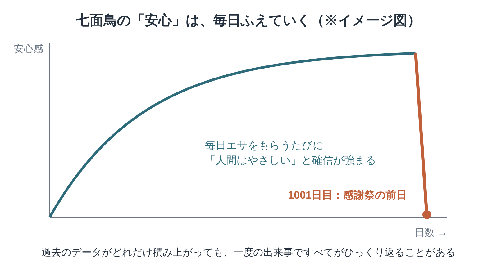
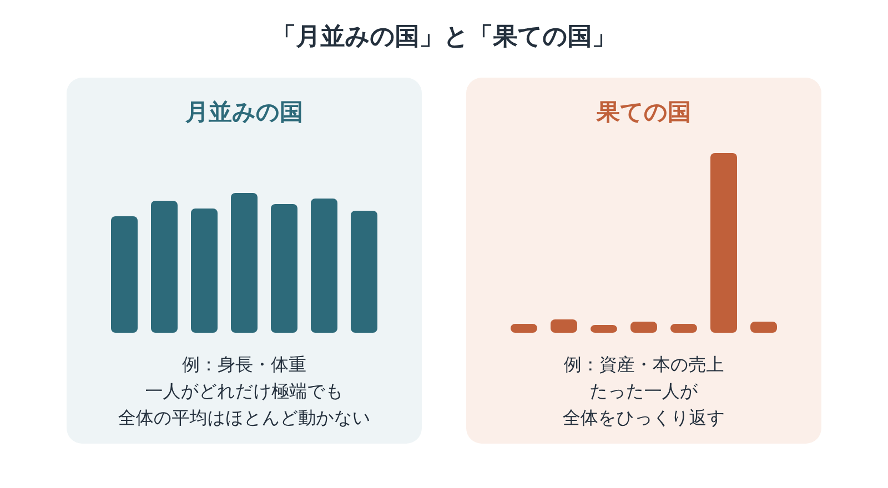

※本記事はアフィリエイト広告を利用しています。

## はじめに

昨日まで元気だった親が、ある朝、転んで骨折する。介護は、たいていそんなふうに「突然」始まります。あとから振り返れば兆しはあったように思えても、その日を正確に予測できた人はほとんどいません。

『ブラック・スワン』は、そうした「まさか」の出来事と、人間の付き合い方を描いた本です。

著者のナシーム・ニコラス・タレブは、トレーダー出身の思想家。2008年の金融危機の前後に大きな話題を呼び、「ブラック・スワン」という言葉は今では経済ニュースでも使われるようになりました。

上下巻で読みごたえはありますが、全部を理解しようとしなくて大丈夫です。この記事では、本書の中心にある考え方を2つの図でかみ砕き、読みどころと、医療・介護職として考えた「まさか」への備え方をまとめました。

まずは気になる章だけ**Kindle（電子書籍）**で拾い読みするのもおすすめです。耳から入りたい方は、**Audible（オーディブル）**で教養書を聴く時間をつくってみてください。どちらも無料体験があります。

**こんな人に読んでほしい**

- 親の介護が「いつか突然始まるかも」と、漠然と不安を感じている方
- 「想定外でした」という言葉に、もやもやすることが多い方
- 事故や失敗の振り返りで、後づけの説明に違和感を覚える医療・介護職の方
- リスクとの付き合い方を、一冊でじっくり考えたい方

---

### 本の概要

| 項目 | 内容 |
|---|---|
| タイトル | 『ブラック・スワン──不確実性とリスクの本質』（原題：The Black Swan） |
| 著者 | ナシーム・ニコラス・タレブ（訳：望月衛） |
| 出版年月日 | 原著2007年。日本語版は2009年6月（ダイヤモンド社、上下巻） |
| 出版国 | アメリカ（原著） |
| 出版時の著者の年齢 | 46〜47歳（1960年生まれ）【要確認：生年月日】 |
| ジャンル | 教養書（リスク論・思想・経済） |
| 本の分量 | 長め（上下巻） |

---

### この本の内容

ヨーロッパの人々は長いあいだ、「白鳥は白いもの」だと信じていました。何千羽、何万羽と見てきた白鳥が、すべて白かったからです。ところがオーストラリアで黒い白鳥が見つかった瞬間、その常識はひっくり返りました。

タレブは、めったに起きないけれど、起きたときの影響がとても大きい出来事を「ブラック・スワン」と呼びます。

なぜ私たちは、それを予測できないのか。そして、予測できない世界で、どう生きればいいのか。その答えが、上下巻にわたって語られます。

👇 **まずは気軽に『ブラック・スワン──不確実性とリスクの本質』を手に取ってみよう**

- **目次を確認しながら、刺さった言葉をハイライトで残したい方**
  👉 [Kindle Unlimited 30日間無料体験はこちら](【アフィリエイトURLを入れる】)
- **忙しくて本を開く時間がない方・耳で学びたい方**
  👉 [Audible 30日間無料体験で教養書を聴く](【アフィリエイトURLを入れる】) 【要確認：本書のAudible配信状況】

---

### この本に登場するキーワード

毎日エサをもらう七面鳥は、日を追うごとに「人間はやさしい」と確信を深めます。いちばん安心しているその日に、すべてがひっくり返る。過去のデータだけに頼る怖さを表した、本書の有名なたとえ話です。

- **ブラック・スワン**：①めったに起きない、②起きると影響がとても大きい、③起きたあとで「予測できたはずだ」と説明がつけられてしまう。この3つの特徴をもつ出来事のことです。
- **七面鳥の問題**：過去にうまくいっていたことが、未来もうまくいく保証にはならない、という問題。図のように、安心が最も大きいときこそ危ないこともあります。
- **講釈の誤り**：ばらばらの出来事に、あとから筋の通った物語をつけてしまう人間のくせ。「だから、こうなったんだ」と納得しやすい説明ほど、疑ってみる必要があります。
- **物言わぬ証拠**：成功した人の話は聞こえてきても、同じことをして失敗した人の声は聞こえてこない。見えていない証拠を忘れてしまう落とし穴です。
- **確認のくせ**：自分の考えに合う情報ばかり集めて、「やっぱり正しかった」と安心してしまう傾向。白い白鳥を何羽見ても、黒い白鳥がいないことの証明にはならないんです。

※訳語は日本語版によります。【要確認：訳語の表記】

---

## 図でわかる「月並みの国」と「果ての国」

左は、極端な人が一人いても平均がほとんど動かない世界。右は、たった一つの出来事や一人の人が全体を決めてしまう世界です。ブラック・スワンが暴れるのは、右の「果ての国」です。

タレブは、世の中を二つの「国」に分けて考えます。

「月並みの国」は、身長や体重のように、極端な値が出ても全体にはほとんど影響しない世界です。世界一背の高い人が部屋に入ってきても、部屋にいる人たちの平均身長はほとんど変わりませんよね。

一方の「果ての国」は、資産や本の売上、戦争や金融危機のように、たった一つの出来事が全体を塗り替えてしまう世界です。世界一の大富豪が部屋に入ってきたら、平均資産は一気に跳ね上がります。

問題は、私たちが「果ての国」の出来事を、「月並みの国」の考え方で予測しようとしてしまうこと。マンデルブロの『禁断の市場』が数学で示した「すその厚さ」を、タレブは人間の考え方のくせという側面から掘り下げています。

---

## 『ブラック・スワン』「まさか」への見方が変わる3つの読みどころ

※本書は著作権のある作品のため、本文の言葉は原文を確認できたものだけを引用します。下の3か所は、お手持ちの本で原文を確かめて差し替えてください。【要確認：原文を本で確かめて差し替え】

### 1. 七面鳥の1001日目

> **「【要確認：原文を本で確かめて差し替え】」**
> （タレブ『ブラック・スワン』上巻、七面鳥のたとえ話の場面より）

エサをくれる人間を信じきった七面鳥が、感謝祭の前日に思いがけない運命を迎える。少しブラックですが、一度読んだら忘れられない話です。

ポイントは、七面鳥が「ばかだった」わけではないこと。毎日の経験から、きわめて合理的に結論を出していたんです。私たち人間も、データを集めて判断するという点では、この七面鳥と何も変わりません。

それでも外れてしまう。過去のデータが積み上がるほど、私たちは安心しすぎてしまうのかもしれません。

### 2. あとから語られる物語に気をつける

> **「【要確認：原文を本で確かめて差し替え】」**
> （タレブ『ブラック・スワン』上巻、「講釈の誤り」を扱う章より）

大きな出来事が起きたあと、ニュースや解説はきれいな「理由」を並べてくれます。聞いていると、まるで最初から分かっていたことのように思えてきますよね。

タレブは、そうした後づけの物語こそが、次のブラック・スワンへの油断を生むと指摘します。

説明がきれいすぎるときほど、「本当に事前に分かっただろうか」と立ち止まってみる。それだけで、物事の見え方が少し変わります。

### 3. 予測より、壊れにくさを

> **「【要確認：原文を本で確かめて差し替え】」**
> （タレブ『ブラック・スワン』下巻、予測の限界と、その中での生き方を語る場面より）

予測できないなら、どうすればいいのか。タレブの答えは、当てようとするよりも、「外れても大丈夫な状態」をつくっておくことです。

悪いブラック・スワンからは身を守り、よいブラック・スワン（思いがけない幸運）にはチャンスを開いておく。そんな構えが紹介されます。

未来を当てる力より、何が起きても立て直せる力。私たちの暮らしにも、そのまま使える考え方です。

---

## 『ブラック・スワン』を医療・介護職の目で読んで——介護の「まさか」にどう備えるか

ケアマネとしてご家族と関わっていると、介護は本当に「ある日突然」始まるものだと実感します。転倒、脳卒中、急な入院。昨日まで普段どおりだった生活が、一晩で変わってしまうことがあるんです。

ご家族の多くは、七面鳥と同じように、「これまで元気だったから大丈夫」と思っています。それは決して不注意ではありません。毎日の経験から、ごく自然にそう感じているだけです。

だからこそ、元気なうちに少しだけ「もしも」を話しておくことをおすすめしたいと思います。誰が駆けつけるのか、どこに相談するのか、地域包括支援センターはどこにあるのか。それだけでも、いざというときの混乱はずいぶん減ります。

実際に介護が始まると、ご家族は病院の説明、手続き、仕事の調整に追われ、落ち着いて考える余裕がなくなります。元気なうちの10分の会話が、そのときの何時間分もの迷いを減らしてくれるはずです。

離れて暮らす親の様子が気になる方には、異変に早く気づくための[高齢者見守りサービスの比較記事](https://site.yanohide.com/posts/elderly-care-services-comparison)も参考にしてみてください。

「講釈の誤り」の話も、現場に重なりました。

事故やヒヤリハットの振り返りでは、「この兆しを見逃した」「こうしていれば防げた」と、あとからきれいな説明がつけられがちです。

もちろん学びは大切です。ただ、結果を知っているからこそ見える筋道を、そのときの担当者に求めすぎると、責める空気だけが残ってしまいます。

理学療法士として転倒予防に関わってきた立場からも、すべての転倒を予測するのは難しいと感じています。だからこそ、予測を完璧にするより、転んでも大けがになりにくい環境づくりや、起きたあとにすぐ気づける仕組みを整えることが大切なんです。

タレブの言う「壊れにくさ」は、ケアの世界の言葉で言いかえれば、備えと支え合いのことだと思います。

一人で背負わず、何かあったときに頼れる人とサービスを、前もってつないでおく。いい意味での「まさか」、たとえば思いがけない回復や人との出会いにも、心を開いておく。上下巻を読み終えて、その当たり前の大切さを改めて感じました。

---

## よくある質問

**Q. 上下巻あって長そうですが、どこから読めばいいですか？**

A. まずは上巻の前半で「ブラック・スワン」と七面鳥の考え方をつかめば、本書の芯は押さえられます。下巻は、予測の限界やベル型カーブへの批判など、より踏み込んだ内容です。

**Q. 投資の本ですか？**

A. 投資の話も出てきますが、中心は「予測できない出来事と、人間の考え方のくせ」です。金融に詳しくなくても、十分に楽しめます。仕事や暮らしの判断にも幅広く当てはまります。

**Q. 文章が独特だと聞きました。**

A. 著者の個性が強く、皮肉や脱線も多い文体です。合う人には痛快ですが、読みにくく感じたら、気になる章から拾い読みしても大丈夫です。

**Q. 『禁断の市場』とどちらを先に読むべき？**

A. 考え方の入口としては『ブラック・スワン』、市場のデータや数学の話に興味があるなら『禁断の市場』がおすすめです。両方読むと、「想定外」の正体が立体的に見えてきます。

---

## まとめ

『ブラック・スワン』のポイントは次の3つです。

1. **めったに起きないけれど影響が大きい「ブラック・スワン」が、世界を動かしている**
2. **七面鳥や「講釈の誤り」など、人間が予測を誤るくせを分かりやすく示してくれる**
3. **当てることより、外れても壊れない備えをつくる大切さを教えてくれる**

上下巻に身構える方は、Kindleで上巻の冒頭を試し読みしてみてください。七面鳥の話までたどり着けば、きっと続きが読みたくなります。耳で聴くなら、Audibleの教養書から関連テーマを探してみるのもいいですよ。

---

💡 **KindleやAudibleを使うなら、Amazonプライムもチェック**

Kindleで本を読んだりAudibleで聴いたりしている方は、すでにAmazonのアカウントをお持ちのはずです。そのまま登録できるAmazonプライムは、読書好きにとってコスパのよいサービスです。

- 📚 **Prime Reading**：対象のKindle本・雑誌・マンガが追加料金なしで読める（Kindle Unlimitedより対象は少なめ）
- 🎬 **Prime Video**：映画・ドラマが見放題
- 🎵 **Amazon Music Prime**：通勤中の音楽やポッドキャストにも
- 📦 **配送料無料**：紙の本を買うときもお得

料金は月額600円、年額なら5,900円（月あたり約492円）です（2026年10月時点）。映画を1〜2本レンタルするのと同じくらいの金額で、読む・観る・聴くがまとめて楽しめます。

※AudibleとKindle Unlimitedはプライムとは別の料金がかかります。

👉 [Amazonプライム 30日間無料体験はこちら](【アフィリエイトURLを入れる】)

---

🎁 **【30日間無料体験】あなたに合った方法で読書を始めよう**

- 🎧 **耳から聴く読書（Audible）**
  プロの朗読で、教養書やビジネス書を耳から学ぶ。無料体験期間中は聴き放題対象作品を楽しめます。
  👉 [Audible（オーディブル）無料体験に登録する](【アフィリエイトURLを入れる】)

- 📖 **スマホ・タブレットで読む（Kindle Unlimited）**
  対象の電子書籍が読み放題。気になった言葉はハイライトで保存できます。
  👉 [Kindle Unlimited 30日間無料体験に登録する](【アフィリエイトURLを入れる】)

- 📕 **紙の本・Kindle版を購入する**
  👉 [『ブラック・スワン──不確実性とリスクの本質』をAmazonで見る](【アフィリエイトURLを入れる】)

---

### この記事を書いた人

**矢野英人**｜つみたて読書

〜老後に効く教養を、耳とスマホで〜

本は読みたい。でも、時間も集中力も続かない。40代半ば、2児の父の私も同じです。

文学部からリハビリ医療の専門職へ。介護の現場で18年、約1,000人の老いを見てきました。

老いは誰にでも来る。それでも、知識は年をとっても伸びるといわれます。お金も教養も、元手は時間。本を開くなら、人生でいちばん若い今日から。

資格：理学療法士／介護支援専門員（ケアマネジャー）／2級FP技能士

---

### 参考情報

- [ブラック・スワン［上］（ダイヤモンド社）](https://www.diamond.co.jp/book/9784478001257.html)
- [ブラック・スワン［下］（ダイヤモンド社）](https://www.diamond.co.jp/book/9784478008881.html)
- [ブラック・スワン 上下巻の内容紹介（ダイヤモンド社）](https://www.diamond.co.jp/_itemcontents/0201_biz/00125-7.html)
- [『ブラック・スワン』の感想（読書メーター）](https://bookmeter.com/books/574732)
