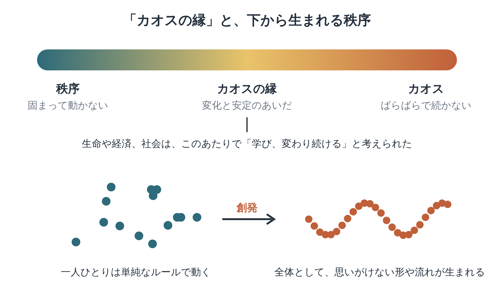

※本記事はアフィリエイト広告を利用しています。

## はじめに

鳥の群れには、指揮をとるリーダーがいません。一羽ずつが近くの仲間に合わせるだけで、あの見事な形が生まれます。

『複雑系』は、この「下から生まれる秩序」の謎に挑んだ科学者たちを、科学ジャーナリストのM・ミッチェル・ワールドロップが描いたノンフィクションです。

<!-- 表紙画像：Amazonアソシエイトの画像付きリンクをここに貼る -->

「複雑系」は、たくさんの要素が影響し合い、部分の足し算では説明できない動きを見せるもの。経済も脳も、その仲間です。

副題の「サンタフェ」は、研究所があるアメリカ南西部の町の名前です。

この本で見えてくるのは、次の3つです。

- 指揮役がいなくても、全体に秩序が生まれるしくみ
- 「一度勝ったものが、さらに勝つ」経済の考え方
- 分野の違う科学者が、一つの研究所に集まった経緯

**人生は設計図どおりに建てるものだと、若いころは思っていた。実際は小さな選択の積み重ねで、勝手に形ができていく。……設計者のいない家に住んでいる気分です。**

683ページの大作なので、気になる研究者の章から開くと続きます。

**Kindle**なら、人物名で検索して読みたい章へすぐ飛べます。研究所の背景は、**Audible（オーディブル）**で科学の教養書を聴いておくと入りやすくなります。

**分厚い本でも、耳と電子で少しずつ読めば、考え方の核は手に入ります。**どちらも無料体験があります。

**こんな人に読んでほしい**

- 「複雑系」という言葉を、ちゃんと理解しておきたい方
- 会社や家庭が、計画どおりに動かない理由を知りたい方
- 分野を越えて新しいことに挑む人たちの物語が好きな方
- 長い本は、耳とスマホで少しずつ読みたい方

---

### この記事を書いた人

:::author
name: 矢野英人
tagline: つみたて読書
catch: 〜耳とスマホで自己投資〜
avatarUrl: /avatars/profile-avatar.png

本は読みたい。でも、時間も集中力も続かない。40代半ば、2児の父の私も同じです。

文学部からリハビリ医療の専門職へ。介護の現場で18年、約1,000人の老いを見てきました。

老いは誰にでも来る。それでも、知識は年をとっても伸びるといわれます。お金も教養も、元手は時間。本を開くなら、人生でいちばん若い今日から。

資格：理学療法士／介護支援専門員（ケアマネジャー）／2級FP技能士
:::

---

### 本の概要

| 項目 | 内容 |
|---|---|
| タイトル | 『複雑系──科学革命の震源地・サンタフェ研究所の天才たち』（原題：Complexity） |
| 著者 | M・ミッチェル・ワールドロップ（生年【要確認】）（訳：田中三彦、遠山峻征） |
| 出版年月日 | 原著1992年。日本語版は1996年6月30日に単行本（新潮社、副題「生命現象から政治、経済までを統合する知の革命」）、2000年6月1日に新潮文庫 |
| 出版国 | アメリカ（原著） |
| 出版時の著者の年齢 | 【要確認：著者の生年】 |
| ジャンル | 科学ノンフィクション |
| 本の分量 | 長め（文庫683ページ） |

---

### この本の内容

経済は、人や会社がばらばらに動いた結果です。生命も、分子の集まりにすぎません。それでも、どちらも足し算では説明しきれないまとまりを持っています。

1980年代、この謎に挑むため、物理学者や経済学者、生物学者がニューメキシコ州の小さな町に集まりました。

**専門の違う人が同じテーブルにつく。それだけで何かが動き出す気がするのは、研究所も町内会も同じなのでしょう。**

彼らは何を見つけ、どこでつまずいたのか。一人ひとりの研究者の人生と重ねながら、新しい科学の誕生がたどられます。

とくに、**物理学者と経済学者が本気で議論をぶつけ合った会議の行方**は、読んでのお楽しみです。

:::speech
speaker: 読者
side: left
tone: stone

680ページ超えは、正直ひるみます……
:::

:::speech
speaker: 矢野英人
side: right
tone: sky

気になる研究者の章だけKindleで。背景はAudibleで聴けば、十分ついていけますよ。
:::

👇 **まずは気軽に『複雑系──科学革命の震源地・サンタフェ研究所の天才たち』を手に取ってみよう**

- **目次を確認しながら、刺さった言葉をハイライトで残したい方**
  👉 [Kindle Unlimited 30日間無料体験はこちら](【アフィリエイトURLを入れる】)
- **忙しくて本を開く時間がない方・耳で学びたい方**
  👉 [Audible 30日間無料体験で教養書を聴く](【アフィリエイトURLを入れる】) 【要確認：本書のAudible配信状況】

---

### この本に登場するキーワード

上の帯は、固まりすぎた「秩序」と、ばらばらの「カオス」の間に、ちょうどいい領域があるという考えです。

下は、一人ひとりが単純に動くだけで、全体に思いがけない形が生まれる「創発」のイメージです。

**固すぎても、ゆるすぎても続かない。家計の予算も、職場のルールも、たぶん真ん中あたりに落としどころがあるのでしょうね。**

- **複雑系**：たくさんの要素が影響し合い、部分だけでは説明できない振る舞いを見せるもの。経済、生態系、脳、都市などが例です。
- **創発**：一つひとつの動きからは予想できないパターンが、全体として「わき上がる」こと。鳥の群れや、市場の値動きがその例です。
- **自己組織化**：外から設計図を与えなくても、要素どうしの関わりから自然に秩序が生まれること。生命の起源を考える手がかりとされます。
- **カオスの縁**：秩序とカオスの境目あたり。この領域でこそ、生命や社会は学び、変わり続けられるのではと考えられました。
- **収穫逓増**：経済学者ブライアン・アーサーが重んじた考え方。先にリードした技術や会社が、さらに有利になっていく現象です。

---

## 図でわかる「カオスの縁」と「創発」

:::speech
speaker: 読者
side: left
tone: stone

「カオスの縁」って、聞くだけで難しそうです。
:::

:::speech
speaker: 矢野英人
side: right
tone: sky

固すぎず、ばらばらすぎない「ちょうどいい加減」のこと。それだけ覚えれば大丈夫です。
:::

もう一度、上の図を見てください。帯の左端は、すべてが決まりきって動かない世界。右端は、何もかもばらばらで、形がすぐ崩れる世界です。

生き物や社会が「生きている」のは、そのどちらでもない中間ではないか。研究者たちは、計算機の中に人工の生命をつくる実験などで、この考えを追いかけました。

下の「創発」は、職場でも見かけます。誰も決めていないのに、いつの間にか「この件はあの人に聞く」という流れができていく。

一人ひとりのルールは単純でも、集まると、誰も計画していない秩序が生まれる。複雑系の科学は、この「下からの秩序」をつかもうとする試みです。

**指示を出せば組織は動く、と思っていた時期もありました。実際に回っているのは、指示のすき間に育ったつながりのほうだったりするのですね。**

---

## 『複雑系』研究者たちの熱気が伝わる3つの場面

※本書は著作権のある作品のため、本文の言葉は原文を確認できたものだけを引用します。下の3か所は、お手持ちの本で原文を確かめて差し替えてください。【要確認：原文を本で確かめて差し替え】

### 1. 主流から外れた経済学者

> **「【要確認：原文を本で確かめて差し替え】」**
> （ワールドロップ『複雑系』、ブライアン・アーサーが収穫逓増のアイデアを語る場面より）

「一度勝ったものが、ますます勝つ」。いまでは当たり前に聞こえる考えも、当時の経済学の主流には受け入れられにくいものでした。

自分の考えを信じながら、なかなか認められない時期のアーサー。サンタフェで同じ問題意識をもつ仲間に出会い、表情が変わっていく姿が読みどころです。

先に強みを持った人や会社が、さらに伸びていく。仕事でも投資でも、この流れを知っておくと、早めに動く理由がはっきりします。

**知識も、早く積み始めた人ほど次の知識がつきやすい。四十代からでも、始めた日がいちばん早い日ということで。**

### 2. 生命は「秩序がただで手に入る」場所から

> **「【要確認：原文を本で確かめて差し替え】」**
> （ワールドロップ『複雑系』、スチュアート・カウフマンが自己組織化を語る場面より）

生物学者スチュアート・カウフマンは、生命が生まれるのに、奇跡のような偶然はいらないのではと考えました。条件さえそろえば、秩序は自然に生まれる、と。

壮大で、どこか楽天的なアイデアです。世界の見え方が、少し明るくなります。

すべてを自分で組み立てなくても、条件を整えれば形はできていく。子育てや部下の育成にも、どこか通じる話です。

**何でも自分で決めないと気がすまない日ほど、うまくいかない。条件だけ整えて待つのも、大人の技術の一つなのでしょう。**

### 3. コンピューターの中の「生命」

> **「【要確認：原文を本で確かめて差し替え】」**
> （ワールドロップ『複雑系』、クリス・ラングトンが人工生命と「カオスの縁」を探る場面より）

計算機の画面の中で、生き物のように振る舞うパターンを追いかけたクリス・ラングトン。回り道を重ねて研究にたどり着いた彼の物語は、とりわけ印象に残ります。

遠回りに見えた経験が、あとから思わぬ形で生きてくる。研究の話でありながら、生き方そのものを励まされる場面です。

キャリアの途中で道を変えた人ほど、この章は響くはずです。

**まっすぐ進めなかった道のりも、あとで振り返ると一本の線になっている。そう思えるのは、ある程度の年を重ねたあとの特権かもしれません。**

---

## 『複雑系』は、どんな順番で読むといい？

| 読み方 | ポイント |
|---|---|
| 人物の章から読む | アーサー、カウフマン、ラングトンなど、気になる研究者の章から読んでも楽しめる |
| 『カオス』を先に読む | グリックの『カオス』で背景をつかんでおくと、話の流れが理解しやすい |
| ネットワーク科学へ進む | 読み終えたら、ブキャナン『複雑な世界、単純な法則』で、つながりの科学へ |

サンタフェ研究所は1984年、ロスアラモス国立研究所の科学者らを中心に設立されました。ノーベル物理学賞を受けたマレー・ゲルマンも、創設メンバーの一人です。

著者のワールドロップは、素粒子物理学で博士号をとったあと、科学誌『サイエンス』の記者として長く書いてきた人です。科学の中身と人間の両方に目が届くのは、そのためでしょう。

**物理の博士が、記者として科学者の人生を書く。遠回りに見える経歴が、この本の厚みになっている気がします。**

---

## 『複雑系』を医療従事者の目で読んで——いい場所は、計画書の外で育つ

引っかかったのは「創発」ということばでした。単純なルールで動く部分がたくさん集まると、誰も設計していない秩序が生まれる。本書は、それを経済や生き物の中に見ていきます。

リハビリの職員として働く場でも、似たことが起きます。デイケア（日帰りでリハビリを受ける場所）のフロアで、利用者さんどうしが席をゆずり合い、いつの間にか「お茶を配る人」が決まっている。職員が計画したわけではありません。

認知症カフェのボランティアでも、続く集まりには、決まりすぎない余白があると感じます。きっちり進行するほど、会話は細っていくのです。

ただ、「秩序は自然に生まれる」と言われると、素直にはうなずけません。自然に見える場の裏では、たいてい誰かが場所を整え、声をかけ続けています。放っておいて育つのは、つながりやすい人どうしのつながりだけです。

**計画どおりにいかない場所ほど、なぜか居心地がいい。書類の上では、なかなか説明しにくい話なのですが。**

人生の後半のつながりも、きっと設計図どおりには育ちません。会社を離れたあと、どこに顔を出し、誰と笑うのか。その答えは、まだ描けていない余白のほうにある気がしています。

---

## よくある質問

**Q. 理系でなくても読めますか？**

A. 理論の細かい説明より、研究者たちの人生や議論のドラマが中心です。わからない理論は、雰囲気をつかむくらいで先へ進んで大丈夫です。

**Q. 『複雑系』はKindleやオーディブル（Audible）でも読めますか？**

A. 新潮文庫版のKindle版・Audible版は、執筆時点で確認できていません。【要確認：Kindle版・Audible版の配信状況】

本書が手に入りにくい場合も、Audibleで複雑系やカオスを扱う教養書を聴いておくと、話の土台ができます。紙の文庫を読むときは、人物の章ごとに区切ると続けやすくなります。

**Q. 『カオス』と内容は重なりますか？**

A. 一部の話題は重なりますが、視点が違います。『カオス』は予測できない動きの発見が中心で、『複雑系』は秩序が生まれるしくみと、それを研究する人々が中心です。

**Q. いま読んでも古くないですか？**

A. 原著は1992年の刊行なので、その後のネットワーク科学などの進展は含まれていません。新しい分野が立ち上がる瞬間の熱気を伝える記録として、いまも読まれています。

---

## まとめ

1. **分野を越えてサンタフェ研究所に集まった科学者たちを描いた、新しい科学誕生の物語**
2. **「創発」「自己組織化」「カオスの縁」など、下から秩序が生まれるしくみがわかる**
3. **物理学者と経済学者がぶつかった会議で何が起きたのかは、本の中に描かれている**

683ページを一気に読む必要はありません。Kindleで気になる研究者の章を開き、科学の背景はAudibleで補う。

**組織や地域が思いどおりに動かない理由**を、一つの考え方として持っておけます。

**全部を設計しなくても、形はできていく。そう思うと、予定どおりにいかない毎日も、少しは面白がれそうです。**

---

💡 **KindleやAudibleを使うなら、Amazonプライムもチェック**

Kindleで本を読んだりAudibleで聴いたりしている方は、すでにAmazonのアカウントをお持ちのはずです。そのまま登録できるAmazonプライムは、読書好きにとってコスパのよいサービスです。

- 📚 **Prime Reading**：対象のKindle本・雑誌・マンガが追加料金なしで読める（Kindle Unlimitedより対象は少なめ）
- 🎬 **Prime Video**：映画・ドラマが見放題
- 🎵 **Amazon Music Prime**：通勤中の音楽やポッドキャストにも
- 📦 **配送料無料**：紙の本を買うときもお得

料金は月額600円、年額なら5,900円（月あたり約492円）です（2026年10月時点）。映画を1〜2本レンタルするのと同じくらいの金額で、読む・観る・聴くがまとめて楽しめます。

※AudibleとKindle Unlimitedはプライムとは別の料金がかかります。

👉 [Amazonプライム 30日間無料体験はこちら](【アフィリエイトURLを入れる】)

---

🎁 **【30日間無料体験】あなたに合った方法で読書を始めよう**

- 🎧 **耳から聴く読書（Audible）**
  プロの朗読で、教養書やビジネス書を耳から学ぶ。無料体験期間中は聴き放題対象作品を楽しめます。
  👉 [Audible（オーディブル）無料体験に登録する](【アフィリエイトURLを入れる】)

- 📖 **スマホ・タブレットで読む（Kindle Unlimited）**
  対象の電子書籍が読み放題。気になった言葉はハイライトで保存できます。
  👉 [Kindle Unlimited 30日間無料体験に登録する](【アフィリエイトURLを入れる】)

- 📕 **紙の本・Kindle版を購入する**
  👉 [『複雑系──科学革命の震源地・サンタフェ研究所の天才たち』をAmazonで見る](【アフィリエイトURLを入れる】)

---

### 参考情報

- [複雑系（新潮文庫）の商品情報（ブックオフオンライン）](https://shopping.bookoff.co.jp/new/0012510905)
- [『複雑系』の感想（読書メーター）](https://bookmeter.com/books/2160)
- [オペレーションズ・リサーチ学会 会報 Vol.49 No.3](https://orsj.org/wp-content/or-archives50/pdf/bul/Vol.49_03_199.pdf)
- [Complexity: The Emerging Science at the Edge of Order and Chaos（Publishers Weekly。1992年 Simon & Schuster刊）](https://publishersweekly.com/9780671767891)
- [Santa Fe Institute（Wikipedia英語版。1984年の設立と創設メンバー）](https://en.wikipedia.org/wiki/Santa_Fe_Institute)
- [George Cowan, Founding President of Santa Fe Institute: 1920-2012（Pacific Standard）](https://psmag.com/social-justice/blog-40765/)
- [M. Mitchell Waldrop（Computer History Museum。素粒子物理学の博士号と『サイエンス』誌での経歴）](https://computerhistory.org/profile/m-mitchell-waldrop/)
