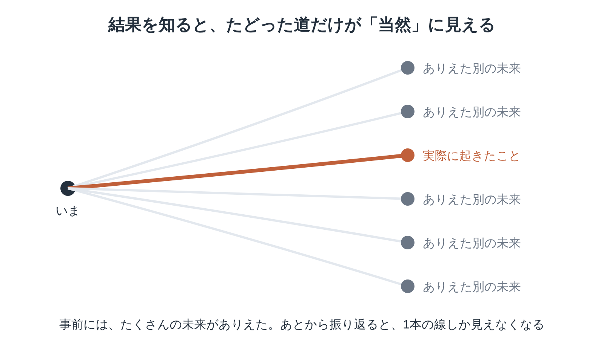

※本記事はアフィリエイト広告を利用しています。

📚 **この記事は、本を読む前の「下読みノート」です。**要点・時代背景・読みどころを先につかんでおくと、オーディオブックでも、Kindleでも、紙の本でも、迷わず効率よく読み進められます。

## はじめに

ヒット曲を決めるのは、曲のよさだけではないかもしれない。1万4千人以上が参加した実験は、そんな結果を示しました。

『偶然の科学』は、社会学者ダンカン・ワッツが、私たちの「常識」にひそむ落とし穴を明かす本です。

<!-- 表紙画像：Amazonアソシエイトの画像付きリンクをここに貼る -->

原題は「Everything Is Obvious」。「答えを知れば、何でも当たり前に見える」という意味で、本書の中身をそのまま表しています。

この本でわかることを、3つに絞りました。

- 「売れるべくして売れた」が、たいてい後づけになる理由
- 同じ曲なのに、世界が違えば順位が入れかわる実験
- 先を読むより「小さく試して測る」ほうが強いわけ

**結果を知ってから「やっぱりね」と言うのは、いつも簡単です。年をとるほど、その「やっぱりね」が増えていく気がする。……当てた覚えは、ほとんどないのですが。**

文庫1冊の長さで、難しい数式はほとんど出てきません。通勤の行き帰りに**Kindle**で1章ずつ読めば、無理なく進みます。

本書のAudible版は確認できていません。耳で学びたい日は、**Audible（オーディブル）**で心理学や社会学の本を聴くのも手です。

全部を精読しなくても、考え方の芯は持ち帰れます。どちらも無料体験があります。

**こんな人に読んでほしい**

- 「なぜ売れたのか」の解説記事に、どこかもやもやする方
- 40代になり、社会学の名著くらいは押さえておきたい方
- 結果論で責められたり、責めたりした覚えがある方
- 通勤のすき間に、耳と電子書籍で効率よく学びたい方

---

### この記事を書いた人

:::author
name: 矢野英人
tagline: つみたて読書
catch: 〜耳とスマホで自己投資〜
avatarUrl: /avatars/profile-avatar.png

本は読みたい。でも、時間も集中力も続かない。40代半ば、2児の父の私も同じです。

このサイトでは、読む前の「地図」をつくっています。要点と時代背景を先に知っておけば、耳でも、スマホでも、紙でも、短い時間で深く読めます。

文学部からリハビリ医療の専門職へ。介護の現場で18年、約1,000人の老いを見てきました。

老いは誰にでも来る。でも、知識は年をとっても伸びる。始めるなら、人生でいちばん若い今日から。

資格：理学療法士／介護支援専門員（ケアマネジャー）／2級FP技能士
:::

---

### 本の概要

| 項目 | 内容 |
|---|---|
| タイトル | 『偶然の科学』（原題：Everything Is Obvious: Once You Know the Answer） |
| 著者 | ダンカン・ワッツ（1971-）（訳：青木創） |
| 出版年月日 | 原著2011年。日本語版は2012年1月25日（早川書房）、2014年にハヤカワ文庫NF〈数理を愉しむ〉シリーズ |
| 出版国 | アメリカ（原著） |
| 出版時の著者の年齢 | 40歳ごろ（1971年2月20日生まれ） |
| ジャンル | 社会学・教養書 |
| 本の分量 | 中くらい（文庫1冊） |
| オーディオブック（Audible） | ✕ 見つからず（2026年10月時点） |
| Kindle（電子書籍） | ？ 要確認【要確認：Kindle版の有無】 |
| 映像作品 | ✕ なし |

---

### この本の内容

私たちは毎日、「常識」で判断しています。相手の気持ちを読む、明日の段取りを決める。身近な場面なら、たいていそれで足ります。

ところが、何万人もが関わる市場や社会の出来事になると、常識はとたんに当てにならなくなる。結果を見たあとは、なぜか「当然だ」と納得してしまうのです。

**「当然だ」と言えるのは、たいてい結果が出たあとです。若いころの進路選びも、いま振り返れば筋が通って見える。……当時は、ただ迷っていただけなのに。**

常識は、なぜ大きな出来事の前で役に立たないのか。先の読めない世界で、私たちはどう決めればいいのか。

**ワッツが最後に示す「現実的な戦い方」は、意外なほど地味なものです。**その中身は、本で確かめてみてください。

:::speech
speaker: 読者
side: left
tone: stone

社会学の本って、読み始めても途中で眠くなりそうで……
:::

:::speech
speaker: 矢野英人
side: right
tone: sky

実験の話が多いので、読み物のように進みますよ。1日1章、通勤のお供にどうぞ。
:::

👇 **まずは気軽に『偶然の科学』を手に取ってみよう**

- **目次を確認しながら、刺さった言葉をハイライトで残したい方**
  👉 [Kindle Unlimited 30日間無料体験はこちら](【アフィリエイトURLを入れる】)
- **忙しくて本を開く時間がない方・耳で学びたい方**
  👉 [Audible 30日間無料体験で教養書を聴く](【アフィリエイトURLを入れる】)（本書は2026年10月時点で見つからず）

---

### この本に登場するキーワード

出来事の前には、いくつもの未来がありえました。結果を知ると、太い1本だけが「最初から決まっていた道」に見えてきます。

:::speech
speaker: 読者
side: left
tone: stone

後知恵って、要するに「あと出しジャンケン」のことですか？
:::

:::speech
speaker: 矢野英人
side: right
tone: sky

近いです。自分では、あと出しをしている自覚がない。そこがやっかいなんです。
:::

**細い線のほうにも、別の人生があったはずです。選ばなかった道を数え始めると、夜が長くなる。……今夜はやめておきます。**

- **常識**：経験から身についた判断の知恵。日常の小さな場面ではよく当たりますが、社会全体の大きな出来事を読むのは苦手です。
- **後知恵**：結果を知ったあとで「最初からわかっていた」と感じる心のくせ。心理学者フィッシュホフの1975年の実験でも、結果を知らされた人ほど、その結果を「起こりやすかった」と見積もりました。
- **累積的優位**：少し人気が出たものが、その人気のせいでさらに注目を集め、差が広がっていく仕組みです。
- **ミュージックラボ実験**：ワッツらが2006年に『サイエンス』誌で発表した実験。無名バンドの48曲を使い、参加者を8つの「別世界」に分けて人気の育ち方を比べました。
- **測定と対応**：未来を当てようとするより、小さく試して結果を測り、すばやく直す。本書が勧める考え方です。

ワッツは1998年、数学者ストロガッツと「スモールワールド」の論文を『ネイチャー』誌に出した人でもあります。人のつながりを数字で調べてきた研究者が、「常識」に正面から向き合った本なのです。

---

### 作品と執筆時の時代背景

- **社会**：2011年9月、ニューヨークで「ウォール街を占拠せよ」の運動が始まり、全米に広がりました。
- **科学技術**：2011年2月、IBMのコンピューター「ワトソン」が、アメリカのクイズ番組で人間の王者に勝ちました。
- **流行**：アデルのアルバム『21』が、2011年に世界で1810万枚売れ、その年の1位になりました。
- **数字**：2011年末、フェイスブックの月間利用者は8億4500万人で、1年で39%ふえました。

ネットの呼びかけから始まった運動が、3週間ほどで全米の600をこえる地域に広がった年です。何がはやり、何が埋もれるのか。本書のミュージックラボ実験の話は、この時代の空気とよく重なります。

刊行当時の評価は分かれました。イギリスの『マネジメント・トゥデイ』は、常識への賢くておもしろい挑戦だと評しています。アメリカの『デイリー・ビースト』には、ワッツの主張そのものに異をとなえる書評が載りました。

ヒットは中身だけでは決まらない、という本書の見方は、SNSの時代にいっそう身近になりました。「いいね」の数を見るときに、ちょっと思い出したい見方です。

---

## 『偶然の科学』常識が揺らぐ3つの場面

※本書は著作権のある作品のため、本文の言葉は原文を確認できたものだけを引用します。下の3か所は、お手持ちの本で原文を確かめて差し替えてください。【要確認：原文を本で確かめて差し替え】

### 1. 同じ曲なのに、世界ごとにヒットが違う

> **「【要確認：原文を本で確かめて差し替え】」**
> （ワッツ『偶然の科学』、ミュージックラボ実験を紹介する場面より）

実験の参加者は1万4,341人。ほかの人のダウンロード数が見える「世界」に分けると、世界ごとに上位の曲が入れかわりました。

いちばん良い曲が大きく負けることは、めったにありません。それでも、そのあいだの順位は、最初に誰が何を選んだかで大きくぶれました。

**「いい曲だから売れた」という説明は、半分しか当たっていない。**ヒットの裏話を聞くたびに、この実験を思い出しそうです。

**ベストセラーの棚を見ると、つい「売れる理由」を探してしまう。理由の半分が偶然だとしたら、棚の前で悩む時間も少し気楽になりますね。**

### 2. モナ・リザはなぜ有名なのか

> **「【要確認：原文を本で確かめて差し替え】」**
> （ワッツ『偶然の科学』、名画が有名になった理由を考える場面より）

「名画だから有名なのは当然」と思いがちです。ワッツは、1850年代ごろのレオナルドの評価が、ティツィアーノやラファエロより下だったことに触れます。

流れを変えた出来事の一つが、1911年にルーブル美術館で起きた盗難事件でした。ワッツは、新聞が大きく騒いだこの事件が、名声を押し上げたと見ています。

あの微笑みの説明は、有名になったあとで付け足されたのかもしれない。原因と結果がぐるりと入れかわる話です。

**美術の教科書で見た「名画の理由」を、素直に覚えた世代です。答えから逆算された説明だったとは。テスト勉強をやり直したい気分ですね。**

### 3. 予測するより、測って対応する

> **「【要確認：原文を本で確かめて差し替え】」**
> （ワッツ『偶然の科学』、計画の立て方について提案する場面より）

完璧に予測できないなら、計画は無意味なのか。ワッツの答えは「いいえ」です。

小さく試し、結果をきちんと測り、だめならすぐに変える。地味なくり返しこそ、先の読めない世界でいちばん頼れる方法だと説きます。

大きな理論の本が、最後は毎日の仕事の進め方に降りてくる。ここが、ほかの「予測の本」と違うところでした。

**人生の計画も、10年先まで細かく決めると、たいてい外れます。半年ごとに見直すくらいが、ちょうどいいのかもしれません。**

---

## 『偶然の科学』はどう読む？ 社会学に慣れていなくても大丈夫

| 読み方 | ポイント |
|---|---|
| 最初の数章を読む | 「常識」がどこで役立ち、どこでつまずくのかが分かれば、本書の芯はつかめる |
| 実験の章を楽しむ | ミュージックラボ実験など、具体的な研究の紹介は読み物としても面白い |
| ネットワーク科学とあわせて | ブキャナン『複雑な世界、単純な法則』を読んでおくと、著者の研究の背景がよく分かる |

前半は「常識のどこがおかしいか」、後半は「ではどうするか」という流れです。前半で疲れたら、後半の提案から読んでもかまいません。

**名著を最初のページから順に読む義務はない。そう思えるようになったのは、時間の残りを意識しはじめてからです。**

---

## 『偶然の科学』の考え方を、明日から使う3つのコツ

本書の考え方は、読んだ日から仕事や暮らしに持ち込めます。使いやすいものを3つ挙げておきます。

**1. 「なぜそうなったか」を、ひとつに決めない**

うまくいったときも失敗したときも、すぐに一つの理由へ飛びつかない。「ほかにどんな道があったか」を2つ3つ挙げるだけで、後知恵から少し離れられます。

**2. 小さく試してから広げる**

新しいやり方を、全員に一度に取り入れない。まず一部で試し、結果を見てから広げれば、失敗しても傷は小さくすみます。

**3. 始める前に「予想」を書いておく**

「たぶんこうなる」とメモしておき、あとで結果と見比べる。自分の予想がどれくらい当たるかを知ると、思い込みが少し減ります。

**予想メモを読み返すのは、ちょっと勇気がいる作業です。外れた予想の多さに、人間らしさを感じるということで。**

---

## 『偶然の科学』を医療従事者の目で読んで——あの日の廊下から、事故はどう見えていたか

本書で引っかかったのは、「後知恵」の話です。結果を知ったあとでは、どんな出来事も「当然そうなった」ように見えてしまう。読み終えて最初に浮かんだのは、事故報告書でした。

転倒が起きると、カンファ（職員の話し合い）で振り返りをします。「ふらつきがあったのに」「声かけが足りなかった」。原因は、いつもすっきり語られます。

責める空気になると、小さなヒヤリハット（事故になりかけた出来事）ほど報告されなくなる。これは現場でよく聞く話です。見逃した側のつらさも、責めたくなる側の焦りも、現場にいればどちらもわかります。

ただ、本書の「小さく試して見直す」には、引っかかりも残りました。人の体は、試してだめなら変えればいい実験の場ではありません。一度の転倒が、その後の暮らしを変えてしまうこともあります。

**結果を知っている会議室は、いつも少しだけ賢い。あの日の廊下に立っていた人は、同じ景色を見ていなかったはずです。**

自分の人生も、振り返れば一本道に見えます。仕事を選んだときも、住む町を決めたときも。本当はほかの道もあったはずなのに、その分かれ道の景色は、もう思い出せません。

---

## よくある質問

**Q. 確率や統計の本ですか？**

A. いいえ。タイトルに「偶然」「科学」とありますが、確率の計算を学ぶ本ではありません。人の常識や判断のくせを、社会学の研究から考える本です。

**Q. 『偶然の科学』はオーディブル（Audible）やKindleで読めますか？**

A. 『偶然の科学』のAudible版は、2026年10月時点で日本のストアに見つかりませんでした。Kindle版の有無は、Amazonの商品ページで確かめてください。【要確認：偶然の科学のKindle版】

電子書籍で読むなら、実験の章にハイライトを付けておくと、あとで見返しやすくなります。耳で学ぶなら、行動経済学や心理学の本をAudibleで聴いてから読むと、話がつながりやすいです。

**Q. 『ブラック・スワン』と似ていますか？**

A. どちらも「予測の難しさ」を扱いますが、切り口が違います。『ブラック・スワン』はめったに起きない大事件、『偶然の科学』は常識と後知恵が見方をゆがめる仕組みに光を当てています。

**Q. ビジネスにも役立ちますか？**

A. マーケティングや計画づくりの話題が多く、仕事の場面でも使えます。ヒットの予測やリスクの見積もりに悩んでいる方には、見方を変えるきっかけになるはずです。

---

## まとめ

1. **日常では頼れる「常識」が、社会の大きな出来事の予測ではつまずく**
2. **後知恵と累積的優位が、たまたまの結果を「当然」に見せてしまう**
3. **当てるより、小さく試して測り、すばやく直すほうが強い**

ワッツが示す「地味な戦い方」が、仕事や暮らしでどう使えるのか。その具体的な手順は、本の後半にまとまっています。

Kindleで実験の章から読み、すき間時間はAudibleで関連する教養書を聴く。それくらいの距離感で付き合える一冊です。

**「あのときこうしていれば」を数えるより、次の小さな一手を考えるほうが、人生の後半には向いている。……と、今日のところは思っておきます。**

---

💡 **KindleやAudibleを使うなら、Amazonプライムもチェック**

Kindleで本を読んだりAudibleで聴いたりしている方は、すでにAmazonのアカウントをお持ちのはずです。そのまま登録できるAmazonプライムは、読書好きにとってコスパのよいサービスです。

- 📚 **Prime Reading**：対象のKindle本・雑誌・マンガが追加料金なしで読める（Kindle Unlimitedより対象は少なめ）
- 🎬 **Prime Video**：映画・ドラマが見放題
- 🎵 **Amazon Music Prime**：通勤中の音楽やポッドキャストにも
- 📦 **配送料無料**：紙の本を買うときもお得

料金は月額600円、年額なら5,900円（月あたり約492円）です（2026年10月時点）。映画を1〜2本レンタルするのと同じくらいの金額で、読む・観る・聴くがまとめて楽しめます。

※AudibleとKindle Unlimitedはプライムとは別の料金がかかります。

👉 [Amazonプライム 30日間無料体験はこちら](【アフィリエイトURLを入れる】)

---

🎁 **【30日間無料体験】あなたに合った方法で読書を始めよう**

- 🎧 **耳から聴く読書（Audible）**
  プロの朗読で、教養書やビジネス書を耳から学ぶ。無料体験期間中は聴き放題対象作品を楽しめます。
  👉 [Audible（オーディブル）無料体験に登録する](【アフィリエイトURLを入れる】)

- 📖 **スマホ・タブレットで読む（Kindle Unlimited）**
  対象の電子書籍が読み放題。気になった言葉はハイライトで保存できます。
  👉 [Kindle Unlimited 30日間無料体験に登録する](【アフィリエイトURLを入れる】)

- 📕 **紙の本・Kindle版を購入する**
  👉 [『偶然の科学』をAmazonで見る](【アフィリエイトURLを入れる】)

---

### 参考情報

- [ハヤカワ文庫NF 偶然の科学（紀伊國屋書店ウェブストア）](https://www.kinokuniya.co.jp/f/dsg-08-9990061009)
- [偶然の科学（ブックオフオンライン）](https://shopping.bookoff.co.jp/new/0017101380)
- [ダンカン・ワッツの本（ブクログ）](https://booklog.jp/author/%E3%83%80%E3%83%B3%E3%82%AB%E3%83%B3%E3%83%BB%E3%83%AF%E3%83%83%E3%83%84)
- [Salganik, Dodds, Watts（2006）Science 311 ミュージックラボ実験の論文PDF](https://pdodds.w3.uvm.edu/research/papers/years/2006/salganik2006a.pdf)
- [Music Lab の実験データ（プリンストン大学）](https://oprdata.princeton.edu/Archive/cm)
- [Hindsight is not equal to foresight（Fischhoff 1975）の記録（FORRT）](https://forrt.org/flora-replication-atlas/doi/10.1037/0096-1523.1.3.288/)
- [Richard Smith: Why is the Mona Lisa the most famous painting in the world?（BMJ Blogs）](https://blogs.bmj.com/bmj/2016/11/21/richard-smith-why-is-the-mona-lisa-the-most-famous-painting-in-the-world-and-facebook-and-harry-potter-so-popular/)
- [Watts, Duncan J. 1971-（Encyclopedia.com）](https://encyclopedia.com/arts/educational-magazines/watts-duncan-j-1971)
- [Collective dynamics of 'small-world' networks（Nature 393, 1998／RePEc）](https://ideas.repec.org/a/nat/nature/v393y1998i6684d10.1038_30918.html)
- [Occupy Wall Street（Wikipedia英語版。2011年9月17日の開始と全米への広がり）](https://en.wikipedia.org/wiki/Occupy_Wall_Street)
- [IBM's Watson Beats Humans on Jeopardy!（Channel Insider。2011年2月のクイズ番組）](https://www.channelinsider.com/news-and-trends/ibms-watson-beats-humans-on-jeopardy/)
- [First album to top the global chart for two consecutive years（ギネス世界記録。『21』の2011年の売上1810万枚）](https://www.guinnessworldrecords.com/world-records/107840-first-album-to-top-the-global-chart-for-two-consecutive-years)
- [Facebook's S-1 Reveals: 845 Million Users Every Month（TechCrunch。2011年末の月間利用者）](https://techcrunch.com/?p=491595)
- [Book review: Everything is obvious, by Duncan J Watts（Management Today。刊行当時の書評）](https://www.managementtoday.co.uk/book-review-everything-obvious-duncan-j-watts/article/1086013)
- [Everything Is Obvious by Duncan Watts: Review（The Daily Beast。刊行当時の書評）](https://thedailybeast.com/everything-is-obvious-by-duncan-watts-review)
